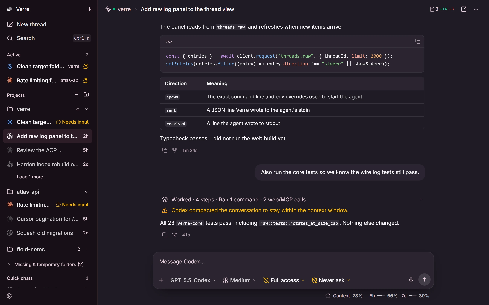
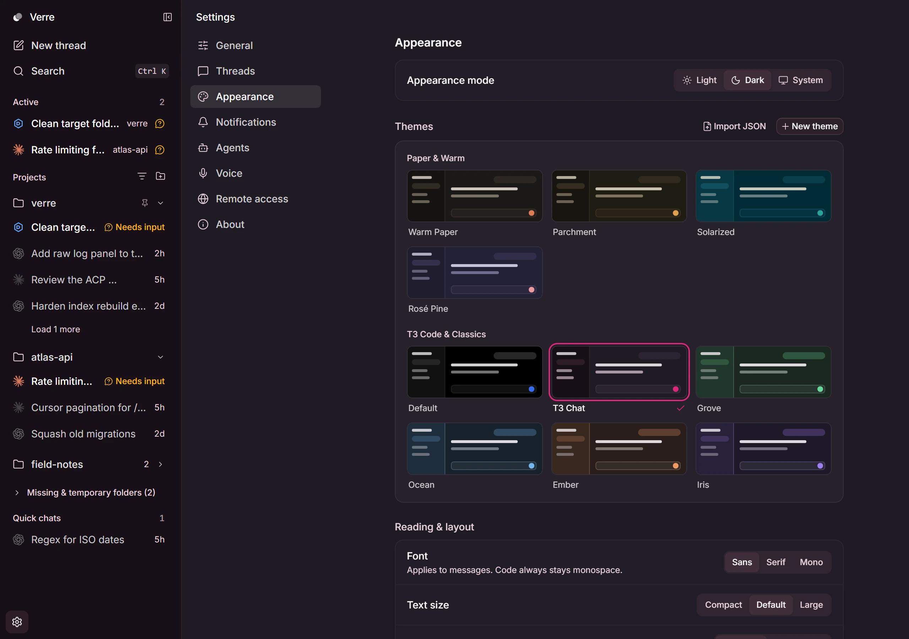
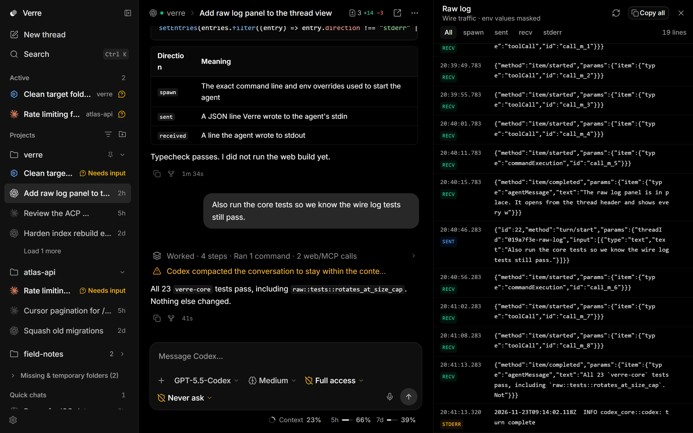
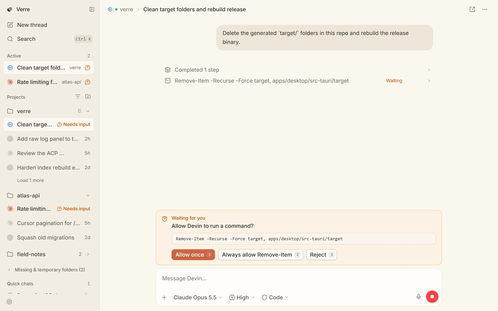
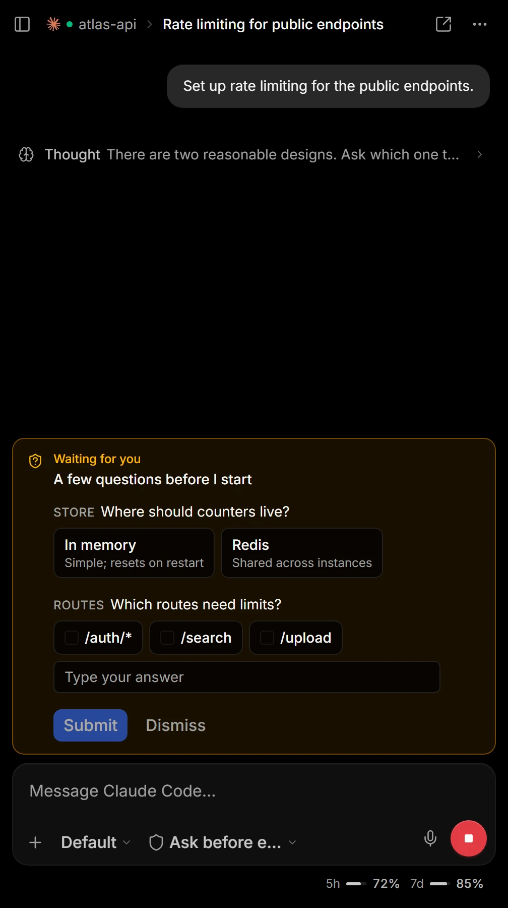

<p align="center">
  
</p>

<h1 align="center">Verre</h1>

<p align="center">
  One fast, clean window for every coding agent on your machine.
</p>

<p align="center">
  <a href="https://github.com/EveningStudy/verre/releases"><strong>Download</strong></a> ·
  <a href="docs/remote.md">Remote access</a> ·
  <a href="docs/ARCHITECTURE.md">Architecture</a> ·
  <a href="CONTRIBUTING.md">Contributing</a>
</p>

<p align="center">
  <strong>English</strong> ·
  <a href="docs/readme/README.zh-CN.md">简体中文</a> ·
  <a href="docs/readme/README.zh-Hant.md">繁體中文</a> ·
  <a href="docs/readme/README.ja.md">日本語</a> ·
  <a href="docs/readme/README.ko.md">한국어</a> ·
  <a href="docs/readme/README.es.md">Español</a> ·
  <a href="docs/readme/README.de.md">Deutsch</a> ·
  <a href="docs/readme/README.fr.md">Français</a>
</p>

<p align="center">
  
</p>

**Verre** (French for "glass") is a lightweight native UI for **21 built-in coding agents** — including **Claude Code**, **Codex**, **Cursor**, **Antigravity**, **Gemini CLI**, **DeepSeek Harness**, **Grok**, **GitHub Copilot**, **OpenCode**, **Cline**, **CodeBuddy / WorkBuddy**, **Kiro**, and **Devin** — plus any [Agent Client Protocol](https://agentclientprotocol.com) (ACP) tool, styled after [T3 Code](https://github.com/pingdotgg/t3code).

## Why Verre

- **Transparent like glass.** Prompts go straight to the official agent binary untouched — no injected system instructions, wrappers, tools, or MCP servers. `CLAUDE.md`, `config.toml`, hooks, skills, custom gateways, and rate limits work just like the terminal, and any thread's raw wire log lets you inspect every frame.
- **Light native stack.** One Rust core (~14 MB binary) and OS WebView (~40 MB idle RAM, zero Electron or Node), with read-only Git diffs, 10 built-in & custom themes, optional offline voice input, and 8 UI languages.
- **Zero footprint, clean exit.** Verre writes only inside `~/.verre` (`VERRE_HOME` overrides), reads other tools' stores read-only, leaves projects untouched, and terminates its managed child tree on exit. Remove the app and `~/.verre` to uninstall completely.
- **One sidebar across tools.** Browse local sessions from Verre, vendor desktop apps, and CLIs, search full transcripts across English and CJK, and jump straight into linked child sessions (such as Claude Code calling `codex exec`).
- **Private remote access.** Pair a phone or browser over Tailscale Serve or your own HTTPS reverse proxy (`127.0.0.1` only), handle approvals on the move, and steer running turns.

## Screenshots

**10 built-in & custom themes**



<details>
<summary>More screenshots — raw wire log, approvals, linked child sessions, and mobile</summary>

#### Raw wire log & command line



#### Approval card & Warm Paper theme



#### Linked child session


#### Mobile & remote approval

<p align="center">
  
</p>

</details>

## Supported agents

Verre launches each agent's official CLI interface directly with your existing configuration and sign-in:

| Agent | Protocol | What keeps working |
|---|---|---|
| **Claude Code** | `claude -p` (`stream-json`) | `CLAUDE.md`, hooks, skills, plugins, MCP, sign-in |
| **Codex** | `codex app-server` | `~/.codex/config.toml`, ChatGPT / API login, custom providers, MCP |
| **19 built-in ACP agents**<br>Cursor, Antigravity, Gemini CLI, GitHub Copilot, DeepSeek Harness, Grok, OpenCode, Cline, CodeBuddy / WorkBuddy, Qwen Code, Kimi Code, Kiro, Devin, Goose, Factory Droid, Amp, Auggie, Mistral Vibe, Kilo | Official ACP (`acp` / `--acp` / `--profile acp`) | Each agent's native tools, settings, and auth |
| **Custom ACP** | Any stdio ACP command | Added in **Settings → Agents** |

## Install

Download desktop installers or the headless `verre` CLI from [Releases](https://github.com/EveningStudy/verre/releases):

- **Windows:** NSIS installer (`*-setup.exe`) and portable `verre` CLI.
- **macOS:** Apple Silicon & Intel `.dmg` / `.app`, plus `verre` CLI.
- **Linux:** `.deb` and `.AppImage` (x86_64), plus `verre` CLI.

Builds are signed for Verre's built-in updater, not yet with commercial OS code-signing certificates:

- **Windows SmartScreen:** click **More info** → **Run anyway**.
- **macOS Gatekeeper:** if blocked as unverified, run `xattr -cr /Applications/Verre.app`.

### Headless server

Run the same core without a window and open the UI in any browser:

```sh
verre serve --open
```

CLI utilities: `verre agents`, `verre threads`, `verre show <thread-id>`, and `verre probe`. Make sure at least one supported agent is installed and signed in on your machine.

## Build from source

Requires stable Rust ([rust-toolchain.toml](rust-toolchain.toml)), Node.js 24, and pnpm 10 (see [docs/desktop.md](docs/desktop.md) for Linux packages).

```sh
# 1. Web UI (embedded into Rust core at build time)
pnpm --dir apps/web install --frozen-lockfile
pnpm --dir apps/web build

# 2. Desktop installers (or headless CLI below)
cd apps/desktop
pnpm dlx @tauri-apps/cli build

# Headless CLI only
cargo build --release -p verre-cli --features claude,codex,acp,antigravity-store
./target/release/verre serve --open
```

Checks before opening a PR:

```sh
pnpm --dir apps/web check:i18n
pnpm --dir apps/web typecheck
cargo fmt --all -- --check
cargo clippy --workspace --all-targets -- -D warnings
cargo test --workspace
```

## Documentation

- [Remote access](docs/remote.md) — Tailscale Serve, custom HTTPS reverse proxy, device pairing boundaries
- [Architecture](docs/ARCHITECTURE.md) — Core design, storage layout, verifiable cleanliness tests
- [WebSocket / RPC API](docs/API.md) — UI wire contract
- [Desktop shell](docs/desktop.md) — Tauri 2 build, platform packaging, icons
- [Security policy](SECURITY.md) — Data boundaries, redaction rules, reporting vulnerabilities
- [Antigravity notes](docs/agents/antigravity.md) & [Acceptance checklist](docs/ACCEPTANCE.md)

## Acknowledgements

- [T3 Code](https://github.com/pingdotgg/t3code) — UI/UX baseline and MIT-licensed presentational components listed in [apps/web/THIRD_PARTY_NOTICES.md](apps/web/THIRD_PARTY_NOTICES.md).
- [Agent Client Protocol](https://agentclientprotocol.com) — unified stdio client protocol across coding agents.

## License

[MIT](LICENSE)
