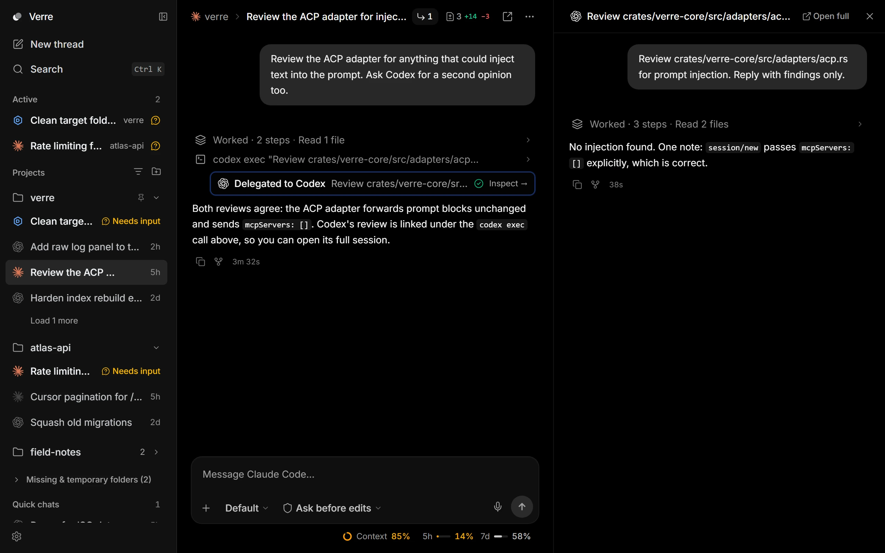

<p align="center">
  
</p>

<h1 align="center">Verre</h1>

<p align="center">
  One fast, clean window for the coding agents already on your machine.
</p>

<p align="center">
  <a href="https://github.com/EveningStudy/verre/releases"><strong>Download</strong></a> ·
  <a href="docs/remote.md">Remote access</a> ·
  <a href="docs/ARCHITECTURE.md">Architecture</a> ·
  <a href="CONTRIBUTING.md">Contributing</a>
</p>

<p align="center">
  <strong>English</strong> ·
  <a href="docs/readme/README.zh-CN.md">简体中文</a> ·
  <a href="docs/readme/README.zh-Hant.md">繁體中文</a> ·
  <a href="docs/readme/README.ja.md">日本語</a> ·
  <a href="docs/readme/README.ko.md">한국어</a> ·
  <a href="docs/readme/README.es.md">Español</a> ·
  <a href="docs/readme/README.de.md">Deutsch</a> ·
  <a href="docs/readme/README.fr.md">Français</a>
</p>

<p align="center">
  
</p>

Verre (French for "glass") is a lightweight native front-end for CLI coding agents: **Claude Code**, **Codex**, **Antigravity**, **Devin**, **Kiro**, **DeepSeek Harness**, **CodeBuddy / WorkBuddy**, and any [Agent Client Protocol](https://agentclientprotocol.com) (ACP) tool. It launches the official binaries installed on your computer with your existing config and sign-in, and renders their sessions in an interface inspired by [T3 Code](https://github.com/pingdotgg/t3code).

## What you get

- **Your agents, untouched.** Prompts pass straight through verbatim — no injected system instructions, wrappers, tools, or MCP servers. Your `CLAUDE.md`, `config.toml`, hooks, skills, custom gateways, and subscriptions work identically to the terminal.
- **21 built-in agents + custom ACP.** Native adapters for Claude Code and Codex alongside 19 built-in ACP presets, plus custom stdio ACP commands in Settings.
- **One sidebar and cross-agent links.** Browse local history from Verre, vendor desktop apps, and CLIs; resume sessions where supported; and jump straight into child sessions when one agent invokes another (such as Claude Code running `codex exec`).
- **Full-text search, diffs, and raw wire logs.** Search across English and CJK transcripts, inspect read-only Git changes and worktrees, and open the live raw wire log on any thread to see the exact spawn command and JSON frames.
- **Private remote access.** Pair a phone or another browser over Tailscale Serve or your own HTTPS reverse proxy (`127.0.0.1` only), answer approvals on the move, and steer active turns.
- **Light by design.** One Rust process (~14 MB desktop binary), OS WebView (WebView2 / WKWebView / WebKitGTK), no Electron or Node at runtime, ~40 MB idle RAM, optional offline voice input, custom themes, and 8 UI languages.

| Raw wire log & command line | Approval card & Warm Paper theme |
|---|---|
|  |  |
| **Linked child session** | **Mobile remote view** |
|  | <p align="center"></p> |

## Supported agents

Verre talks directly to each vendor's official interface and surfaces the models, reasoning levels, permission modes, and rate limits the agent itself reports.

| Agent | Protocol | Local setup preserved |
|---|---|---|
| Claude Code | `claude -p` (bidirectional `stream-json`) | `CLAUDE.md`, hooks, skills, plugins, MCP, sign-in |
| Codex | `codex app-server` | `~/.codex/config.toml`, ChatGPT/API login, custom providers, MCP |
| Antigravity | `agy acp` | Official tools, settings, and Google sign-in ([notes](docs/agents/antigravity.md)) |
| Devin | `devin acp` | Native tools, settings, and browser auth |
| Kiro | `kiro-cli acp` | Native CLI tools, settings, and auth |

**Built-in ACP presets (16 more):** DeepSeek Harness, CodeBuddy / WorkBuddy, Gemini CLI, OpenCode, Cursor, GitHub Copilot, Cline, Qwen Code, Kimi Code, Goose, Factory Droid, Amp, Auggie, Mistral Vibe, Kilo, and Grok. Custom stdio ACP commands can be added in **Settings → Agents**.

> Claude Code, Codex, Antigravity, Devin, and Kiro are directly verified against live agent binaries. Other presets follow each CLI's documented ACP flags — if a vendor updates flags or binary paths, please open an issue.

## Install

Download desktop installers or the headless `verre` CLI from [Releases](https://github.com/EveningStudy/verre/releases):

- **Windows:** NSIS installer (`*-setup.exe`) and portable `verre` CLI.
- **macOS:** Apple Silicon & Intel `.dmg` / `.app`, plus `verre` CLI.
- **Linux:** `.deb` and `.AppImage` (x86_64), plus `verre` CLI.

Builds are signed for Verre's built-in updater, not yet with commercial OS code-signing certificates:

- **Windows SmartScreen:** click **More info** → **Run anyway**.
- **macOS Gatekeeper:** if macOS flags the app as unverified, run `xattr -cr /Applications/Verre.app`.

### Headless server

Run the same core without a desktop window and open the UI in any browser:

```sh
verre serve --open
```

Useful CLI utilities: `verre agents` (detected binaries & versions), `verre threads` (search local index), `verre show <thread-id>`, and `verre probe`.

Before starting, make sure at least one supported agent is installed and signed in on your machine.

## Why "glass"?

- **Zero injection.** Verre forwards what you typed untouched. System prompts, skills, tools, and model choices come solely from your agent and the controls you toggle.
- **Zero footprint.** Verre writes only to `~/.verre` (`VERRE_HOME` overrides). Other agents' directories and SQLite stores are opened read-only; workspaces are touched only by explicit user actions. Delete the app and `~/.verre` to uninstall completely.
- **No orphans.** Managed child trees terminate when Verre exits (Windows Job Object; Unix process group watchdog), and Verre warns before releasing a session with active background processes.
- **Thin client scope.** Conversation, approvals, history, read-only Git diffs, offline voice input, and private remote access — never a bundled IDE, terminal emulator, or multi-agent orchestrator.

## Build from source

Requires stable Rust ([rust-toolchain.toml](rust-toolchain.toml)), Node.js 24, and pnpm 10 (see [docs/desktop.md](docs/desktop.md) for platform system packages).

```sh
# 1. Web UI (embedded into Rust core at build time)
pnpm --dir apps/web install --frozen-lockfile
pnpm --dir apps/web build

# 2. Desktop installers (or headless CLI below)
cd apps/desktop
pnpm dlx @tauri-apps/cli build

# Headless CLI only
cargo build --release -p verre-cli --features claude,codex,acp,antigravity-store
./target/release/verre serve --open
```

Verification suite before opening a PR:

```sh
pnpm --dir apps/web check:i18n
pnpm --dir apps/web typecheck
cargo fmt --all -- --check
cargo clippy --workspace --all-targets -- -D warnings
cargo test --workspace
```

## Documentation

- [Remote access](docs/remote.md) — Tailscale Serve, custom HTTPS reverse proxy, device pairing boundaries
- [Architecture](docs/ARCHITECTURE.md) — Core design, storage layout, verifiable cleanliness tests
- [WebSocket / RPC API](docs/API.md) — UI wire contract
- [Desktop shell](docs/desktop.md) — Tauri 2 build, platform packaging, icons
- [Security policy](SECURITY.md) — Data boundaries, redaction rules, reporting vulnerabilities
- [Antigravity notes](docs/agents/antigravity.md) & [Acceptance checklist](docs/ACCEPTANCE.md)

## Acknowledgements

- [T3 Code](https://github.com/pingdotgg/t3code) — UI/UX baseline and MIT-licensed presentational components listed in [apps/web/THIRD_PARTY_NOTICES.md](apps/web/THIRD_PARTY_NOTICES.md).
- [Agent Client Protocol](https://agentclientprotocol.com) — unified stdio client protocol across coding agents.

## License

[MIT](LICENSE)
