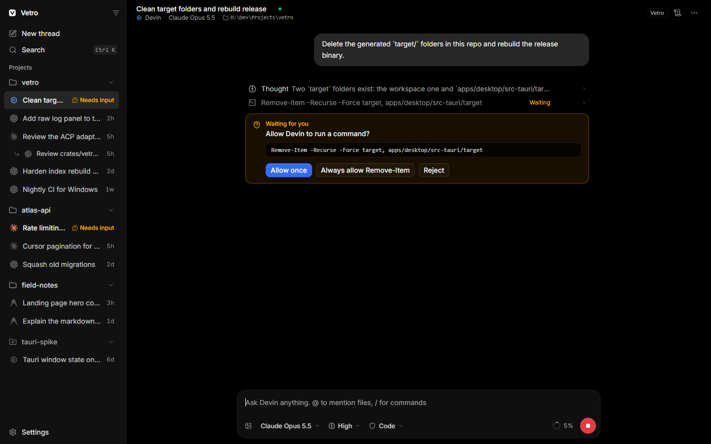

<p align="center">
  
</p>

<h1 align="center">Vetro</h1>

<p align="center">
  One clean window for the coding agents you already have installed.<br>
  Claude Code, Codex, Antigravity, Devin and any ACP agent, each running exactly as it does in your terminal.
</p>

<p align="center">
  English · <a href="README.zh-CN.md">简体中文</a>
</p>


Vetro means "glass" in Italian. It is a lightweight, unified entry point for the coding agents already installed on your machine: **Claude Code, Codex, Antigravity and Devin**, plus any [Agent Client Protocol](https://agentclientprotocol.com) agent you add in the settings. It starts the official, unmodified agent programs, shows all their sessions in one interface, and otherwise stays out of the way.

It ships as a desktop app for Windows, macOS and Linux. The same UI also runs in a browser, and there is a phone layout for remote use. The interface is modelled on [T3 Code](https://github.com/pingdotgg/t3code).

## Why Vetro

Unified front-ends for coding agents already exist, and several of them are very good interfaces. To fit the agents into their own workflow, many also change the agents: they inject instructions into the prompt, register extra MCP tools, write skills into `~/.claude` and similar folders, bring a heavy runtime, or leave processes running after they close. Those are reasonable choices for an agent harness, but the agent you are talking to is then no longer quite the one you installed.

Vetro makes the opposite promise. Running an agent through Vetro should give you the same input, the same output, the same context, the same quota use and the same abilities as running it natively. Vetro is a thin client, never an agent harness.

## The rules

Every change to Vetro has to keep these rules (see [AGENTS.md](AGENTS.md)):

1. **Zero injection.** The agent receives exactly what you typed. Vetro adds no system prompts, developer instructions, skills, MCP servers, tools, wrapper text or replayed history. Model, mode and thinking-level choices go through the agent's own switches, and only when you change them.
2. **Zero footprint.** Vetro writes only under `~/.vetro`. It never creates, modifies or deletes anything in `~/.claude`, `~/.codex`, `~/.gemini`, `~/.agents`, Devin's folders or your projects. Other tools' databases are opened read-only. (The agents still write their own sessions and logs, as they do in the terminal.)
3. **Native runtimes only.** Vetro launches the binaries it finds on your machine. It never downloads an agent and never reads, copies, forwards or stores credentials. You sign in through each agent's own flow.
4. **No orphans.** Every child process dies when Vetro exits: a Job Object on Windows; on macOS and Linux a watchdog that kills the process group and the descendants it tracks.
5. **Light.** One Rust process. No Node, no Electron and no bundled browser at runtime. Idle agent processes are released and resumed when you need them again.
6. **Same rules for every agent.** No agent gets special restrictions or special features in the UI.

## How each agent is connected

Each agent is driven through the interface its vendor provides for clients like this, so its own configuration keeps working.

| Agent | How Vetro runs it | What keeps working |
|---|---|---|
| Codex | `codex app-server`, the protocol the Codex desktop app uses | Everything in `~/.codex/config.toml`: ChatGPT sign-in, API keys, custom providers and gateways, hooks, MCP servers, skills |
| Claude Code | `claude -p` with stream-json in both directions, the protocol the official Agent SDK uses | The real Claude Code system prompt, `CLAUDE.md`, hooks, skills, plugins and MCP servers, as in the terminal |
| Antigravity | `agy acp`, the integration Google documents for ACP clients ([details](docs/agents/antigravity.md)) | Antigravity's own tools, settings and sign-in |
| Devin | `devin acp` | Devin's own tools, settings and sign-in |
| Any ACP agent | The command you configure, over stdio | Whatever that agent provides |

Vetro never handles credentials. When an agent needs you to sign in, Vetro offers the agent's own sign-in methods and the agent runs them. The technical details are in [docs/ARCHITECTURE.md](docs/ARCHITECTURE.md).

## Features

- **One sidebar for every session.** Vetro lists every session each agent has stored, including sessions you created in the vendors' own desktop apps and CLIs. Continue a session where the agent allows it; otherwise it opens read-only.
- **Full-text search** across titles and messages, in English and Chinese.
- **Links between agents.** When one agent runs another agent's CLI (for example, Claude Code calling `codex exec`), the child session appears under the tool call that started it and updates live.
- **Raw log.** Each thread can show what Vetro sent to the agent process and what came back, including the command line used to start the agent. The log is kept up to a size limit; the oldest entries are dropped first.
- **Permission requests and questions** from the agent, answered in place.
- **Model, mode and thinking-level pickers** whose options come from the agent itself.
- **Remote access** over your own Tailscale network, with device pairing. The server only listens on `127.0.0.1`.
- **Headless mode.** `vetro serve` runs the same core without a window and serves the UI to your browser.
- English and Simplified Chinese interface, light and dark themes.

| Start a thread with any agent | Answer a permission request |
|---|---|
|  |  |
| **A Codex session started by Claude Code** | **The raw log next to the thread** |
|  |  |

<p align="center">
  
</p>

The screenshots use synthetic data.

## Size

Measured on Windows 11 on 2026-11-23, version 0.1.0:

| | Size |
|---|---|
| Windows installer | 3.4 MB |
| Desktop executable | 10.3 MB |
| Headless binary (`vetro`) | 6.9 MB |
| Vetro process at idle | about 40 MB working set (18 MB private) |
| macOS dmg | 5.3 MB |
| Linux deb | 5.4 MB |

The window uses the system WebView (WebView2 on Windows, WKWebView on macOS, WebKitGTK on Linux), so no browser is bundled. The core is Rust, the shell is Tauri 2, and the UI is React.

## Verify it yourself

You do not have to take the rules on trust.

- **Read the raw log.** Open it from the thread header. It shows the exact command line Vetro used to start the agent, the names of environment overrides (values are masked), and every message sent and received. If Vetro added anything to your prompt, you would see it there.
- **Run the tests.** The checks listed under [Verifiable cleanliness](docs/ARCHITECTURE.md#verifiable-cleanliness) run in the default `cargo test --workspace`, against fake agents:
  - a footprint test that runs full sessions with a temporary home folder and fails if anything outside `.vetro` changed ([crates/vetro-core/tests/websocket.rs](crates/vetro-core/tests/websocket.rs));
  - no-injection checks: each adapter's fake agent compares the command line and the outgoing messages with exactly what is expected, so the prompt must arrive unchanged and nothing may be added ([Codex](crates/vetro-agent-codex/tests/fake_app_server.rs), [Claude Code](crates/vetro-agent-claude/tests/fake.rs), [ACP](crates/vetro-agent-acp/tests/fake_acp.rs));
  - a process test that kills the host and checks that no child survives ([crates/vetro-agent-api/tests/transport.rs](crates/vetro-agent-api/tests/transport.rs)).
- **Look at what is stored.** Everything Vetro writes is in `~/.vetro` (`%USERPROFILE%\.vetro` on Windows; set `VETRO_HOME` to move it):
  - `config.json`: settings;
  - `state.json`: local token, paired devices, your local titles, archive flags and project names;
  - `index.db`: the thread index and search text; safe to delete, it is rebuilt from the agents' own stores;
  - `raw/`: the size-capped wire log of each session you attached in Vetro;
  - `logs/`: Vetro's own logs.
- **Uninstall.** Delete the app and `~/.vetro`. Nothing else needs cleaning up.

<!-- STATUS:BEGIN -->
## Status

Version 0.1.0 is the first build and has not been published yet. Checked on 2026-11-23:

| Platform or agent | Verified |
|---|---|
| Windows 11 desktop | Live sessions with Codex, Claude Code and Devin; stored history of all four agents; a Claude Code session running `codex exec` shown as a linked child; installer builds. |
| Antigravity | Connection over `agy acp`, session list, stored history of the desktop app and the CLI. A live reply has not been verified yet: the test account's quota was exhausted (HTTP 429), and the error was shown as the agent reported it. |
| Remote access | A Mac reached the Windows host over Tailscale: pairing, listing and the limits for remote devices. Not yet tried on a phone. |
| macOS (Apple Silicon) | The app builds and runs; Codex verified live; no child process left after a hard kill. Only Codex was installed on the test Mac. The window itself was not inspected. |
| Linux (x86_64) | deb and AppImage build; the core ran a full session with a test ACP agent, and no child process was left after a hard kill. No vendor agent was installed on the test machine, and the window was not inspected. |
| Not verified | Device-code sign-in, image input, questions asked by a real agent, Intel Macs, ARM Linux. |
<!-- STATUS:END -->

## Getting started

You need at least one supported agent installed and signed in on your machine. Vetro finds the agents on your `PATH` and in their usual install locations. In Settings → Agents you can point it at a different binary, or add extra arguments and environment variables.

Once version 0.1.0 is published, installers will be on this repository's Releases page: an NSIS installer for Windows, a `.dmg` for macOS, and a `.deb` and AppImage for Linux, plus the headless `vetro` binary. Until then, build from source.

## Build from source

Prerequisites: a stable Rust toolchain (see [rust-toolchain.toml](rust-toolchain.toml)), Node.js 24 and pnpm 10. On Windows you also need the MSVC toolchain and WebView2 (included in Windows 11). On macOS you need the Xcode command line tools. On Linux you need the WebKitGTK and GTK packages listed in [docs/desktop.md](docs/desktop.md).

Build the UI first; the core embeds it:

```sh
pnpm --dir apps/web install
pnpm --dir apps/web build
```

Desktop app and installers (NSIS on Windows, `.app` and `.dmg` on macOS, AppImage and deb on Linux):

```sh
cd apps/desktop
pnpm dlx @tauri-apps/cli build
```

Headless binary:

```sh
cargo build --release -p vetro-cli --features claude,codex,acp,antigravity-store
./target/release/vetro serve --open
```

`vetro serve` listens on `127.0.0.1` (port 47600 or the next free one) and prints a local URL. `vetro agents` shows which agents were detected, and `vetro threads` lists the indexed sessions.

Checks for contributors:

```sh
cargo fmt --all
cargo clippy --workspace --all-targets -- -D warnings
cargo test --workspace
pnpm --dir apps/web typecheck
```

## FAQ

**Does it use my subscriptions?**
Yes, in the same way the terminal does. The vendor's own program runs with your sign-in and uses your plan or API credits. Vetro adds no usage of its own.

**Can it get my account restricted?**
Vetro runs each official, unmodified program the way its vendor documents it, with your own sign-in, and does nothing more. It does not extract tokens, proxy traffic or rotate accounts. Each vendor's terms still apply to how you use their agent. For Antigravity, Google's statements are collected in [docs/agents/antigravity.md](docs/agents/antigravity.md): a person driving sessions in an ACP client is the supported case, while having another agent or an automated loop send prompts to `agy` on a consumer sign-in is not.

**Why not Electron?**
Because Vetro is meant to be light. It is one Rust process, and the window uses the WebView your operating system already ships. See [Size](#size).

**Where are my chats stored?**
Nowhere new. Each agent keeps its sessions in its own store, as it always has. Vetro keeps an index of them for the sidebar and search, plus the raw logs of sessions you attached in Vetro, all under `~/.vetro`. You can delete any of it at any time.

**How do I add another ACP agent?**
Any program that speaks ACP over stdio can be added as a custom agent in Vetro's settings, stored as `customAcpAgents` in `~/.vetro/config.json`:

```json
{
  "customAcpAgents": [
    { "id": "my-agent", "name": "My Agent", "command": "my-agent", "args": ["acp"], "env": {} }
  ]
}
```

Restart Vetro after you change how an agent is launched. A custom agent follows the same rules as the built-in ones.

## Contributing

Read [CONTRIBUTING.md](CONTRIBUTING.md), then [docs/ARCHITECTURE.md](docs/ARCHITECTURE.md) before changing the core and [docs/API.md](docs/API.md) before touching the UI protocol. Please report security issues privately, as described in [SECURITY.md](SECURITY.md).

## Acknowledgements

- [T3 Code](https://github.com/pingdotgg/t3code), the interface Vetro learns from. Some presentational code is ported from it under its MIT license; the files are listed in [apps/web/THIRD_PARTY_NOTICES.md](apps/web/THIRD_PARTY_NOTICES.md).
- The [Agent Client Protocol](https://agentclientprotocol.com), which lets one client speak to many agents.

## License

[MIT](LICENSE)
