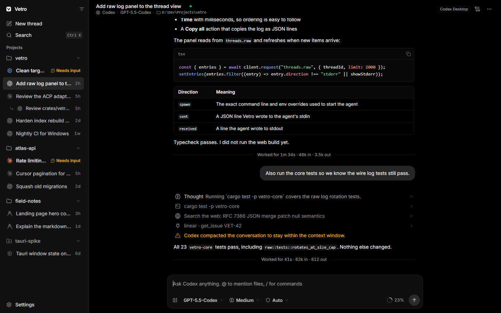
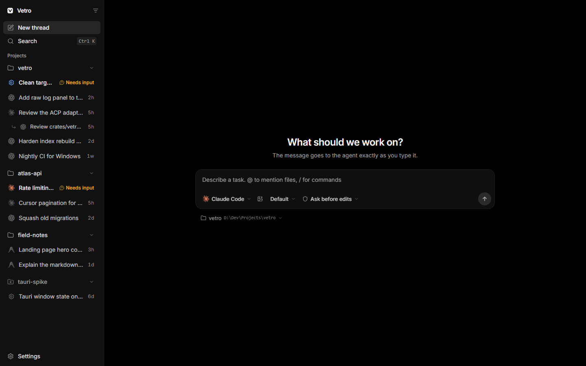
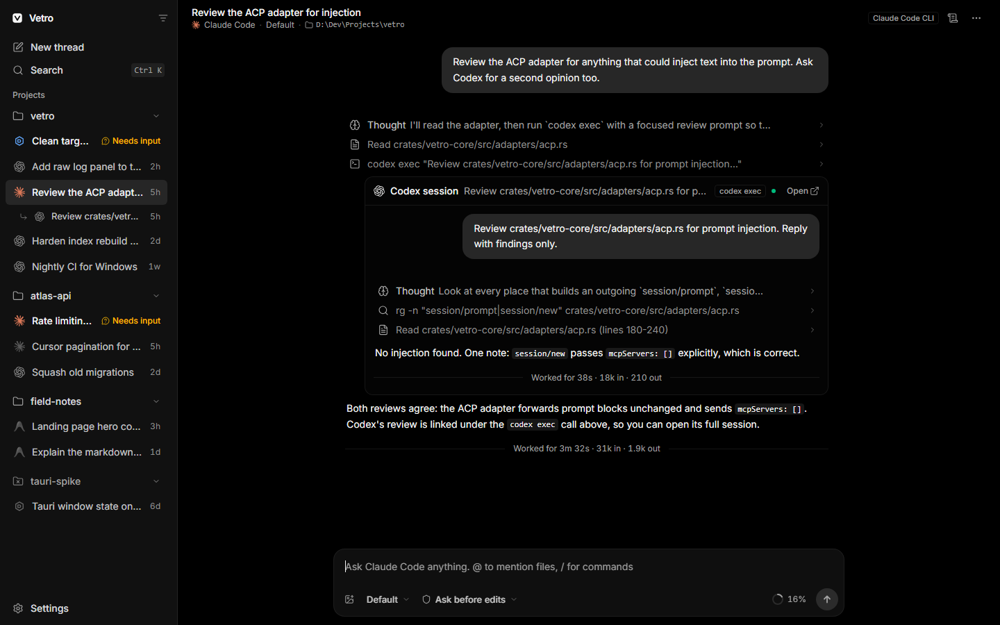
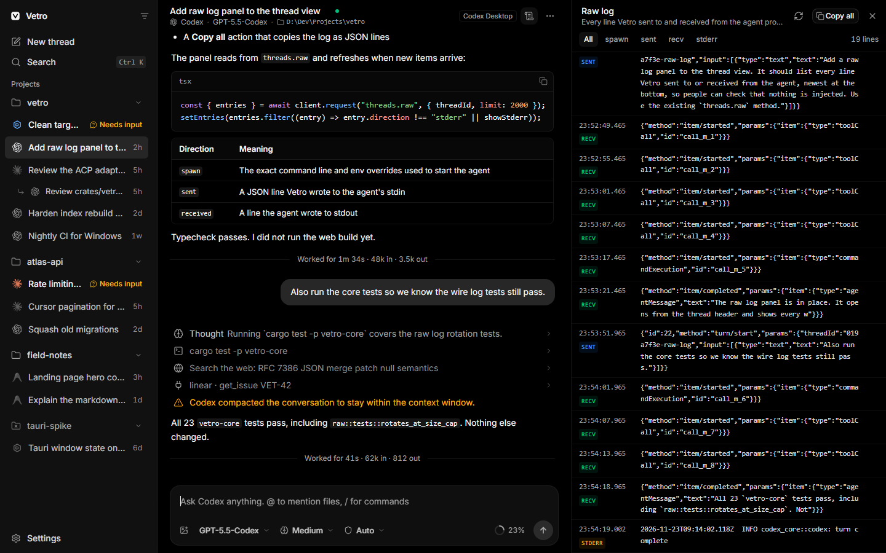
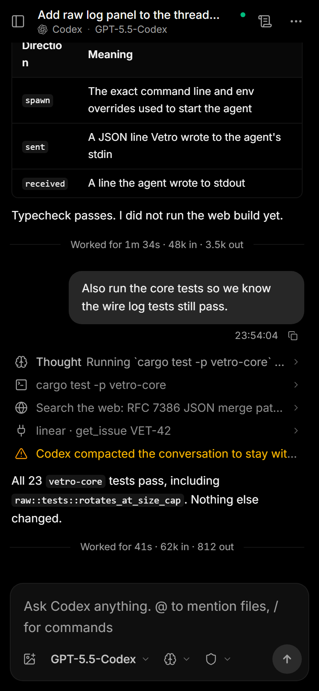

<p align="center">
  
</p>

<h1 align="center">Verre</h1>

<p align="center">
  One clean window for the coding agents you already have installed.<br>
  Claude Code, Codex, Kiro, Antigravity, Devin and custom ACP agents.
</p>

<p align="center">
  English · <a href="README.zh-CN.md">简体中文</a>
</p>



Verre (pronounced "vair") means "glass" in French. It is a lightweight, unified entry point for the coding agents already installed on your machine. It starts the official agent programs and shows the sessions their local stores and protocols expose. You can add other [Agent Client Protocol](https://agentclientprotocol.com) agents in Settings.

It ships as a desktop app for Windows, macOS and Linux. The same UI also runs in a browser, and there is a phone layout for remote use. The interface is modelled on [T3 Code](https://github.com/pingdotgg/t3code).

## Why Verre

Unified front-ends for coding agents already exist, and several of them are very good interfaces. To fit the agents into their own workflow, many also change the agents: they inject instructions into the prompt, register extra MCP tools, write skills into `~/.claude` and similar folders, bring a heavy runtime, or leave processes running after they close. Those are reasonable choices for an agent harness, but the agent you are talking to is then no longer quite the one you installed.

Verre passes your input unchanged to the native agent and uses its existing configuration and sign-in. The features available in the window depend on what the installed agent exposes through its client protocol.

## The rules

Every change to Verre has to keep these rules (see [AGENTS.md](AGENTS.md)):

1. **Zero injection.** The agent receives exactly what you typed. Verre adds no system prompts, developer instructions, skills, MCP servers, tools, wrapper text, or replayed history. Model, mode, and thinking-level choices go through the agent's own switches, and only when you change them.
2. **Zero footprint.** Verre stores its own data only under `~/.verre`. It never creates, modifies, or deletes anything in `~/.claude`, `~/.codex`, `~/.gemini`, `~/.agents`, Devin's folders, or other tools' stores, and opens their databases read-only. It never silently writes hidden config into your projects; only explicit actions you trigger (such as creating a folder) touch the workspace. (The agents still write their own sessions and logs, as they do in the terminal.)
3. **Native runtimes only.** Verre launches the official agent binaries it finds on your machine. It never downloads an agent and never reads, copies, forwards, or stores credentials. You sign in through each agent's own flow.
4. **No orphans.** Every managed child process dies when Verre exits: a Job Object on Windows; on macOS and Linux a watchdog that kills the process group and tracked descendants. While running, Verre warns before closing or releasing a session with active background work.
5. **Light — in runtime and scope.** One Rust process, system WebView, no Node, no Electron, and no bundled browser at runtime. Idle agent processes are released and resumed on demand. Verre stays a thin client for conversation, approvals, history, read-only diffs, and remote access — not a built-in IDE, terminal, or workflow orchestrator.
6. **Capability-driven, not privileged.** Every agent shares the same UI skeleton and rules, with no artificial restrictions or favoritism. Useful capabilities exposed by an agent's native protocol (such as rate limits, steering, fork, or multi-dimensional permissions) appear through unified UI slots.
7. **Progressive disclosure.** The primary canvas focuses on user intent, items needing human action, and final answers. Intermediate reasoning, tool logs, code diffs, linked child sessions, internal sessions, and raw protocol traffic stay collapsed or in on-demand drawers by default.

## How each agent is connected

Each agent runs through its native client interface. The options and actions you see depend on your installed runtime. See [tested agent capabilities](docs/ACCEPTANCE.md#native-smoke-runs) for the versions, platforms, and interactions covered.

| Agent | How Verre runs it | What keeps working |
|---|---|---|
| Codex | `codex app-server`, the protocol the Codex desktop app uses | Your existing `~/.codex/config.toml` setup: ChatGPT sign-in, API keys, custom providers and gateways, hooks, MCP servers, skills |
| Claude Code | `claude -p` with stream-json in both directions, the protocol the official Agent SDK uses | The real Claude Code system prompt, `CLAUDE.md`, hooks, skills, plugins and MCP servers, as in the terminal |
| Antigravity | `agy acp`, the integration Google documents for ACP clients ([details](docs/agents/antigravity.md)) | Antigravity's own tools, settings and sign-in |
| Devin | `devin acp` | Devin's own tools, settings and sign-in |
| Kiro | `kiro-cli acp` | The installed CLI engine's tools, settings and sign-in |
| Any ACP agent | The command you configure, over stdio | Whatever that agent provides |

Verre never handles credentials. When an agent needs you to sign in, Verre offers the agent's own sign-in methods and the agent runs them. The technical details are in [docs/ARCHITECTURE.md](docs/ARCHITECTURE.md).

## Features

- **One sidebar for discoverable sessions.** Browse supported local history from Verre, vendor desktop apps and CLIs. Continue a session where the native runtime supports it.
- **Full-text search** across titles and messages, in English and Chinese.
- **Links between agents.** When one agent runs another agent's CLI (for example, Claude Code calling `codex exec`), the child session appears under the tool call that started it and updates live.
- **Raw log.** Each thread can show what Verre sent to the agent process and what came back, including the command line used to start the agent. The log is kept up to a size limit; the oldest entries are dropped first.
- **Permission requests and questions** from the agent, answered in place.
- **Model, mode and thinking-level pickers** whose options come from the agent itself.
- **Remote access** with device pairing through Tailscale Serve or your own HTTPS reverse proxy. The server listens on `127.0.0.1`. See the [setup guide](docs/remote.md).
- **Local voice input & notifications.** Optional on-demand offline speech-to-text models (downloaded to `~/.verre/voice` only when requested), plus configurable desktop popups, sound chimes, and taskbar/Dock badges.
- **Headless mode.** `verre serve` runs the same core without a window and serves the UI to your browser.
- English and Simplified Chinese interface, light and dark themes.

| Start a thread with any agent | Answer a permission request |
|---|---|
|  |  |
| **A Codex session started by Claude Code** | **The raw log next to the thread** |
|  |  |

<p align="center">
  
</p>

The screenshots use synthetic data.

## Size

Baseline measurements on Windows 11 (version 0.1.0, 2026-11-23; release sizes vary slightly across versions and platforms):

| | Size |
|---|---|
| Windows installer | 3.4 MB |
| Desktop executable | 10.3 MB |
| Headless binary (`verre`) | 6.9 MB |
| Verre process at idle | about 40 MB working set (18 MB private) |
| macOS dmg | 5.3 MB |
| Linux deb | 5.4 MB |

The window uses the system WebView (WebView2 on Windows, WKWebView on macOS, WebKitGTK on Linux), so no browser is bundled. The core is Rust, the shell is Tauri 2, and the UI is React.

## Verify it yourself

You do not have to take the rules on trust.

- **Read the raw log.** Open it from the thread header. It shows the exact command line Verre used to start the agent, the names of environment overrides (values are masked), and every message sent and received. If Verre added anything to your prompt, you would see it there.
- **Run the tests.** The checks listed under [Verifiable cleanliness](docs/ARCHITECTURE.md#verifiable-cleanliness) run in the default `cargo test --workspace`, against fake agents:
  - a footprint test that runs full sessions with a temporary home folder and fails if anything outside `.verre` changed ([crates/verre-core/tests/websocket.rs](crates/verre-core/tests/websocket.rs));
  - no-injection checks: each adapter's fake agent compares the command line and the outgoing messages with exactly what is expected, so the prompt must arrive unchanged and nothing may be added ([Codex](crates/verre-agent-codex/tests/fake_app_server.rs), [Claude Code](crates/verre-agent-claude/tests/fake.rs), [ACP](crates/verre-agent-acp/tests/fake_acp.rs));
  - a process test that kills the host and checks that no child survives ([crates/verre-agent-api/tests/transport.rs](crates/verre-agent-api/tests/transport.rs)).
- **Look at what is stored.** Everything Verre writes is in `~/.verre` (`%USERPROFILE%\.verre` on Windows; set `VERRE_HOME` to move it):
  - `config.json`: settings;
  - `state.json`: local token, hashed paired-device tokens, your local titles, archive flags and project names;
  - `index.db`: the thread index and search text; safe to delete, it is rebuilt from the agents' own stores;
  - `raw/`: the wire log of each session you attached in Verre (ring-capped at 4 MiB per file);
  - `logs/`: Verre's own logs (for example `core.log`, capped at 256 KiB).
  See [SECURITY.md](SECURITY.md) for data boundaries, redaction, and remote pairing limits.
- **Uninstall.** Delete the app and `~/.verre`. Nothing else needs cleaning up.

<!-- STATUS:BEGIN -->
## Status

[Version 0.3.0](https://github.com/EveningStudy/verre/releases/tag/v0.3.0) was published on November 27, 2026 (formerly named Vetro through v0.2.0). The table reports checks on the current source tree through November 27, 2026. See the [acceptance checklist](docs/ACCEPTANCE.md) for scope and remaining checks.

| Platform or agent | Verified |
|---|---|
| Windows 11 desktop | NSIS installation and WebView launch, native file picker, microphone input, and live sessions with Codex, Claude Code, Kiro, and Devin. |
| Antigravity | ACP handshake and session listing, plus saved history from the desktop app and the CLI. |
| Remote access | Mac-to-Windows over Tailscale and production browser tests through an HTTPS reverse proxy. Checks include pairing, approvals, steering, reconnect, and revocation. |
| macOS (Apple Silicon) | DMG launch, native WebView, system folder picker, Dock reopen, application quit, and built-in microphone recording. |
| Linux (x86_64) | AppImage and Debian package launches on Ubuntu 24.04 under WSL with X11. Checked embedded UI, native window close, system Python ACP, and the system file opener. |

The v0.3.0 Linux AppImage and `.deb` packages are built and smoke-tested on Ubuntu 24.04.
<!-- STATUS:END -->

## Getting started

You need at least one supported agent installed and signed in on your machine. Verre finds the agents on your `PATH` and in their usual install locations. In Settings → Agents you can point it at a different binary, or add extra arguments and environment variables.

Download an installer or the headless `verre` binary from [Releases](https://github.com/EveningStudy/verre/releases). The desktop packages include an NSIS installer for Windows, disk images for macOS, and `.deb` and AppImage packages for Linux.

## Build from source

Prerequisites: a stable Rust toolchain (see [rust-toolchain.toml](rust-toolchain.toml)), Node.js 24 and pnpm 10. On Windows you also need the MSVC toolchain and WebView2 (included in Windows 11). On macOS you need the Xcode command line tools. On Linux you need the WebKitGTK and GTK packages listed in [docs/desktop.md](docs/desktop.md).

Build the UI first; the core embeds it:

```sh
pnpm --dir apps/web install
pnpm --dir apps/web build
```

Desktop app and installers (NSIS on Windows, `.app` and `.dmg` on macOS, AppImage and deb on Linux):

```sh
cd apps/desktop
pnpm dlx @tauri-apps/cli build
```

Headless binary:

```sh
cargo build --release -p verre-cli --features claude,codex,acp,antigravity-store
./target/release/verre serve --open
```

`verre serve` listens on `127.0.0.1` (port 47600 or the next free one) and prints a local URL. `verre agents` shows which agents were detected, and `verre threads` lists the indexed sessions.

Checks for contributors:

```sh
cargo fmt --all
cargo clippy --workspace --all-targets -- -D warnings
cargo test --workspace
pnpm --dir apps/web typecheck
```

## FAQ

**Does it use my subscriptions?**
Yes, in the same way the terminal does. The vendor's own program runs with your sign-in and uses your plan or API credits. Verre adds no usage of its own.

**Can it get my account restricted?**
Verre runs each official, unmodified program the way its vendor documents it, with your own sign-in, and does nothing more. It does not extract tokens, proxy traffic or rotate accounts. Each vendor's terms still apply to how you use their agent. For Antigravity, Google's statements are collected in [docs/agents/antigravity.md](docs/agents/antigravity.md): a person driving sessions in an ACP client is the supported case, while having another agent or an automated loop send prompts to `agy` on a consumer sign-in is not.

**Why not Electron?**
Because Verre is meant to be light. It is one Rust process, and the window uses the WebView your operating system already ships. See [Size](#size).

**Where are my chats stored?**
Nowhere new. Each agent keeps its sessions in its own store, as it always has. Verre keeps an index of them for the sidebar and search, plus the raw logs of sessions you attached in Verre, all under `~/.verre`. You can delete any of it at any time.

**How do I add another ACP agent?**
Any program that speaks ACP over stdio can be added as a custom agent in Verre's settings, stored as `customAcpAgents` in `~/.verre/config.json`:

```json
{
  "customAcpAgents": [
    { "id": "my-agent", "name": "My Agent", "command": "my-agent", "args": ["acp"], "env": {} }
  ]
}
```

Restart Verre after you change how an agent is launched. A custom agent follows the same rules as the built-in ones.

## Contributing

Read [CONTRIBUTING.md](CONTRIBUTING.md), then [docs/ARCHITECTURE.md](docs/ARCHITECTURE.md) before changing the core and [docs/API.md](docs/API.md) before touching the UI protocol. Please report security issues privately, as described in [SECURITY.md](SECURITY.md).

## Acknowledgements

- [T3 Code](https://github.com/pingdotgg/t3code), the interface Verre learns from. Some presentational code is ported from it under its MIT license; the files are listed in [apps/web/THIRD_PARTY_NOTICES.md](apps/web/THIRD_PARTY_NOTICES.md).
- The [Agent Client Protocol](https://agentclientprotocol.com), which lets one client speak to many agents.

## License

[MIT](LICENSE)
