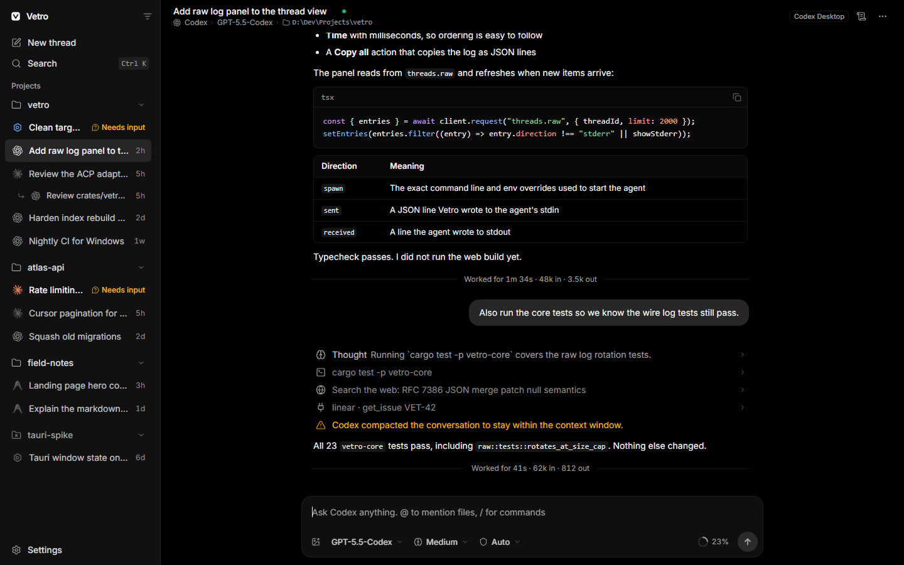
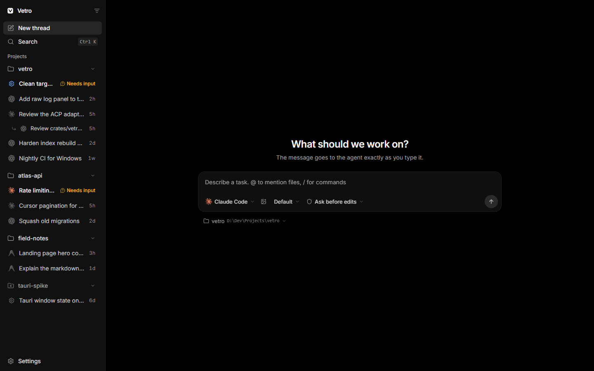
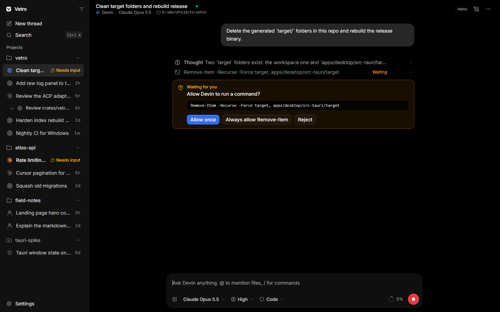
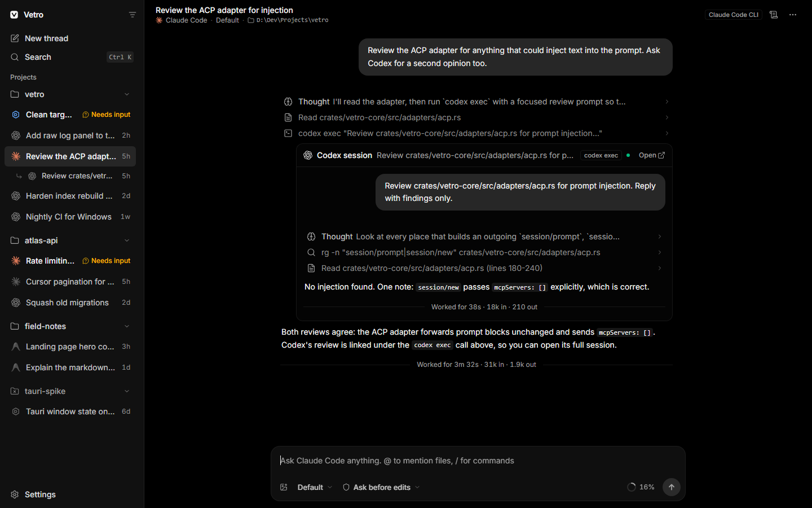
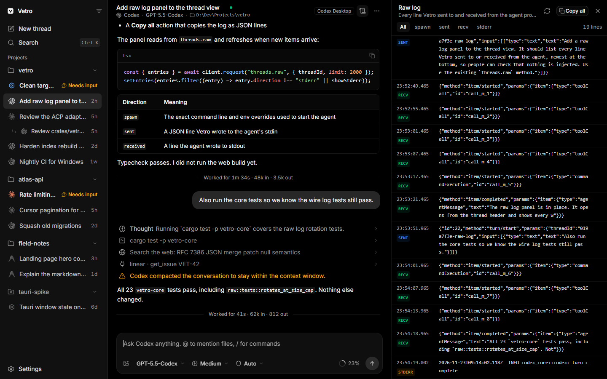
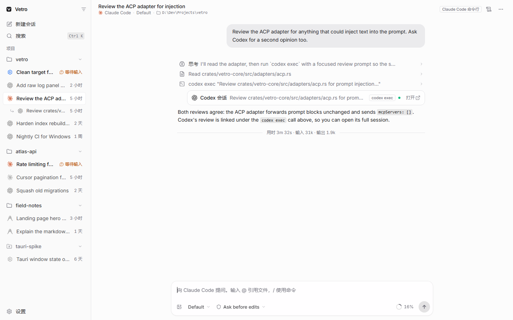
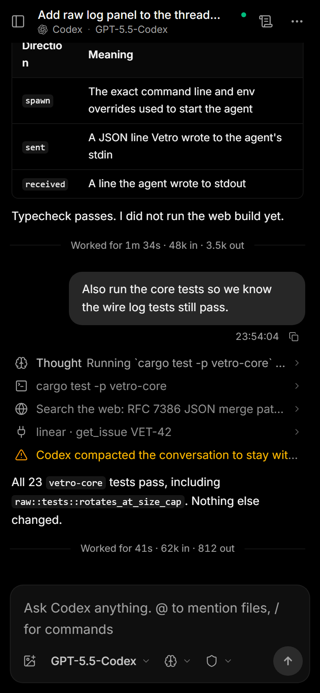

<p align="center">
  
</p>

<h1 align="center">Vetro</h1>

<p align="center">
  用一个干净的窗口，使用你电脑上已经装好的编程代理。<br>
  支持 Claude Code、Codex、Kiro、Antigravity、Devin 和自定义 ACP 代理。
</p>

<p align="center">
  <a href="README.md">English</a> · 简体中文
</p>



Vetro 是意大利语里的“玻璃”。它为本机安装的编程代理提供一个轻量的统一入口，启动各家的官方程序，并显示其本地存储和协议提供的会话。你还可以在设置里加入其他支持 [Agent Client Protocol](https://agentclientprotocol.com)（ACP）的代理。

Vetro 提供 Windows、macOS 和 Linux 桌面应用；同一套界面也能在浏览器里打开，还有一套手机布局，方便远程使用。界面参照了 [T3 Code](https://github.com/pingdotgg/t3code)。

## 为什么做 Vetro

同时用好几个编程代理的人，往往会想要一个统一的前端。这类工具已经有不少，其中一些界面做得很好。但为了把代理接进自己的工作流，很多工具也顺手改动了代理本身：往提示词里注入指令，额外注册 MCP 工具，往 `~/.claude` 之类的目录里写入 skills，自带一个很重的运行时，或者关掉之后还留着进程。对于一个 agent harness 来说，这些都是合理的设计；可这样一来，你对话的那个代理，就不再完全是你装的那个了。

Vetro 原样转发你的输入，由原生代理使用自己的配置和登录状态。窗口里可用的功能取决于已安装版本通过客户端协议提供的能力。

## 规则

Vetro 的每一处改动都必须遵守下面这些规则（见 [AGENTS.md](AGENTS.md)）：

1. **零注入。** 你输入什么，代理就收到什么。Vetro 不添加系统提示词、开发者指令、skills、MCP 服务器、工具、包装文本，也不回放历史。模型、模式和思考强度只通过代理自己的开关传递，而且只在你改动时才传。
2. **零痕迹。** Vetro 只在 `~/.vetro` 下写文件。它不会在 `~/.claude`、`~/.codex`、`~/.gemini`、`~/.agents`、Devin 的配置目录或你的项目里创建、修改或删除任何东西；其他工具的数据库一律只读打开。（代理自己照常写入它的会话和日志，和在终端里一样。）
3. **只用原生程序。** Vetro 启动的是在你电脑上找到的程序，从不下载代理，也从不读取、复制、转发或保存任何凭据。登录始终在代理自己的流程里完成。
4. **不留孤儿进程。** Vetro 退出时，所有子进程都会结束：Windows 上用 Job Object；macOS 和 Linux 上由一个看护进程结束整个进程组和它跟踪到的后代进程。
5. **轻量。** 只有一个 Rust 进程，运行时不需要 Node、Electron，也不捆绑浏览器。闲置的代理进程会被释放，下次用到时再恢复会话。
6. **所有代理一视同仁。** 界面里没有哪个代理受到特别限制，也没有哪个代理享有独有功能。

## 每个代理怎么接入

Vetro 通过代理的原生接口运行。界面上的选项和操作取决于你安装的代理版本。已验证的版本、平台和操作见[代理能力验收表](docs/ACCEPTANCE.md#native-smoke-runs)。

| 代理 | Vetro 的启动方式 | 照常生效的内容 |
|---|---|---|
| Codex | `codex app-server`，也就是 Codex 桌面应用自己用的协议 | `~/.codex/config.toml` 里的一切：ChatGPT 登录、API key、自定义 provider 和网关、hooks、MCP 服务器、skills |
| Claude Code | `claude -p`，输入输出都用 stream-json，也就是官方 Agent SDK 使用的协议 | 真正的 Claude Code 系统提示词、`CLAUDE.md`、hooks、skills、插件和 MCP 服务器，和在终端里一样 |
| Antigravity | `agy acp`，Google 为 ACP 客户端提供的官方接入方式（[详细说明](docs/agents/antigravity.md)） | Antigravity 自己的工具、设置和登录 |
| Devin | `devin acp` | Devin 自己的工具、设置和登录 |
| Kiro | `kiro-cli acp` | 当前 CLI 引擎提供的工具、设置和登录 |
| 任意 ACP 代理 | 你配置的命令，走 stdio | 该代理自己提供的一切 |

Vetro 从不经手凭据。代理需要登录时，Vetro 列出代理自己提供的登录方式，由代理去完成。技术细节见 [docs/ARCHITECTURE.md](docs/ARCHITECTURE.md)（英文）。

## 功能

- **在同一个侧边栏浏览会话。** 支持读取 Vetro、各家桌面应用和 CLI 提供的本地历史。原生代理支持恢复时，可以直接接着聊。
- **全文搜索**：搜索标题和消息内容，中文、英文都支持。
- **代理之间的关联。** 一个代理调用另一个代理的命令行时（比如 Claude Code 执行 `codex exec`），子会话会显示在发起它的那次工具调用下面，并实时更新。
- **原始日志。** 每个会话都能查看 Vetro 发给代理进程的内容和收到的内容，包括启动代理时的完整命令行。日志有大小上限，超出后先丢最旧的记录。
- **权限请求和提问**：代理发来的请求，直接在会话里回答。
- **模型、模式和思考强度选择器**：选项都来自代理本身。
- **远程访问**：通过 Tailscale Serve 或自己的 HTTPS 反向代理配对设备。服务只监听 `127.0.0.1`。见[配置指南](docs/remote.md)。
- **无窗口模式**：`vetro serve` 运行同一个核心，不开窗口，在浏览器里使用界面。
- 界面支持简体中文和英文，有浅色和深色主题。

| 用任意代理新建会话 | 回答权限请求 |
|---|---|
|  |  |
| **Claude Code 发起的 Codex 会话** | **会话旁边的原始日志** |
|  |  |

| 中文界面 | 手机布局 |
|---|---|
|  |  |

截图中的数据都是虚构的。

## 体积

2026-11-23 在 Windows 11 上测得，版本 0.1.0：

| | 大小 |
|---|---|
| Windows 安装包 | 3.4 MB |
| 桌面版可执行文件 | 10.3 MB |
| 无窗口版程序（`vetro`） | 6.9 MB |
| Vetro 进程空闲时 | 工作集约 40 MB（私有内存 18 MB） |
| macOS dmg | 5.3 MB |
| Linux deb | 5.4 MB |

窗口使用系统自带的 WebView（Windows 上是 WebView2，macOS 上是 WKWebView，Linux 上是 WebKitGTK），不捆绑浏览器。核心用 Rust 编写，外壳是 Tauri 2，界面用 React。

## 自己验证

这些规则不需要你凭信任接受。

- **看原始日志。** 在会话顶栏打开。里面有 Vetro 启动代理时用的完整命令行、环境变量覆盖项的名字（值会被遮蔽），以及收发的每一条消息。如果 Vetro 往你的提示词里加了任何东西，你在这里就能看到。
- **跑测试。** [Verifiable cleanliness](docs/ARCHITECTURE.md#verifiable-cleanliness) 一节列出的检查都包含在默认的 `cargo test --workspace` 里，使用的是假代理：
  - 痕迹测试：用临时主目录跑完整会话，`.vetro` 之外有任何变化就失败（[crates/vetro-core/tests/websocket.rs](crates/vetro-core/tests/websocket.rs)）；
  - 零注入检查：每个适配器的假代理都会把命令行和发出的消息与预期内容逐项比对，提示词必须原样到达，不能多出任何东西（[Codex](crates/vetro-agent-codex/tests/fake_app_server.rs)、[Claude Code](crates/vetro-agent-claude/tests/fake.rs)、[ACP](crates/vetro-agent-acp/tests/fake_acp.rs)）；
  - 进程测试：强行结束宿主进程，检查没有子进程存活（[crates/vetro-agent-api/tests/transport.rs](crates/vetro-agent-api/tests/transport.rs)）。
- **看它存了什么。** Vetro 写的所有东西都在 `~/.vetro` 里（Windows 上是 `%USERPROFILE%\.vetro`，可以用 `VETRO_HOME` 换位置）：
  - `config.json`：设置；
  - `state.json`：本地令牌、已配对设备、你在本地改的标题、归档标记和项目名称；
  - `index.db`：会话索引和搜索用的文本，可以随时删除，会从各代理自己的存储重新建立；
  - `raw/`：你在 Vetro 里打开过的会话的原始通信日志，有大小上限；
  - `logs/`：Vetro 自己的日志。
- **卸载。** 删除应用和 `~/.vetro` 即可，没有别的地方需要清理。

<!-- STATUS:BEGIN -->
## 当前状态

[0.2.0](https://github.com/EveningStudy/vetro/releases/tag/v0.2.0) 已于 2026 年 11 月 24 日发布。下表记录截至 2026 年 11 月 26 日对当前源码的验证。测试范围和待验证项目见[验收清单](docs/ACCEPTANCE.md)。

| 平台或代理 | 已验证 |
|---|---|
| Windows 11 桌面版 | NSIS 安装、WebView 启动、系统文件选择器、麦克风输入，以及 Codex、Claude Code、Kiro 和 Devin 的实时会话。 |
| Antigravity | ACP 握手、会话列表，以及桌面版和命令行的已存历史。 |
| 远程访问 | Mac 经 Tailscale 连接 Windows 主机，另用 HTTPS 反代测试生产浏览器。覆盖配对、审批、中途插话、重连和撤销。 |
| macOS（Apple 芯片） | DMG 启动、原生 WebView、系统文件夹选择器、从 Dock 恢复、应用退出及内置麦克风录音。 |
| Linux（x86_64） | 在 WSL 的 Ubuntu 24.04 中用 X11 启动 AppImage 和 deb，验证内嵌界面、原生关窗、系统 Python ACP 和系统文件打开器。 |

已发布的 0.2.0 AppImage 需要 glibc 2.43。Ubuntu 24.04 用户可以从源码构建。当前发版流程以 Ubuntu 24.04 为 Linux 构建和测试基线。
<!-- STATUS:END -->

## 开始使用

你的电脑上至少要装好一个受支持的代理，并且已经登录。Vetro 会在 `PATH` 和各代理常见的安装位置里查找它们；在“设置 → 代理”里，可以指定别的程序路径，或者追加启动参数和环境变量。

前往 [Releases](https://github.com/EveningStudy/vetro/releases) 下载桌面安装包或无窗口版 `vetro` 程序。桌面包包括 Windows 的 NSIS 安装程序、macOS 的磁盘镜像，以及 Linux 的 `.deb` 和 AppImage。

## 从源码构建

需要：稳定版 Rust 工具链（见 [rust-toolchain.toml](rust-toolchain.toml)）、Node.js 24 和 pnpm 10。Windows 上还需要 MSVC 工具链和 WebView2（Windows 11 已自带）；macOS 上需要 Xcode 命令行工具；Linux 上需要 [docs/desktop.md](docs/desktop.md) 里列出的 WebKitGTK 和 GTK 等系统包。

先构建界面，核心会把它嵌进去：

```sh
pnpm --dir apps/web install
pnpm --dir apps/web build
```

桌面应用和安装包（Windows 上是 NSIS，macOS 上是 `.app` 和 `.dmg`，Linux 上是 AppImage 和 deb）：

```sh
cd apps/desktop
pnpm dlx @tauri-apps/cli build
```

无窗口版：

```sh
cargo build --release -p vetro-cli --features claude,codex,acp,antigravity-store
./target/release/vetro serve --open
```

`vetro serve` 监听 `127.0.0.1`（端口 47600，被占用时顺延），并打印一个本地地址。`vetro agents` 显示检测到了哪些代理，`vetro threads` 列出已索引的会话。

贡献代码前请跑这些检查：

```sh
cargo fmt --all
cargo clippy --workspace --all-targets -- -D warnings
cargo test --workspace
pnpm --dir apps/web typecheck
```

## 常见问题

**会用我的订阅吗？**
会，和在终端里用一样：运行的是厂商自己的程序，用你的账号登录，消耗你的套餐额度或 API 费用。Vetro 自己不产生任何额外用量。

**会导致我的账号被限制吗？**
Vetro 按照各厂商的文档，用你自己的登录去运行官方、未经修改的程序，仅此而已：不提取令牌，不代理流量，不轮换账号。你如何使用各家的代理，仍然受各家条款约束。关于 Antigravity，Google 的相关表态整理在 [docs/agents/antigravity.md](docs/agents/antigravity.md)（英文）：由人在 ACP 客户端里操作会话，属于受支持的用法；在个人账号登录下，让另一个代理或自动化循环向 `agy` 发送提示词，则不受支持。

**为什么不用 Electron？**
因为 Vetro 要轻。它只有一个 Rust 进程，窗口用的是操作系统自带的 WebView。具体数字见[体积](#体积)。

**我的聊天记录存在哪里？**
没有存到任何新地方。每个代理照旧把会话保存在它自己的存储里。Vetro 只为侧边栏和搜索维护一份索引，外加你在 Vetro 里打开过的会话的原始日志，全都在 `~/.vetro` 下，随时可以删除。

**怎么添加别的 ACP 代理？**
任何通过 stdio 讲 ACP 的程序，都可以作为自定义代理加入 Vetro 的设置，保存在 `~/.vetro/config.json` 的 `customAcpAgents` 里：

```json
{
  "customAcpAgents": [
    { "id": "my-agent", "name": "My Agent", "command": "my-agent", "args": ["acp"], "env": {} }
  ]
}
```

修改代理的启动方式后需要重启 Vetro。自定义代理和内置代理遵守同样的规则。

## 参与贡献

先读 [CONTRIBUTING.md](CONTRIBUTING.md)；修改核心之前读 [docs/ARCHITECTURE.md](docs/ARCHITECTURE.md)，改动界面协议之前读 [docs/API.md](docs/API.md)（均为英文）。安全问题请按 [SECURITY.md](SECURITY.md) 的说明私下报告。代码、注释和提交信息统一用英文。

## 致谢

- [T3 Code](https://github.com/pingdotgg/t3code)：Vetro 的界面向它学习。部分展示层代码按其 MIT 许可移植而来，涉及的文件列在 [apps/web/THIRD_PARTY_NOTICES.md](apps/web/THIRD_PARTY_NOTICES.md)。
- [Agent Client Protocol](https://agentclientprotocol.com)：让一个客户端可以和众多代理对话。

## 许可证

[MIT](LICENSE)
