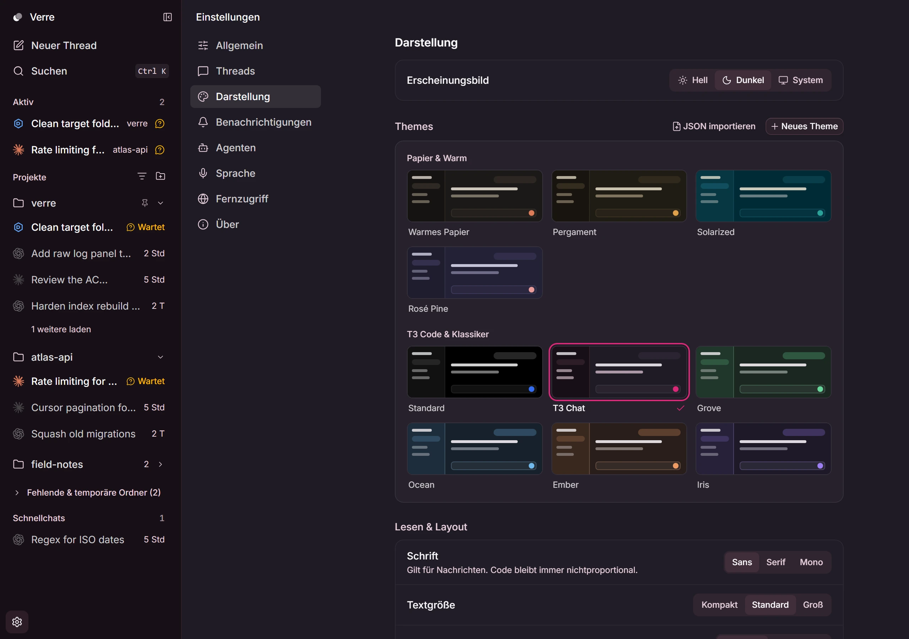
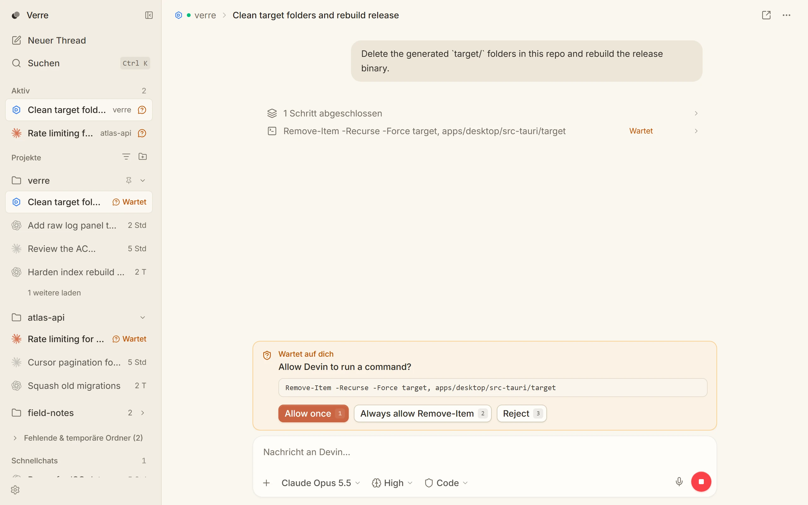
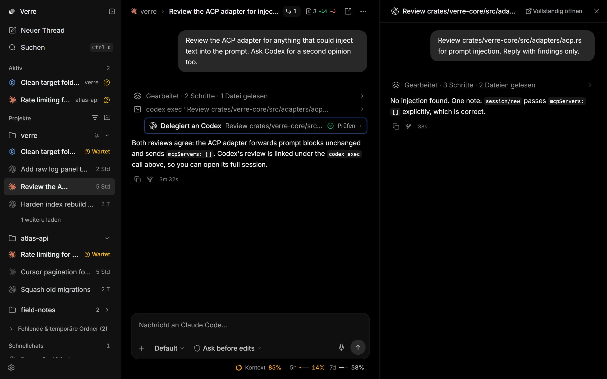

<p align="center">
  
</p>

<h1 align="center">Verre</h1>

<p align="center">
  Ein schnelles, aufgeräumtes Fenster für alle Coding-Agenten auf deinem Rechner.
</p>

<p align="center">
  <a href="https://github.com/EveningStudy/verre/releases"><strong>Download</strong></a> ·
  <a href="../remote.md">Fernzugriff</a> ·
  <a href="../ARCHITECTURE.md">Architektur</a> ·
  <a href="../../CONTRIBUTING.md">Mitwirken</a>
</p>

<p align="center">
  <a href="../../README.md">English</a> ·
  <a href="README.zh-CN.md">简体中文</a> ·
  <a href="README.zh-Hant.md">繁體中文</a> ·
  <a href="README.ja.md">日本語</a> ·
  <a href="README.ko.md">한국어</a> ·
  <a href="README.es.md">Español</a> ·
  <strong>Deutsch</strong> ·
  <a href="README.fr.md">Français</a>
</p>

<p align="center">
  
</p>

**Verre** (französisch für „Glas“, ausgesprochen „vair“) ist eine schlanke native Oberfläche für **21 integrierte Coding-Agenten** – darunter **Claude Code**, **Codex**, **Cursor**, **Antigravity**, **Gemini CLI**, **DeepSeek Harness**, **Grok**, **GitHub Copilot**, **OpenCode**, **Cline**, **CodeBuddy / WorkBuddy**, **Kiro** und **Devin** – sowie jedes [Agent Client Protocol](https://agentclientprotocol.com) (ACP)-Tool, angelehnt an [T3 Code](https://github.com/pingdotgg/t3code).

## Warum Verre

- **Durchsichtig wie Glas.** Eingaben gehen unverändert an das offizielle Binary – keine System-Prompts, keine Wrapper, keine extra MCP-Server. `CLAUDE.md`, `config.toml`, Hooks, Skills, eigene Gateways und Limits verhalten sich exakt wie im Terminal, und jedes Rohprotokoll zeigt jeden Frame live.
- **Leichtes natives Fundament.** Ein Rust-Prozess (~14 MB Binary) plus System-WebView (~40 MB Ruhe-RAM, kein Electron oder Node), mit schreibgeschützten Git-Diffs, 10 integrierten & eigenen Themes, optionaler Offline-Spracheingabe und 8 UI-Sprachen.
- **Keine Spuren, sauberes Ende.** Verre schreibt nur nach `~/.verre` (`VERRE_HOME` überschreibt den Pfad), liest fremde Stores strikt schreibgeschützt, lässt Projekte unberührt und beendet beim Schließen seine komplette Kindprozess-Hierarchie. App und `~/.verre` löschen genügt zum Deinstallieren.
- **Eine Seitenleiste für alle Tools.** Durchsuche lokale Sitzungen aus Verre, offiziellen Desktop-Apps und CLIs in Englisch und CJK und springe direkt in verknüpfte Subsitzungen (etwa wenn Claude Code `codex exec` startet).
- **Privater Fernzugriff.** Kopple Smartphone oder Browser per Tailscale Serve oder eigenem HTTPS-Reverse-Proxy (nur `127.0.0.1`), gib Befehle unterwegs frei und steuere laufende Züge nach.

## Screenshots

**10 integrierte & eigene Themes**



<details>
<summary>Weitere Screenshots — Rohprotokoll, Freigaben, Subsitzungen und Mobilansicht</summary>

#### Rohprotokoll & Startbefehl


#### Freigabekarte & Warmes-Papier-Theme



#### Verknüpfte Subsitzung



#### Mobile Fernfreigabe

<p align="center">
  
</p>

</details>

## Unterstützte Agenten

Verre startet direkt das offizielle CLI-Protokoll des jeweiligen Agenten mit deiner vorhandenen Konfiguration und Anmeldung:

| Agent | Protokoll | Was erhalten bleibt |
|---|---|---|
| **Claude Code** | `claude -p` (`stream-json`) | `CLAUDE.md`, Hooks, Skills, Plugins, MCP, Anmeldung |
| **Codex** | `codex app-server` | `~/.codex/config.toml`, ChatGPT-/API-Login, eigene Provider, MCP |
| **19 integrierte ACP-Agenten**<br>Cursor, Antigravity, Gemini CLI, GitHub Copilot, DeepSeek Harness, Grok, OpenCode, Cline, CodeBuddy / WorkBuddy, Qwen Code, Kimi Code, Kiro, Devin, Goose, Factory Droid, Amp, Auggie, Mistral Vibe, Kilo | Offizielles ACP (`acp` / `--acp` / `--profile acp`) | Eigene Tools, Einstellungen und Anmeldung des Agenten |
| **Eigenes ACP** | Beliebiger stdio-ACP-Befehl | Unter **Einstellungen → Agenten** hinzufügen |

## Installation

Desktop-Installer oder das fensterlose `verre`-CLI gibt es unter [Releases](https://github.com/EveningStudy/verre/releases):

- **Windows:** NSIS-Installer (`*-setup.exe`) und portables `verre`-CLI.
- **macOS:** `.dmg` / `.app` für Apple Silicon & Intel sowie `verre`-CLI.
- **Linux:** `.deb` und `.AppImage` (x86_64) sowie `verre`-CLI.

Die Builds sind für den integrierten Updater signiert, tragen aber noch keine kommerziellen OS-Code-Signing-Zertifikate:

- **Windows SmartScreen:** **Weitere Informationen** → **Trotzdem ausführen** wählen.
- **macOS Gatekeeper:** Falls macOS die App blockiert, `xattr -cr /Applications/Verre.app` ausführen.

### Server ohne Fenster (Headless)

Denselben Core ohne Desktop-Fenster starten und im Browser öffnen:

```sh
verre serve --open
```

Nützliche Befehle: `verre agents`, `verre threads`, `verre show <thread-id>` und `verre probe`. Vorher sicherstellen, dass mindestens ein unterstützter Agent installiert und angemeldet ist.

## Aus dem Quellcode bauen

Erfordert stabiles Rust ([rust-toolchain.toml](../../rust-toolchain.toml)), Node.js 24 und pnpm 10 (Linux-Systempakete siehe [docs/desktop.md](../desktop.md)).

```sh
# 1. Web-UI bauen (wird in den Rust-Core eingebettet)
pnpm --dir apps/web install --frozen-lockfile
pnpm --dir apps/web build

# 2. Desktop-Pakete bauen (oder unten nur das Headless-CLI)
cd apps/desktop
pnpm dlx @tauri-apps/cli build

# Nur Headless-CLI
cargo build --release -p verre-cli --features claude,codex,acp,antigravity-store
./target/release/verre serve --open
```

Prüfungen vor einem PR:

```sh
pnpm --dir apps/web check:i18n
pnpm --dir apps/web typecheck
cargo fmt --all -- --check
cargo clippy --workspace --all-targets -- -D warnings
cargo test --workspace
```

## Dokumentation

- [Fernzugriff](../remote.md) — Tailscale Serve, eigener HTTPS-Reverse-Proxy, Geräte-Kopplung
- [Architektur](../ARCHITECTURE.md) — Core-Design, Speicherstruktur, Tests (Englisch)
- [WebSocket- / RPC-API](../API.md) — UI-Protokollvertrag (Englisch)
- [Desktop-Shell](../desktop.md) — Tauri-2-Build, Plattformpakete, Icons (Englisch)
- [Sicherheitsrichtlinie](../../SECURITY.md) — Datengrenzen, Maskierung, Schwachstellen melden (Englisch)
- [Hinweise zu Antigravity](../agents/antigravity.md) & [Abnahme-Checkliste](../ACCEPTANCE.md) (Englisch)

## Danksagung

- [T3 Code](https://github.com/pingdotgg/t3code) — UI/UX-Referenz; unter der MIT-Lizenz übernommene Präsentationskomponenten sind in [THIRD_PARTY_NOTICES.md](../../apps/web/THIRD_PARTY_NOTICES.md) aufgeführt.
- [Agent Client Protocol](https://agentclientprotocol.com) — einheitliches stdio-Client-Protokoll für Coding-Agenten.

## Lizenz

[MIT](../../LICENSE)
