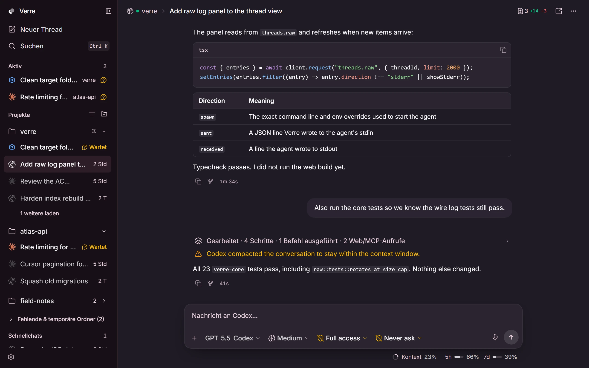
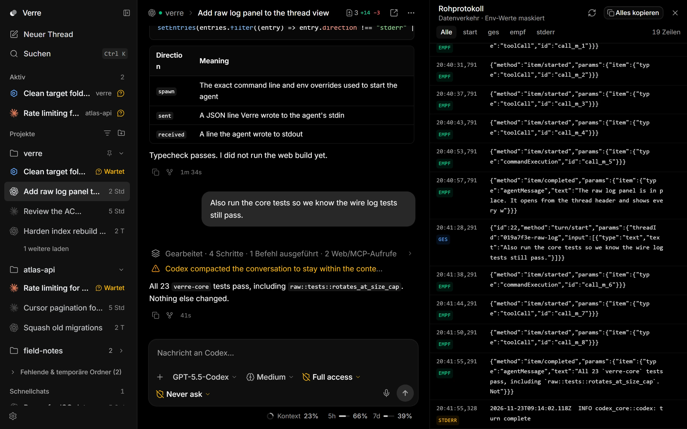
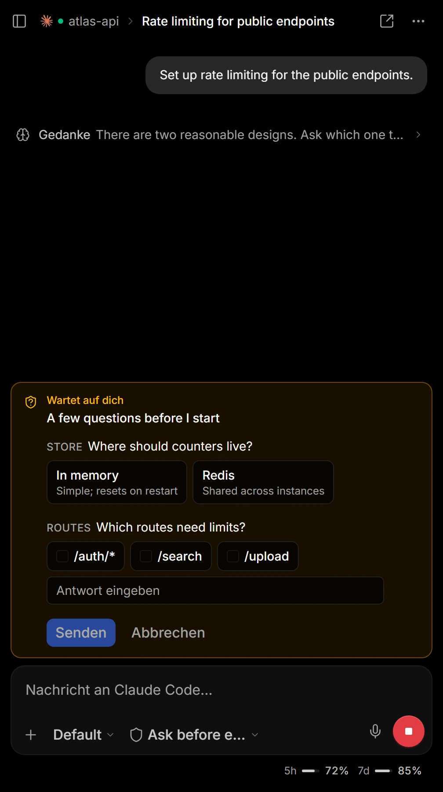

<p align="center">
  
</p>

<h1 align="center">Verre</h1>

<p align="center">
  Ein schnelles, aufgeräumtes Fenster für alle Coding-Agenten auf deinem Rechner.
</p>

<p align="center">
  <a href="https://github.com/EveningStudy/verre/releases"><strong>Download</strong></a> ·
  <a href="../remote.md">Fernzugriff</a> ·
  <a href="../ARCHITECTURE.md">Architektur</a> ·
  <a href="../../CONTRIBUTING.md">Mitwirken</a>
</p>

<p align="center">
  <a href="../../README.md">English</a> ·
  <a href="README.zh-CN.md">简体中文</a> ·
  <a href="README.zh-Hant.md">繁體中文</a> ·
  <a href="README.ja.md">日本語</a> ·
  <a href="README.ko.md">한국어</a> ·
  <a href="README.es.md">Español</a> ·
  <strong>Deutsch</strong> ·
  <a href="README.fr.md">Français</a>
</p>

<p align="center">
  
</p>

Verre (französisch für „Glas“, ausgesprochen „vair“) ist ein schlankes, natives Frontend für lokale CLI-Coding-Agenten: **Claude Code**, **Codex**, **Antigravity**, **Devin**, **Kiro**, **DeepSeek Harness**, **CodeBuddy / WorkBuddy** sowie jedes Tool mit [Agent Client Protocol](https://agentclientprotocol.com) (ACP). Verre startet die offiziell installierten Binärdateien mit deiner vorhandenen Konfiguration und Anmeldung unter einer von [T3 Code](https://github.com/pingdotgg/t3code) inspirierten Oberfläche.

## Was Verre bietet

- **Deine Agenten bleiben unverändert.** Eingaben gehen wortgetreu durch – keine versteckten System-Prompts, keine Wrapper-Texte, keine zusätzlich injizierten Tools oder MCP-Server. `CLAUDE.md`, `config.toml`, Hooks, Skills, eigene Gateways und Abos verhalten sich exakt wie im Terminal.
- **21 integrierte Agenten + eigenes ACP.** Native Adapter für Claude Code und Codex plus 19 vorkonfigurierte ACP-Presets; beliebige stdio-ACP-Befehle lassen sich in den Einstellungen ergänzen.
- **Eine Seitenleiste und agentenübergreifende Links.** Durchsuche lokale Verläufe aus Verre, den offiziellen Desktop-Apps und CLIs, setze Sitzungen nahtlos fort und springe direkt in verknüpfte Subsitzungen, wenn ein Agent einen anderen aufruft (z. B. Claude Code über `codex exec`).
- **Volltextsuche, schreibgeschützte Diffs & Rohprotokolle.** Durchsuche englische und CJK-Transkripte, prüfe Git-Änderungen und Worktrees schreibgeschützt und öffne in jedem Thread das Live-Rohprotokoll mit exaktem Startbefehl und JSON-Frames.
- **Privater Fernzugriff.** Kopple Smartphone oder Browser über Tailscale Serve oder einen eigenen HTTPS-Reverse-Proxy (Lauschen nur auf `127.0.0.1`), beantworte Freigaben unterwegs und steuere laufende Züge nach.
- **Bewusst leichtgewichtig.** Ein einziger Rust-Prozess (~14 MB Desktop-Binary) plus System-WebView (WebView2 / WKWebView / WebKitGTK), kein Electron oder Node zur Laufzeit, ~40 MB Ruhe-RAM. Dazu optionale Offline-Spracheingabe, eigene Themes und 8 UI-Sprachen.

| Rohprotokoll & Startbefehl | Freigabekarte & Warmes-Papier-Theme |
|---|---|
|  |  |
| **Verknüpfte Subsitzung** | **Mobile Fernansicht** |
|  | <p align="center"></p> |

## Unterstützte Agenten

Verre spricht direkt das offizielle Client-Protokoll des jeweiligen Anbieters und zeigt genau die Modelle, Denkintensitäten, Berechtigungsmodi und Ratenlimits an, die der Agent selbst meldet.

| Agent | Protokoll | Erhaltene lokale Einrichtung |
|---|---|---|
| Claude Code | `claude -p` (bidirektionales `stream-json`) | `CLAUDE.md`, Hooks, Skills, Plugins, MCP, Anmeldung |
| Codex | `codex app-server` | `~/.codex/config.toml`, ChatGPT-/API-Login, eigene Provider, MCP |
| Antigravity | `agy acp` | Native Tools, Einstellungen & Google-Anmeldung ([Hinweise](../agents/antigravity.md)) |
| Devin | `devin acp` | Native Tools, Einstellungen & Browser-Auth |
| Kiro | `kiro-cli acp` | Native CLI-Tools, Einstellungen & Anmeldung |

**Weitere 16 integrierte ACP-Presets:** DeepSeek Harness, CodeBuddy / WorkBuddy, Gemini CLI, OpenCode, Cursor, GitHub Copilot, Cline, Qwen Code, Kimi Code, Goose, Factory Droid, Amp, Auggie, Mistral Vibe, Kilo und Grok. Eigene stdio-ACP-Befehle lassen sich unter **Einstellungen → Agenten** hinzufügen.

> Claude Code, Codex, Antigravity, Devin und Kiro wurden direkt gegen echte Binärdateien verifiziert. Die übrigen 16 Presets orientieren sich an den jeweiligen dokumentierten ACP-Flags (`--acp` / `acp` / `--profile acp`) – melde gern ein Issue, falls ein CLI-Update Flags oder Pfade ändert.

## Installation

Desktop-Installer oder das fensterlose `verre`-CLI stehen unter [Releases](https://github.com/EveningStudy/verre/releases) bereit:

- **Windows:** NSIS-Installer (`*-setup.exe`) und portables `verre`-CLI.
- **macOS:** `.dmg` / `.app` für Apple Silicon & Intel sowie `verre`-CLI.
- **Linux:** `.deb` und `.AppImage` (x86_64) sowie `verre`-CLI.

Die Builds sind für den integrierten Updater signiert, tragen aber noch keine kommerziellen OS-Code-Signing-Zertifikate:

- **Windows SmartScreen:** **Weitere Informationen** → **Trotzdem ausführen** wählen.
- **macOS Gatekeeper:** Falls macOS die App blockiert, im Terminal `xattr -cr /Applications/Verre.app` ausführen.

### Server ohne Fenster (Headless)

Starte denselben Core ohne Desktop-Fenster und öffne die UI im Browser:

```sh
verre serve --open
```

Nützliche CLI-Befehle: `verre agents` (erkannte Programme & Versionen), `verre threads` (Suche im lokalen Index), `verre show <thread-id>` und `verre probe`.

Stelle vorab sicher, dass mindestens ein unterstützter Agent lokal installiert und angemeldet ist.

## Warum „Glas“?

- **Keine Injektion.** Eingaben erreichen den Agenten unverändert. System-Prompts, Skills, Tools und Modellvorgaben stammen ausschließlich vom Agenten und deinen sichtbaren Reglern.
- **Keine Spuren.** Verre schreibt nur nach `~/.verre` (`VERRE_HOME` überschreibt den Pfad). Fremde Agenten-Ordner und SQLite-Datenbanken werden strikt schreibgeschützt geöffnet; Arbeitsverzeichnisse bleiben ohne explizite Aktion unberührt. App und `~/.verre` löschen genügt zur rückstandsfreien Deinstallation.
- **Keine verwaisten Prozesse.** Kindprozessbäume enden mit Verre (Windows Job Object / Unix-Prozessgruppen-Watchdog); bei laufender Hintergrundarbeit fragt Verre vor dem Freigeben oder Beenden nach.
- **Klare Grenzen.** Konversation, Freigaben, Verlauf, schreibgeschützte Git-Diffs, lokale Spracheingabe und privater Fernzugriff – kein eingebauter Editor, kein Terminal-Emulator, kein Multi-Agent-Orchestrator.

## Aus dem Quellcode bauen

Erfordert stabiles Rust ([rust-toolchain.toml](../../rust-toolchain.toml)), Node.js 24 und pnpm 10 (Linux-Systempakete siehe [docs/desktop.md](../desktop.md)).

```sh
# 1. Web-UI bauen (wird beim Kompilieren in den Rust-Core eingebettet)
pnpm --dir apps/web install --frozen-lockfile
pnpm --dir apps/web build

# 2. Desktop-Pakete bauen (oder unten nur das Headless-CLI)
cd apps/desktop
pnpm dlx @tauri-apps/cli build

# Nur Headless-CLI
cargo build --release -p verre-cli --features claude,codex,acp,antigravity-store
./target/release/verre serve --open
```

Prüfungen vor einem PR:

```sh
pnpm --dir apps/web check:i18n
pnpm --dir apps/web typecheck
cargo fmt --all -- --check
cargo clippy --workspace --all-targets -- -D warnings
cargo test --workspace
```

## Dokumentation

- [Fernzugriff](../remote.md) — Tailscale Serve, eigener HTTPS-Reverse-Proxy, Geräte-Kopplung
- [Architektur](../ARCHITECTURE.md) — Core-Design, Speicherstruktur, Tests (Englisch)
- [WebSocket- / RPC-API](../API.md) — UI-Protokollvertrag (Englisch)
- [Desktop-Shell](../desktop.md) — Tauri-2-Build, Plattformpakete, Icons (Englisch)
- [Sicherheitsrichtlinie](../../SECURITY.md) — Datengrenzen, Maskierung, Schwachstellen melden (Englisch)
- [Hinweise zu Antigravity](../agents/antigravity.md) & [Abnahme-Checkliste](../ACCEPTANCE.md) (Englisch)

## Danksagung

- [T3 Code](https://github.com/pingdotgg/t3code) — UI/UX-Referenz; unter der MIT-Lizenz übernommene Präsentationskomponenten sind in [THIRD_PARTY_NOTICES.md](../../apps/web/THIRD_PARTY_NOTICES.md) aufgeführt.
- [Agent Client Protocol](https://agentclientprotocol.com) — einheitliches stdio-Client-Protokoll für Coding-Agenten.

## Lizenz

[MIT](../../LICENSE)
