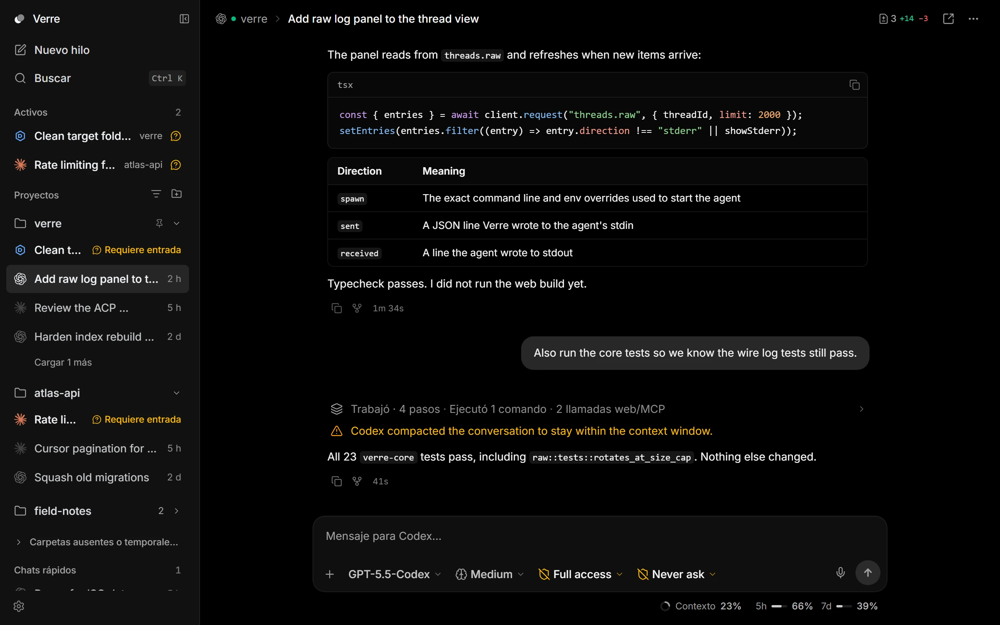
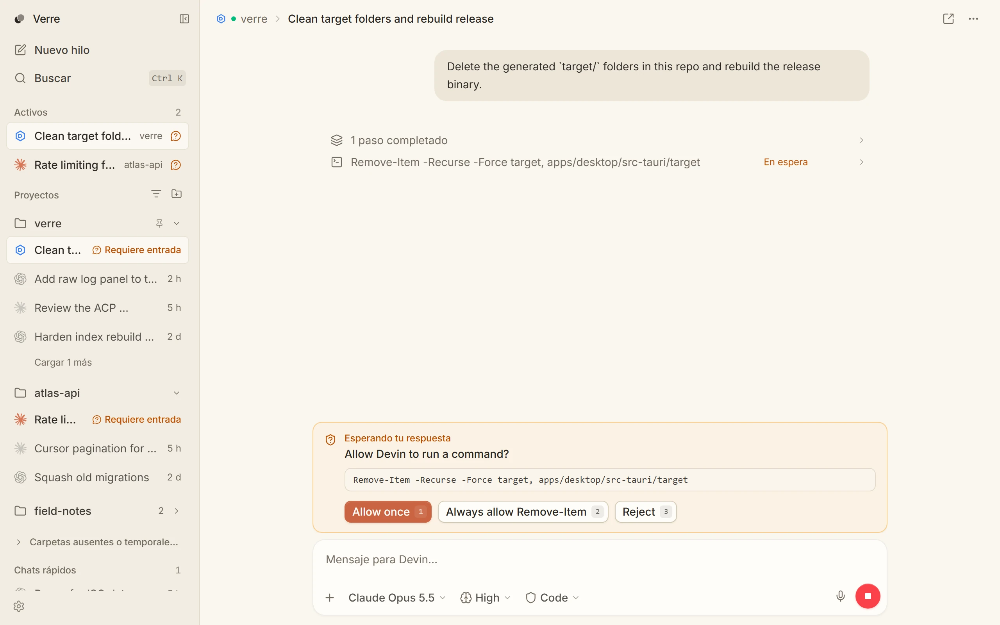
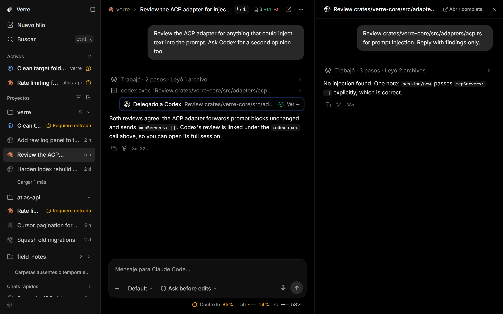
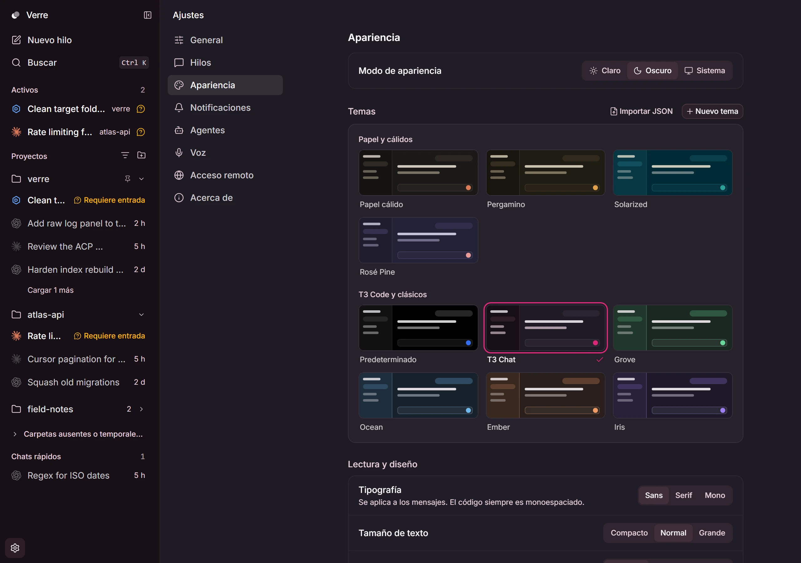

<p align="center">
  
</p>

<h1 align="center">Verre</h1>

<p align="center">
  Una ventana rápida y limpia para cada agente de código en tu equipo.
</p>

<p align="center">
  <a href="https://github.com/EveningStudy/verre/releases"><strong>Descargar</strong></a> ·
  <a href="../remote.md">Acceso remoto</a> ·
  <a href="../ARCHITECTURE.md">Arquitectura</a> ·
  <a href="../../CONTRIBUTING.md">Contribuir</a>
</p>

<p align="center">
  <a href="../../README.md">English</a> ·
  <a href="README.zh-CN.md">简体中文</a> ·
  <a href="README.zh-Hant.md">繁體中文</a> ·
  <a href="README.ja.md">日本語</a> ·
  <a href="README.ko.md">한국어</a> ·
  <strong>Español</strong> ·
  <a href="README.de.md">Deutsch</a> ·
  <a href="README.fr.md">Français</a>
</p>

<p align="center">
  
</p>

**Verre** («vidrio» en francés) es una interfaz nativa ligera para **21 agentes de código integrados** —entre ellos **Claude Code**, **Codex**, **Cursor**, **Antigravity**, **Gemini CLI**, **DeepSeek Harness**, **Grok**, **GitHub Copilot**, **OpenCode**, **Cline**, **CodeBuddy / WorkBuddy**, **Kiro** y **Devin**— además de cualquier herramienta compatible con el [Agent Client Protocol](https://agentclientprotocol.com) (ACP), con diseño inspirado en [T3 Code](https://github.com/pingdotgg/t3code).

## Por qué Verre

- **Transparente como el vidrio.** Lo que escribes llega intacto al binario oficial: sin prompts del sistema añadidos, sin envoltorios ni servidores MCP extra. Tu `CLAUDE.md`, `config.toml`, hooks, skills, pasarelas y límites de uso funcionan igual que en la terminal, con registro sin procesar visible en cada hilo.
- **Cero rastro, salida limpia.** Solo escribe en `~/.verre` (`VERRE_HOME` lo cambia), abre las bases de otros agentes en modo solo lectura, deja tus proyectos intactos y detiene todos sus subprocesos al cerrar. Para desinstalarlo, borra la app y `~/.verre`.
- **Una barra lateral para todo.** Explora sesiones locales de Verre, apps oficiales y CLIs, busca en inglés y CJK, y salta directo a sesiones secundarias lanzadas por otro agente (como Claude Code ejecutando `codex exec`).
- **Acceso remoto privado.** Empareja un teléfono o navegador mediante Tailscale Serve o tu propio proxy inverso HTTPS (`127.0.0.1`), aprueba permisos desde cualquier lugar e interviene en turnos activos.
- **Ligero de verdad.** Un solo núcleo en Rust (~14 MB) y la WebView del sistema (~40 MB de RAM en reposo, sin Electron ni Node), con diffs Git de solo lectura, 10 temas integrados y personalizados, voz sin conexión opcional e interfaz en 8 idiomas.

| Registro sin procesar y línea de comandos | Aprobación de permisos y tema Papel cálido |
|---|---|
|  |  |
| **Sesión secundaria vinculada** | **Temas integrados y personalizados** |
|  |  |

<p align="center">
  
</p>

## Agentes compatibles

Verre inicia directamente la interfaz CLI oficial de cada agente conservando tu configuración y sesión actuales:

| Agente | Protocolo | Qué se conserva |
|---|---|---|
| **Claude Code** | `claude -p` (`stream-json`) | `CLAUDE.md`, hooks, skills, plugins, MCP, sesión iniciada |
| **Codex** | `codex app-server` | `~/.codex/config.toml`, acceso ChatGPT / API, proveedores propios, MCP |
| **19 agentes ACP integrados**<br>Cursor, Antigravity, Gemini CLI, GitHub Copilot, DeepSeek Harness, Grok, OpenCode, Cline, CodeBuddy / WorkBuddy, Qwen Code, Kimi Code, Kiro, Devin, Goose, Factory Droid, Amp, Auggie, Mistral Vibe, Kilo | ACP oficial (`acp` / `--acp` / `--profile acp`) | Herramientas nativas, ajustes y autenticación de cada agente |
| **ACP personalizado** | Cualquier comando stdio ACP | Añadido en **Ajustes → Agentes** |

## Instalación

Descarga los instaladores de escritorio o el binario `verre` CLI desde [Releases](https://github.com/EveningStudy/verre/releases):

- **Windows:** instalador NSIS (`*-setup.exe`) y CLI portable `verre`.
- **macOS:** `.dmg` / `.app` para Apple Silicon e Intel, más CLI `verre`.
- **Linux:** `.deb` y `.AppImage` (x86_64), más CLI `verre`.

Las compilaciones incluyen firma para el actualizador interno de Verre, pero aún no tienen certificados comerciales de firma de sistema operativo:

- **Windows SmartScreen:** haz clic en **Más información** → **Ejecutar de todas formas**.
- **macOS Gatekeeper:** si macOS bloquea la app, ejecuta `xattr -cr /Applications/Verre.app`.

### Servidor sin interfaz gráfica

Ejecuta el mismo núcleo sin ventana y abre la UI en tu navegador:

```sh
verre serve --open
```

Utilidades: `verre agents`, `verre threads`, `verre show <thread-id>` y `verre probe`. Asegúrate de tener instalado e iniciado sesión en al menos un agente compatible.

## Compilar desde el código fuente

Requiere Rust estable ([rust-toolchain.toml](../../rust-toolchain.toml)), Node.js 24 y pnpm 10 (paquetes Linux en [docs/desktop.md](../desktop.md)).

```sh
# 1. Compilar la interfaz web (se incrusta en el núcleo Rust)
pnpm --dir apps/web install --frozen-lockfile
pnpm --dir apps/web build

# 2. Empaquetar la aplicación de escritorio (o compilar solo el CLI abajo)
cd apps/desktop
pnpm dlx @tauri-apps/cli build

# Solo binario CLI sin ventana
cargo build --release -p verre-cli --features claude,codex,acp,antigravity-store
./target/release/verre serve --open
```

Comprobaciones antes de abrir un PR:

```sh
pnpm --dir apps/web check:i18n
pnpm --dir apps/web typecheck
cargo fmt --all -- --check
cargo clippy --workspace --all-targets -- -D warnings
cargo test --workspace
```

## Documentación

- [Acceso remoto](../remote.md) — Tailscale Serve, proxy inverso HTTPS propio y límites de emparejamiento
- [Arquitectura](../ARCHITECTURE.md) — Diseño del núcleo, almacenamiento y pruebas de limpieza (en inglés)
- [API WebSocket / RPC](../API.md) — Contrato de comunicación con la interfaz (en inglés)
- [Aplicación de escritorio](../desktop.md) — Compilación con Tauri 2, paquetes e iconos (en inglés)
- [Política de seguridad](../../SECURITY.md) — Límites de datos, enmascarado y reporte de vulnerabilidades (en inglés)
- [Notas sobre Antigravity](../agents/antigravity.md) y [lista de verificación](../ACCEPTANCE.md) (en inglés)

## Agradecimientos

- [T3 Code](https://github.com/pingdotgg/t3code) — referencia de diseño UX/UI y componentes visuales bajo licencia MIT listados en [THIRD_PARTY_NOTICES.md](../../apps/web/THIRD_PARTY_NOTICES.md).
- [Agent Client Protocol](https://agentclientprotocol.com) — protocolo cliente común sobre stdio para múltiples agentes.

## Licencia

[MIT](../../LICENSE)
