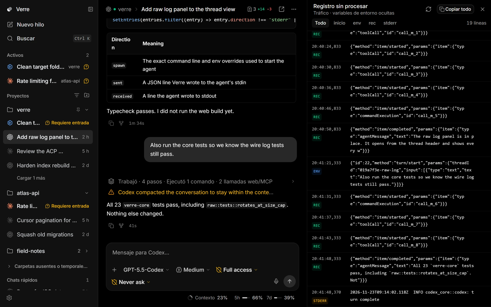
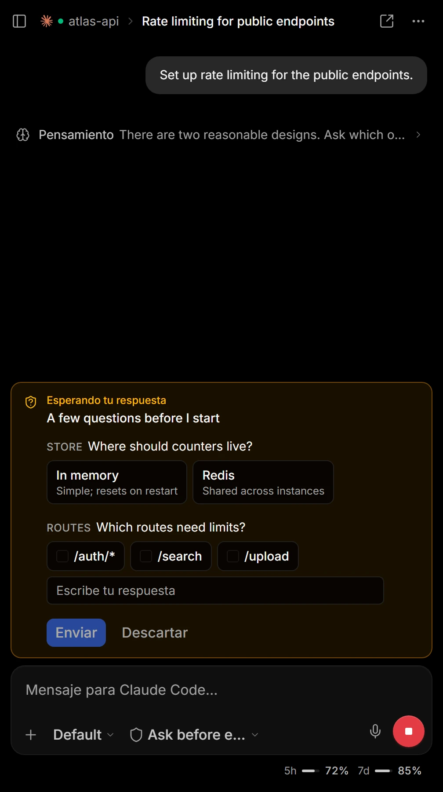

<p align="center">
  
</p>

<h1 align="center">Verre</h1>

<p align="center">
  Una ventana rápida y limpia para los agentes de código ya instalados en tu equipo.
</p>

<p align="center">
  <a href="https://github.com/EveningStudy/verre/releases"><strong>Descargar</strong></a> ·
  <a href="../remote.md">Acceso remoto</a> ·
  <a href="../ARCHITECTURE.md">Arquitectura</a> ·
  <a href="../../CONTRIBUTING.md">Contribuir</a>
</p>

<p align="center">
  <a href="../../README.md">English</a> ·
  <a href="README.zh-CN.md">简体中文</a> ·
  <a href="README.zh-Hant.md">繁體中文</a> ·
  <a href="README.ja.md">日本語</a> ·
  <a href="README.ko.md">한국어</a> ·
  <strong>Español</strong> ·
  <a href="README.de.md">Deutsch</a> ·
  <a href="README.fr.md">Français</a>
</p>

<p align="center">
  
</p>

Verre («vidrio» en francés) es una interfaz nativa ligera para agentes de programación por terminal: **Claude Code**, **Codex**, **Antigravity**, **Devin**, **Kiro**, **DeepSeek Harness**, **CodeBuddy / WorkBuddy** y cualquier herramienta compatible con el [Agent Client Protocol](https://agentclientprotocol.com) (ACP). Inicia los binarios oficiales de tu equipo con tu configuración y sesión actuales, dentro de una interfaz inspirada en [T3 Code](https://github.com/pingdotgg/t3code).

## Qué ofrece

- **Tus agentes, intactos.** Lo que escribes llega sin cambios: cero prompts del sistema añadidos, cero envoltorios, herramientas o servidores MCP extra. Tu `CLAUDE.md`, `config.toml`, hooks, skills, pasarelas personalizadas y suscripciones funcionan igual que en la terminal.
- **21 agentes integrados + ACP personalizado.** Adaptadores nativos para Claude Code y Codex junto con 19 preajustes ACP integrados, además de comandos stdio ACP propios desde Ajustes.
- **Una sola barra lateral y enlaces entre agentes.** Explora el historial local de Verre, aplicaciones oficiales de escritorio y CLIs; retoma sesiones cuando el agente lo permite; y salta directo a sesiones secundarias cuando un agente lanza a otro (por ejemplo, Claude Code ejecutando `codex exec`).
- **Búsqueda de texto completo, diffs y registro sin procesar.** Busca en transcripciones en inglés y CJK, revisa cambios Git y worktrees en modo solo lectura, y abre el registro de tráfico en vivo en cualquier hilo para ver el comando exacto y las tramas JSON.
- **Acceso remoto privado.** Empareja tu teléfono u otro navegador mediante Tailscale Serve o tu propio proxy inverso HTTPS (solo escucha en `127.0.0.1`), aprueba comandos desde cualquier lugar e interviene en turnos activos.
- **Ligero por diseño.** Un único proceso en Rust (binario de escritorio de ~14 MB) y WebView del sistema (WebView2 / WKWebView / WebKitGTK), sin Electron ni Node en tiempo de ejecución y ~40 MB de memoria en reposo. Incluye entrada de voz sin conexión opcional, temas personalizados e interfaz en 8 idiomas.

| Registro sin procesar y línea de comandos | Aprobación de permisos y tema Papel cálido |
|---|---|
|  |  |
| **Sesión secundaria vinculada** | **Vista móvil remota** |
|  | <p align="center"></p> |

## Agentes compatibles

Verre se conecta directamente con el protocolo oficial de cada fabricante y muestra los modelos, niveles de razonamiento, modos de permiso y límites de uso que el propio agente reporta.

| Agente | Protocolo | Configuración local conservada |
|---|---|---|
| Claude Code | `claude -p` (`stream-json` bidireccional) | `CLAUDE.md`, hooks, skills, plugins, MCP, sesión iniciada |
| Codex | `codex app-server` | `~/.codex/config.toml`, acceso ChatGPT / API, proveedores propios, MCP |
| Antigravity | `agy acp` | Herramientas nativas, ajustes e inicio con Google ([notas](../agents/antigravity.md)) |
| Devin | `devin acp` | Herramientas nativas, ajustes y autenticación por navegador |
| Kiro | `kiro-cli acp` | Herramientas CLI nativas, ajustes y autenticación |

**Otros 16 preajustes ACP integrados:** DeepSeek Harness, CodeBuddy / WorkBuddy, Gemini CLI, OpenCode, Cursor, GitHub Copilot, Cline, Qwen Code, Kimi Code, Goose, Factory Droid, Amp, Auggie, Mistral Vibe, Kilo y Grok. También puedes añadir comandos stdio ACP en **Ajustes → Agentes**.

> Claude Code, Codex, Antigravity, Devin y Kiro han sido verificados directamente frente a sus binarios reales. Los demás preajustes siguen los argumentos ACP publicados por cada herramienta; si alguna actualización cambia rutas o parámetros, abre un issue.

## Instalación

Descarga los instaladores de escritorio o el binario sin ventana (`verre`) en [Releases](https://github.com/EveningStudy/verre/releases):

- **Windows:** instalador NSIS (`*-setup.exe`) y CLI `verre`.
- **macOS:** `.dmg` / `.app` para Apple Silicon e Intel, más CLI `verre`.
- **Linux:** `.deb` y `.AppImage` (x86_64), más CLI `verre`.

Las compilaciones incluyen firma para el actualizador interno de Verre, pero aún no cuentan con certificados comerciales de firma de sistema operativo:

- **Windows SmartScreen:** haz clic en **Más información** → **Ejecutar de todas formas**.
- **macOS Gatekeeper:** si macOS bloquea la app por desarrollador no verificado, ejecuta `xattr -cr /Applications/Verre.app`.

### Servidor sin interfaz gráfica

Ejecuta el mismo núcleo sin ventana de escritorio y abre la interfaz en tu navegador:

```sh
verre serve --open
```

Utilidades incluidas: `verre agents` (binarios y versiones detectadas), `verre threads` (búsqueda en el índice local), `verre show <thread-id>` y `verre probe`.

Antes de empezar, asegúrate de tener instalado e iniciado sesión en al menos un agente compatible.

## Por qué «vidrio»

- **Cero inyección.** Verre envía exactamente lo que escribes. Las instrucciones del sistema, skills, herramientas y ajustes provienen únicamente de tu agente y de lo que selecciones.
- **Cero rastro.** Verre solo escribe dentro de `~/.verre` (`VERRE_HOME` permite cambiar la ruta). Los directorios y bases SQLite de otros agentes se abren en modo solo lectura; tus proyectos no reciben archivos ocultos ni configuraciones silenciosas. Para desinstalarlo por completo, borra la app y `~/.verre`.
- **Sin procesos huérfanos.** Todo árbol de subprocesos se detiene al salir de Verre (Job Object en Windows; vigilancia de grupo de procesos en Unix), con aviso previo si hay trabajo en segundo plano activo.
- **Cliente ligero.** Conversación, aprobaciones, historial, diffs Git de solo lectura, voz local y acceso remoto privado — sin convertirlo en un IDE, emulador de terminal ni orquestador multiagente.

## Compilar desde el código fuente

Requiere Rust estable ([rust-toolchain.toml](../../rust-toolchain.toml)), Node.js 24 y pnpm 10 (consulta los paquetes de sistema para Linux en [docs/desktop.md](../desktop.md)).

```sh
# 1. Compilar la interfaz web (se incrusta en el núcleo Rust)
pnpm --dir apps/web install --frozen-lockfile
pnpm --dir apps/web build

# 2. Empaquetar la aplicación de escritorio (o compilar solo el CLI abajo)
cd apps/desktop
pnpm dlx @tauri-apps/cli build

# Solo binario CLI sin ventana
cargo build --release -p verre-cli --features claude,codex,acp,antigravity-store
./target/release/verre serve --open
```

Comprobaciones antes de abrir un PR:

```sh
pnpm --dir apps/web check:i18n
pnpm --dir apps/web typecheck
cargo fmt --all -- --check
cargo clippy --workspace --all-targets -- -D warnings
cargo test --workspace
```

## Documentación

- [Acceso remoto](../remote.md) — Tailscale Serve, proxy inverso HTTPS propio y límites de emparejamiento
- [Arquitectura](../ARCHITECTURE.md) — Diseño del núcleo, almacenamiento y pruebas de limpieza (en inglés)
- [API WebSocket / RPC](../API.md) — Contrato de comunicación con la interfaz (en inglés)
- [Aplicación de escritorio](../desktop.md) — Compilación con Tauri 2, paquetes e iconos (en inglés)
- [Política de seguridad](../../SECURITY.md) — Límites de datos, enmascarado y reporte de vulnerabilidades (en inglés)
- [Notas sobre Antigravity](../agents/antigravity.md) y [lista de verificación](../ACCEPTANCE.md) (en inglés)

## Agradecimientos

- [T3 Code](https://github.com/pingdotgg/t3code) — referencia de diseño UX/UI y componentes visuales bajo licencia MIT listados en [THIRD_PARTY_NOTICES.md](../../apps/web/THIRD_PARTY_NOTICES.md).
- [Agent Client Protocol](https://agentclientprotocol.com) — protocolo cliente común sobre stdio para múltiples agentes.

## Licencia

[MIT](../../LICENSE)
