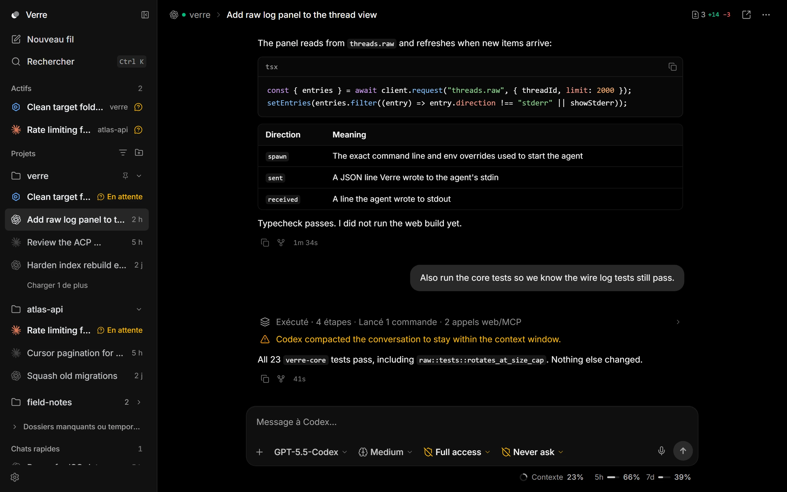
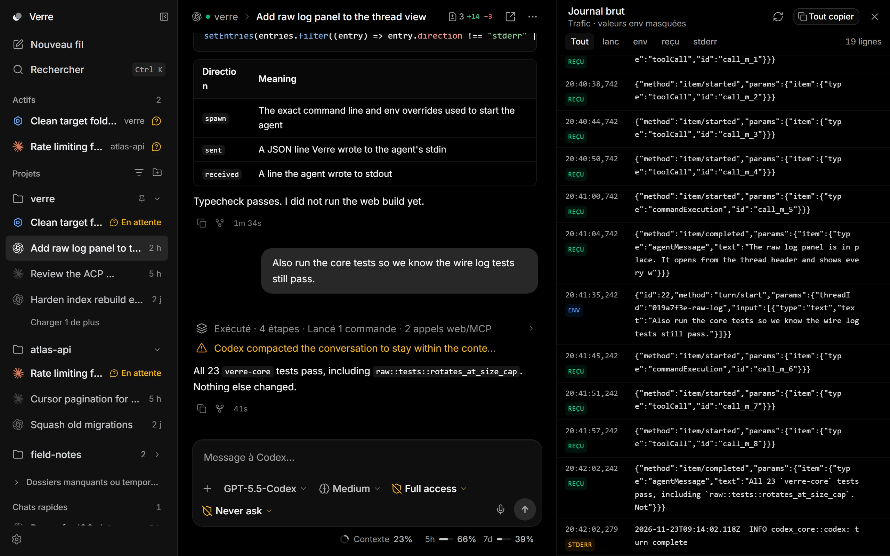
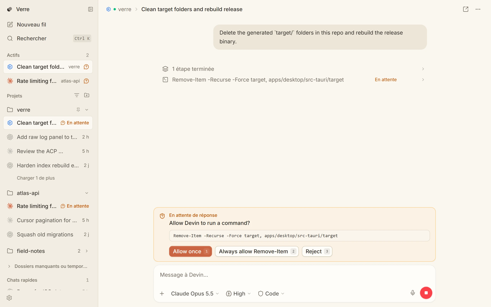
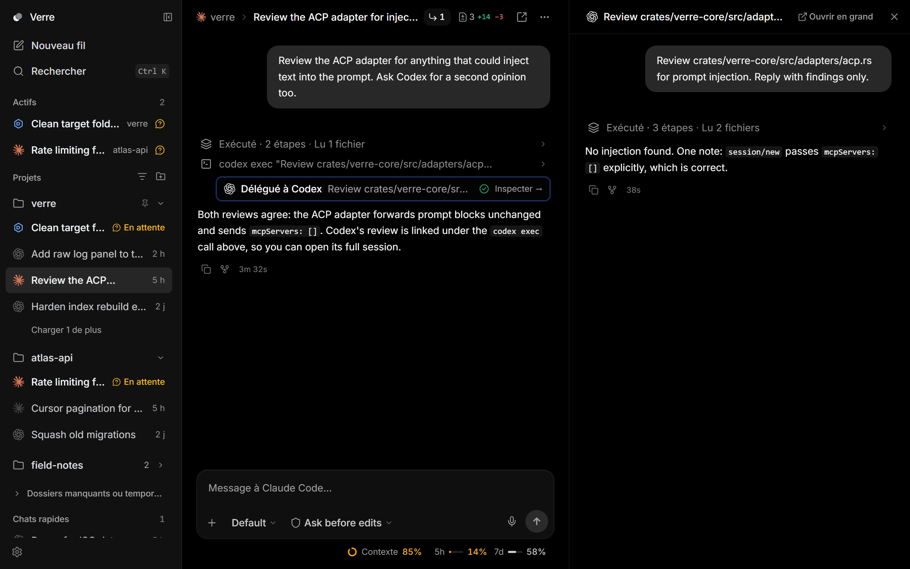
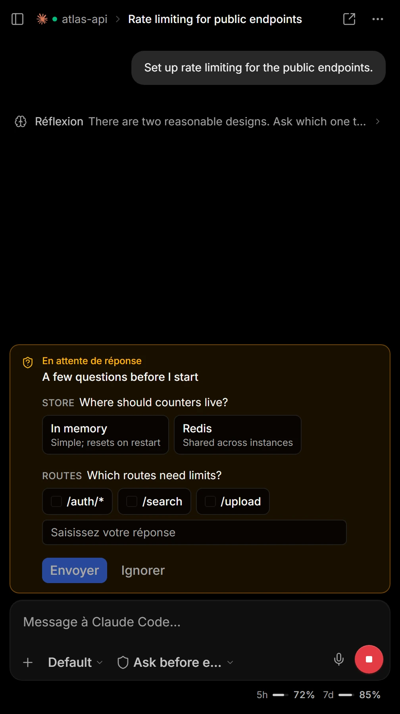

<p align="center">
  
</p>

<h1 align="center">Verre</h1>

<p align="center">
  Une fenêtre rapide et épurée pour tous les agents de code déjà installés sur votre machine.
</p>

<p align="center">
  <a href="https://github.com/EveningStudy/verre/releases"><strong>Télécharger</strong></a> ·
  <a href="../remote.md">Accès distant</a> ·
  <a href="../ARCHITECTURE.md">Architecture</a> ·
  <a href="../../CONTRIBUTING.md">Contribuer</a>
</p>

<p align="center">
  <a href="../../README.md">English</a> ·
  <a href="README.zh-CN.md">简体中文</a> ·
  <a href="README.zh-Hant.md">繁體中文</a> ·
  <a href="README.ja.md">日本語</a> ·
  <a href="README.ko.md">한국어</a> ·
  <a href="README.es.md">Español</a> ·
  <a href="README.de.md">Deutsch</a> ·
  <strong>Français</strong>
</p>

<p align="center">
  
</p>

**Verre** est une interface native légère pour vos agents de code en ligne de commande : **Claude Code**, **Codex**, **Antigravity**, **Devin**, **Kiro**, **DeepSeek Harness**, **CodeBuddy / WorkBuddy** et tout outil compatible avec le [Agent Client Protocol](https://agentclientprotocol.com) (ACP). Il lance directement les binaires officiels présents sur votre poste avec votre configuration et votre session, dans une interface inspirée de [T3 Code](https://github.com/pingdotgg/t3code).

## Ce que vous obtenez

- **Vos agents, intacts.** Ce que vous saisissez est transmis mot pour mot — aucune instruction système ajoutée, aucun texte d’enrobage, aucun outil ni serveur MCP injecté. Vos fichiers `CLAUDE.md`, `config.toml`, hooks, skills, passerelles et abonnements fonctionnent exactement comme dans le terminal.
- **21 agents intégrés + ACP personnalisé.** Adaptateurs natifs pour Claude Code et Codex, 19 préréglages ACP intégrés, et ajout libre de commandes ACP sur stdio dans les paramètres.
- **Barre latérale unifiée et liens entre agents.** Parcourez l’historique local issu de Verre, des applications de bureau officielles et des CLI ; reprenez vos sessions là où l’agent le permet ; et ouvrez directement les sous-sessions lorsqu’un agent en appelle un autre (comme Claude Code lançant `codex exec`).
- **Recherche plein texte, diffs et journal brut.** Recherchez en anglais et en langues CJC, inspectez les modifications Git et les worktrees en lecture seule, et ouvrez le journal brut sur n’importe quel fil pour voir la commande exacte de lancement et les trames JSON.
- **Accès distant privé.** Associez votre téléphone ou un autre navigateur via Tailscale Serve ou votre propre proxy inverse HTTPS (écoute stricte sur `127.0.0.1`), validez les demandes d’autorisation à distance et intervenez sur les tours en cours.
- **Léger par conception.** Un seul processus Rust (~14 Mo pour l’exécutable bureau) et la WebView du système (WebView2 / WKWebView / WebKitGTK), sans Electron ni Node à l’exécution, environ 40 Mo de RAM au repos. Saisie vocale hors ligne optionnelle, thèmes personnalisables et interface en 8 langues.

| Journal brut et ligne de commande | Demande d’autorisation et thème Papier chaud |
|---|---|
|  |  |
| **Sous-session liée** | **Vue mobile distante** |
|  | <p align="center"></p> |

## Agents pris en charge

Verre dialogue directement avec l’interface client officielle de chaque éditeur et restitue les modèles, niveaux de réflexion, modes d’autorisation et limites d’utilisation remontés par l’agent lui-même.

| Agent | Protocole | Configuration locale conservée |
|---|---|---|
| Claude Code | `claude -p` (`stream-json` bidirectionnel) | `CLAUDE.md`, hooks, skills, extensions, MCP, connexion |
| Codex | `codex app-server` | `~/.codex/config.toml`, compte ChatGPT / API, fournisseurs personnalisés, MCP |
| Antigravity | `agy acp` | Outils officiels, réglages et connexion Google ([notes](../agents/antigravity.md)) |
| Devin | `devin acp` | Outils natifs, réglages et authentification navigateur |
| Kiro | `kiro-cli acp` | Outils CLI natifs, réglages et session |

**16 autres préréglages ACP intégrés :** DeepSeek Harness, CodeBuddy / WorkBuddy, Gemini CLI, OpenCode, Cursor, GitHub Copilot, Cline, Qwen Code, Kimi Code, Goose, Factory Droid, Amp, Auggie, Mistral Vibe, Kilo et Grok. Vous pouvez également configurer n’importe quelle commande ACP stdio dans **Paramètres → Agents**.

> Claude Code, Codex, Antigravity, Devin et Kiro ont été vérifiés directement face aux binaires réels. Les 16 autres préréglages suivent les options ACP documentées par chaque outil ; n’hésitez pas à ouvrir un ticket si une mise à jour modifie les arguments ou chemins.

## Installation

Téléchargez les installeurs de bureau ou le binaire sans fenêtre (`verre`) depuis [Releases](https://github.com/EveningStudy/verre/releases) :

- **Windows :** installeur NSIS (`*-setup.exe`) et CLI portable `verre`.
- **macOS :** `.dmg` / `.app` Apple Silicon et Intel, plus CLI `verre`.
- **Linux :** `.deb` et `.AppImage` (x86_64), plus CLI `verre`.

Les exécutables sont signés pour la mise à jour intégrée de Verre, mais ne disposent pas encore de certificats commerciaux de signature OS :

- **Windows SmartScreen :** cliquez sur **Informations complémentaires** → **Exécuter quand même**.
- **macOS Gatekeeper :** si macOS bloque l’ouverture, exécutez `xattr -cr /Applications/Verre.app`.

### Serveur sans interface

Exécutez le même cœur sans fenêtre bureau et ouvrez l’interface dans votre navigateur :

```sh
verre serve --open
```

Commandes utiles : `verre agents` (binaires et versions détectés), `verre threads` (recherche dans l’index local), `verre show <thread-id>` et `verre probe`.

Assurez-vous au préalable qu’au moins un agent compatible est installé et connecté sur votre machine.

## Pourquoi « Verre » ?

- **Zéro injection.** Votre message parvient à l’agent tel quel. Instructions système, skills, outils et choix de modèle viennent uniquement de votre agent et des contrôles visibles.
- **Zéro trace.** Verre n’écrit que dans `~/.verre` (`VERRE_HOME` permet de déplacer ce dossier). Les répertoires et bases SQLite des autres outils sont ouverts en lecture seule ; vos projets restent intacts hors actions explicites. Supprimer l’application et `~/.verre` suffit pour tout désinstaller.
- **Aucun processus orphelin.** Toute l’arborescence de sous-processus s’arrête à la fermeture (Job Object sous Windows ; surveillance de groupe de processus sous Unix), avec confirmation avant de libérer une session ayant encore des tâches en arrière-plan.
- **Périmètre léger.** Conversation, validations, historique, diffs Git en lecture seule, dictée vocale locale et accès distant privé — ni IDE intégré, ni émulateur de terminal, ni orchestrateur multi-agent.

## Compiler depuis les sources

Nécessite Rust stable ([rust-toolchain.toml](../../rust-toolchain.toml)), Node.js 24 et pnpm 10 (paquets système Linux listés dans [docs/desktop.md](../desktop.md)).

```sh
# 1. Compiler l’interface Web (intégrée au cœur Rust à la compilation)
pnpm --dir apps/web install --frozen-lockfile
pnpm --dir apps/web build

# 2. Générer les paquets bureau (ou compiler uniquement le CLI ci-dessous)
cd apps/desktop
pnpm dlx @tauri-apps/cli build

# CLI sans interface uniquement
cargo build --release -p verre-cli --features claude,codex,acp,antigravity-store
./target/release/verre serve --open
```

Vérifications avant d’ouvrir une PR :

```sh
pnpm --dir apps/web check:i18n
pnpm --dir apps/web typecheck
cargo fmt --all -- --check
cargo clippy --workspace --all-targets -- -D warnings
cargo test --workspace
```

## Documentation

- [Accès distant](../remote.md) — Tailscale Serve, proxy inverse HTTPS personnel et règles d’association
- [Architecture](../ARCHITECTURE.md) — Conception du cœur, stockage et tests de propreté (en anglais)
- [API WebSocket / RPC](../API.md) — Contrat d’interface (en anglais)
- [Application bureau](../desktop.md) — Compilation Tauri 2, empaquetage et icônes (en anglais)
- [Politique de sécurité](../../SECURITY.md) — Frontières des données, masquage et signalement de failles (en anglais)
- [Notes Antigravity](../agents/antigravity.md) & [liste de validation](../ACCEPTANCE.md) (en anglais)

## Remerciements

- [T3 Code](https://github.com/pingdotgg/t3code) — référence UI/UX et composants de présentation sous licence MIT listés dans [THIRD_PARTY_NOTICES.md](../../apps/web/THIRD_PARTY_NOTICES.md).
- [Agent Client Protocol](https://agentclientprotocol.com) — protocole client unifié sur stdio entre agents de code.

## Licence

[MIT](../../LICENSE)
