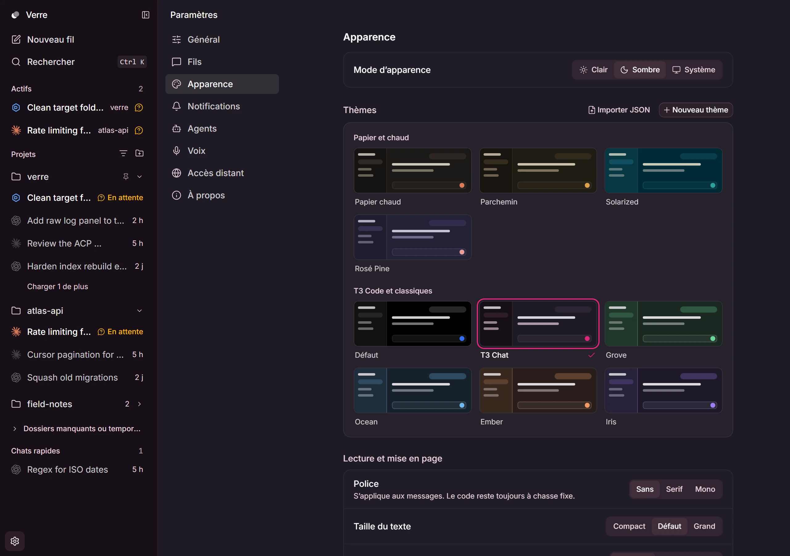

<p align="center">
  
</p>

<h1 align="center">Verre</h1>

<p align="center">
  Une fenêtre rapide et épurée pour tous les agents de code sur votre machine.
</p>

<p align="center">
  <a href="https://github.com/EveningStudy/verre/releases"><strong>Télécharger</strong></a> ·
  <a href="../remote.md">Accès distant</a> ·
  <a href="../ARCHITECTURE.md">Architecture</a> ·
  <a href="../../CONTRIBUTING.md">Contribuer</a>
</p>

<p align="center">
  <a href="../../README.md">English</a> ·
  <a href="README.zh-CN.md">简体中文</a> ·
  <a href="README.zh-Hant.md">繁體中文</a> ·
  <a href="README.ja.md">日本語</a> ·
  <a href="README.ko.md">한국어</a> ·
  <a href="README.es.md">Español</a> ·
  <a href="README.de.md">Deutsch</a> ·
  <strong>Français</strong>
</p>

<p align="center">
  
</p>

**Verre** est une interface native légère pour **21 agents de code intégrés** — dont **Claude Code**, **Codex**, **Cursor**, **Antigravity**, **Gemini CLI**, **DeepSeek Harness**, **Grok**, **GitHub Copilot**, **OpenCode**, **Cline**, **CodeBuddy / WorkBuddy**, **Kiro** et **Devin** — ainsi que tout outil compatible avec le [Agent Client Protocol](https://agentclientprotocol.com) (ACP), dans une interface inspirée de [T3 Code](https://github.com/pingdotgg/t3code).

## Pourquoi « Verre »

- **Transparent comme le verre.** Vos messages arrivent intacts au binaire officiel : aucune instruction système ajoutée, aucun enrobage, aucun serveur MCP injecté. Vos fichiers `CLAUDE.md`, `config.toml`, hooks, skills, passerelles et quotas fonctionnent comme dans le terminal, et le journal brut montre chaque trame échangée.
- **Zéro trace, sortie propre.** Verre écrit uniquement dans `~/.verre` (`VERRE_HOME` permet de changer ce dossier), lit les autres bases en lecture seule, laisse vos projets intacts et ferme toute son arborescence de sous-processus à la sortie. Supprimer l’app et `~/.verre` suffit pour tout désinstaller.
- **Une barre latérale unifiée.** Parcourez les sessions locales issues de Verre, des apps officielles et des CLI, recherchez en anglais et CJC, et ouvrez directement les sous-sessions liées (par exemple quand Claude Code lance `codex exec`).
- **Accès distant privé.** Associez un téléphone ou un navigateur via Tailscale Serve ou votre propre proxy inverse HTTPS (`127.0.0.1` uniquement), approuvez des actions à distance et intervenez en cours de tour.
- **Socle natif léger.** Un seul cœur Rust (~14 Mo) et la WebView du système (~40 Mo de RAM au repos, sans Electron ni Node), avec diffs Git en lecture seule, 10 thèmes intégrés et personnalisés, dictée vocale hors ligne optionnelle et 8 langues d’interface.

| Journal brut et ligne de commande | Demande d’autorisation et thème Papier chaud |
|---|---|
|  |  |
| **Sous-session liée** | **Thèmes intégrés et personnalisés** |
|  |  |

<p align="center">
  
</p>

## Agents pris en charge

Verre lance directement l’interface CLI officielle de chaque agent tout en conservant votre configuration et votre session :

| Agent | Protocole | Ce qui reste actif |
|---|---|---|
| **Claude Code** | `claude -p` (`stream-json`) | `CLAUDE.md`, hooks, skills, extensions, MCP, connexion |
| **Codex** | `codex app-server` | `~/.codex/config.toml`, compte ChatGPT / API, fournisseurs personnalisés, MCP |
| **19 agents ACP intégrés**<br>Cursor, Antigravity, Gemini CLI, GitHub Copilot, DeepSeek Harness, Grok, OpenCode, Cline, CodeBuddy / WorkBuddy, Qwen Code, Kimi Code, Kiro, Devin, Goose, Factory Droid, Amp, Auggie, Mistral Vibe, Kilo | ACP officiel (`acp` / `--acp` / `--profile acp`) | Outils, réglages et authentification propres à chaque agent |
| **ACP personnalisé** | Toute commande ACP stdio | Ajoutée dans **Paramètres → Agents** |

## Installation

Téléchargez les installeurs de bureau ou le binaire `verre` CLI depuis [Releases](https://github.com/EveningStudy/verre/releases) :

- **Windows :** installeur NSIS (`*-setup.exe`) et CLI portable `verre`.
- **macOS :** `.dmg` / `.app` Apple Silicon et Intel, plus CLI `verre`.
- **Linux :** `.deb` et `.AppImage` (x86_64), plus CLI `verre`.

Les exécutables sont signés pour la mise à jour intégrée de Verre, sans certificat commercial de signature OS pour l’instant :

- **Windows SmartScreen :** cliquez sur **Informations complémentaires** → **Exécuter quand même**.
- **macOS Gatekeeper :** si macOS bloque l’ouverture, exécutez `xattr -cr /Applications/Verre.app`.

### Serveur sans interface

Lancez le même cœur sans fenêtre bureau et ouvrez l’UI dans votre navigateur :

```sh
verre serve --open
```

Commandes utiles : `verre agents`, `verre threads`, `verre show <thread-id>` et `verre probe`. Assurez-vous qu’au moins un agent compatible est installé et connecté sur votre machine.

## Compiler depuis les sources

Nécessite Rust stable ([rust-toolchain.toml](../../rust-toolchain.toml)), Node.js 24 et pnpm 10 (paquets système Linux listés dans [docs/desktop.md](../desktop.md)).

```sh
# 1. Compiler l’interface Web (intégrée au cœur Rust à la compilation)
pnpm --dir apps/web install --frozen-lockfile
pnpm --dir apps/web build

# 2. Générer les paquets bureau (ou compiler uniquement le CLI ci-dessous)
cd apps/desktop
pnpm dlx @tauri-apps/cli build

# CLI sans interface uniquement
cargo build --release -p verre-cli --features claude,codex,acp,antigravity-store
./target/release/verre serve --open
```

Vérifications avant d’ouvrir une PR :

```sh
pnpm --dir apps/web check:i18n
pnpm --dir apps/web typecheck
cargo fmt --all -- --check
cargo clippy --workspace --all-targets -- -D warnings
cargo test --workspace
```

## Documentation

- [Accès distant](../remote.md) — Tailscale Serve, proxy inverse HTTPS personnel et règles d’association
- [Architecture](../ARCHITECTURE.md) — Conception du cœur, stockage et tests de propreté (en anglais)
- [API WebSocket / RPC](../API.md) — Contrat d’interface (en anglais)
- [Application bureau](../desktop.md) — Compilation Tauri 2, empaquetage et icônes (en anglais)
- [Politique de sécurité](../../SECURITY.md) — Frontières des données, masquage et signalement de failles (en anglais)
- [Notes Antigravity](../agents/antigravity.md) & [liste de validation](../ACCEPTANCE.md) (en anglais)

## Remerciements

- [T3 Code](https://github.com/pingdotgg/t3code) — référence UI/UX et composants de présentation sous licence MIT listés dans [THIRD_PARTY_NOTICES.md](../../apps/web/THIRD_PARTY_NOTICES.md).
- [Agent Client Protocol](https://agentclientprotocol.com) — protocole client unifié sur stdio entre agents de code.

## Licence

[MIT](../../LICENSE)
