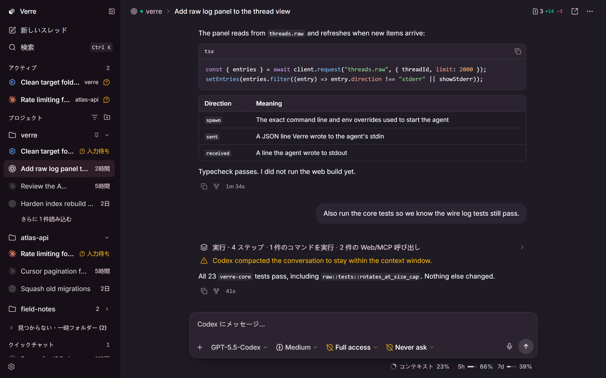
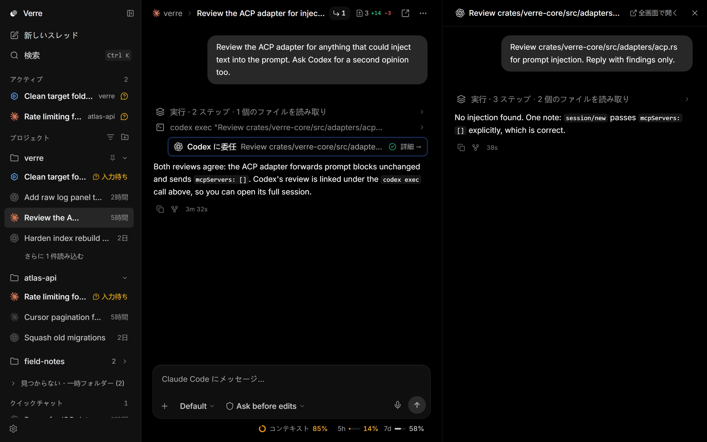
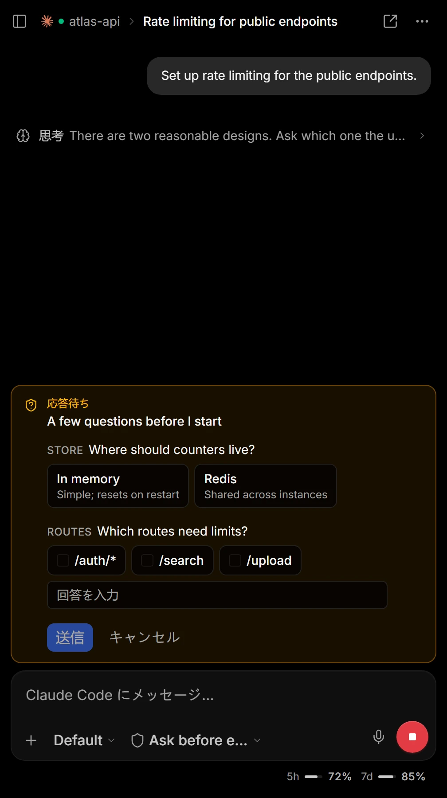

<p align="center">
  
</p>

<h1 align="center">Verre</h1>

<p align="center">
  手元のマシンに導入済みのコーディングエージェントを、ひとつの軽快なウィンドウで。
</p>

<p align="center">
  <a href="https://github.com/EveningStudy/verre/releases"><strong>ダウンロード</strong></a> ·
  <a href="../remote.md">リモートアクセス</a> ·
  <a href="../ARCHITECTURE.md">アーキテクチャ</a> ·
  <a href="../../CONTRIBUTING.md">コントリビュート</a>
</p>

<p align="center">
  <a href="../../README.md">English</a> ·
  <a href="README.zh-CN.md">简体中文</a> ·
  <a href="README.zh-Hant.md">繁體中文</a> ·
  <strong>日本語</strong> ·
  <a href="README.ko.md">한국어</a> ·
  <a href="README.es.md">Español</a> ·
  <a href="README.de.md">Deutsch</a> ·
  <a href="README.fr.md">Français</a>
</p>

<p align="center">
  
</p>

Verre（フランス語で「ガラス」の意、発音は vair）は、ローカルの CLI コーディングエージェント向けの軽量なネイティブフロントエンドです。**Claude Code**、**Codex**、**Antigravity**、**Devin**、**Kiro**、**DeepSeek Harness**、**CodeBuddy / WorkBuddy**、さらに [Agent Client Protocol](https://agentclientprotocol.com)（ACP）対応のあらゆるエージェントを、既存の認証・設定のまま起動し、[T3 Code](https://github.com/pingdotgg/t3code) をベースにした統一 UI で扱えます。

## 主な特徴

- **エージェントを書き換えない。** 入力内容は一字一句そのまま送信され、システムプロンプト、ラッパー指示、独自ツールや MCP は一切注入しません。`CLAUDE.md`、`config.toml`、hooks、skills、カスタムゲートウェイ、各社のサブスクリプションも端末と同様に動きます。
- **21 の組み込みエージェント + カスタム ACP。** Claude Code と Codex のネイティブアダプターに加え、19 の ACP プリセットを内蔵。設定から任意の stdio ACP コマンドも追加できます。
- **統合サイドバーとエージェント間リンク。** Verre だけでなく各社公式アプリや CLI が保存したローカル履歴も一覧・検索でき、対応ランタイムではそのまま再開可能。あるエージェントが別のエージェント（例：Claude Code が `codex exec`）を呼び出した場合、子セッションがツール呼び出しの直下に紐づきます。
- **全文検索・差分表示・生プロトコルログ。** 英語および CJK の全文検索、読み取り専用の Git 差分／Worktree 確認に加え、任意のスレッドで起動コマンドと JSON フレームをそのまま確認できる生ログパネルを備えています。
- **プライベートなリモート操作。** Tailscale Serve や自前の HTTPS リバースプロキシ経由でスマートフォンや別ブラウザーをペアリング可能（サーバーは `127.0.0.1` のみ待ち受け）。外出先から承認や割り込み送信を行えます。
- **軽量設計。** 単一の Rust プロセス（デスクトップ実行ファイル約 14 MB）と OS 標準の WebView（WebView2 / WKWebView / WebKitGTK）のみで構成。Electron や Node は不要で待機時メモリは約 40 MB。ローカル音声入力、カスタムテーマ、8 言語 UI に対応しています。

| 生プロトコルログと起動コマンド | 承認プロンプトとウォームペーパーテーマ |
|---|---|
|  |  |
| **リンクされた子セッション** | **モバイル向けリモート画面** |
|  | <p align="center"></p> |

## 対応エージェント

各ベンダーの公式クライアントプロトコルへ直接接続するため、モデル一覧・思考レベル・権限モード・レート制限はエージェント自身が返す値がそのまま表示されます。

| エージェント | プロトコル | 維持されるローカル設定 |
|---|---|---|
| Claude Code | `claude -p`（双方向 `stream-json`） | `CLAUDE.md`、hooks、skills、プラグイン、MCP、ログイン状態 |
| Codex | `codex app-server` | `~/.codex/config.toml`、ChatGPT / API ログイン、カスタムプロバイダー、MCP |
| Antigravity | `agy acp` | 公式ツール・設定・Google サインイン（[詳細](../agents/antigravity.md)） |
| Devin | `devin acp` | ネイティブツール・設定・ブラウザー認証 |
| Kiro | `kiro-cli acp` | ネイティブ CLI ツール・設定・認証 |

**その他の組み込み ACP プリセット（16 種）：** DeepSeek Harness、CodeBuddy / WorkBuddy、Gemini CLI、OpenCode、Cursor、GitHub Copilot、Cline、Qwen Code、Kimi Code、Goose、Factory Droid、Amp、Auggie、Mistral Vibe、Kilo、Grok。**設定 → エージェント**から独自の stdio ACP コマンドも登録できます。

> Claude Code、Codex、Antigravity、Devin、Kiro は実機バイナリで直接動作確認済みです。残りの 16 プリセットは各ツールの公開 ACP フラグ（`--acp` / `acp` / `--profile acp`）に合わせて定義しているため、バージョン変更に伴うフラグ差異があれば Issue でお知らせください。

## インストール

[Releases](https://github.com/EveningStudy/verre/releases) からプラットフォーム向けのインストーラーまたはヘッドレス版 `verre` CLI をダウンロードしてください：

- **Windows:** NSIS インストーラー（`*-setup.exe`）および単体 `verre` CLI。
- **macOS:** Apple Silicon / Intel 向け `.dmg`・`.app` および `verre` CLI。
- **Linux:** `.deb`・`.AppImage`（x86_64）および `verre` CLI。

バイナリにはアプリ内アップデーター用の署名のみが付与されており、商用の OS コード署名証明書はまだ組み込まれていません：

- **Windows SmartScreen:** **詳細情報** → **実行** を選択してください。
- **macOS Gatekeeper:** 開発元を確認できないと表示される場合は、ターミナルで `xattr -cr /Applications/Verre.app` を実行してください。

### ヘッドレスモード

ウィンドウを開かず同じコアを起動し、ブラウザーから利用します：

```sh
verre serve --open
```

主なサブコマンド：`verre agents`（検出されたバイナリとバージョン）、`verre threads`（ローカルインデックス検索）、`verre show <thread-id>`、`verre probe`。

利用前に、対象となるエージェントを少なくとも 1 つローカルへインストールし、サインインを完了しておいてください。

## なぜ「ガラス（Verre）」なのか

- **ゼロ注入。** 入力したテキストを加工せずに渡します。システムプロンプトやスキル、モデル設定はすべて各エージェント側と明示的な操作に委ねます。
- **ゼロフットプリント。** Verre が書き込む先は `~/.verre`（`VERRE_HOME` で変更可）のみ。他ツールの設定フォルダーや SQLite DB は読み取り専用で開き、ワークスペースへ隠し設定を書き込むことはありません。アンインストールはアプリ本体と `~/.verre` を消すだけです。
- **孤立プロセスを残さない。** Verre 終了時に管理下の子プロセスツリーをすべて停止します（Windows Job Object / Unix プロセスグループ監視）。バックグラウンド処理が動いている場合は解放・終了前に確認を出します。
- **薄いクライアントに徹する。** 会話、権限承認、履歴、読み取り専用の差分確認、ローカル音声入力、プライベートなリモート接続に特化し、IDE やターミナルエミュレーター、ワークフロー制御ツールには拡張しません。

## ソースからのビルド

安定版 Rust（[rust-toolchain.toml](../../rust-toolchain.toml)）、Node.js 24、pnpm 10 が必要です（Linux の依存パッケージは [docs/desktop.md](../desktop.md) を参照）。

```sh
# 1. Web UI をビルド（コンパイル時に Rust コアへ埋め込まれます）
pnpm --dir apps/web install --frozen-lockfile
pnpm --dir apps/web build

# 2. デスクトップ版をビルド（ヘッドレス版のみの場合は下段を実行）
cd apps/desktop
pnpm dlx @tauri-apps/cli build

# ヘッドレス CLI のみ
cargo build --release -p verre-cli --features claude,codex,acp,antigravity-store
./target/release/verre serve --open
```

PR 前のチェックコマンド：

```sh
pnpm --dir apps/web check:i18n
pnpm --dir apps/web typecheck
cargo fmt --all -- --check
cargo clippy --workspace --all-targets -- -D warnings
cargo test --workspace
```

## ドキュメント

- [リモートアクセス](../remote.md) — Tailscale Serve、HTTPS リバースプロキシ、ペアリング権限制御
- [アーキテクチャ](../ARCHITECTURE.md) — コア構造、ストレージ設計、テスト構成（英語）
- [WebSocket / RPC API](../API.md) — UI 通信仕様（英語）
- [デスクトップシェル](../desktop.md) — Tauri 2 ビルドとプラットフォーム別パッケージ（英語）
- [セキュリティポリシー](../../SECURITY.md) — データ境界、マスキング規則、脆弱性報告（英語）
- [Antigravity ノート](../agents/antigravity.md) & [受け入れテスト項目](../ACCEPTANCE.md)（英語）

## 謝辞

- [T3 Code](https://github.com/pingdotgg/t3code) — UI/UX の基準であり、MIT ライセンスで移植したプレゼンテーションコンポーネントは [THIRD_PARTY_NOTICES.md](../../apps/web/THIRD_PARTY_NOTICES.md) に記載しています。
- [Agent Client Protocol](https://agentclientprotocol.com) — エージェント間を共通プロトコルで接続する仕組みを提供しています。

## ライセンス

[MIT](../../LICENSE)
