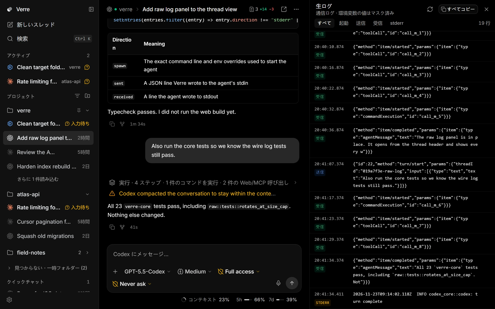
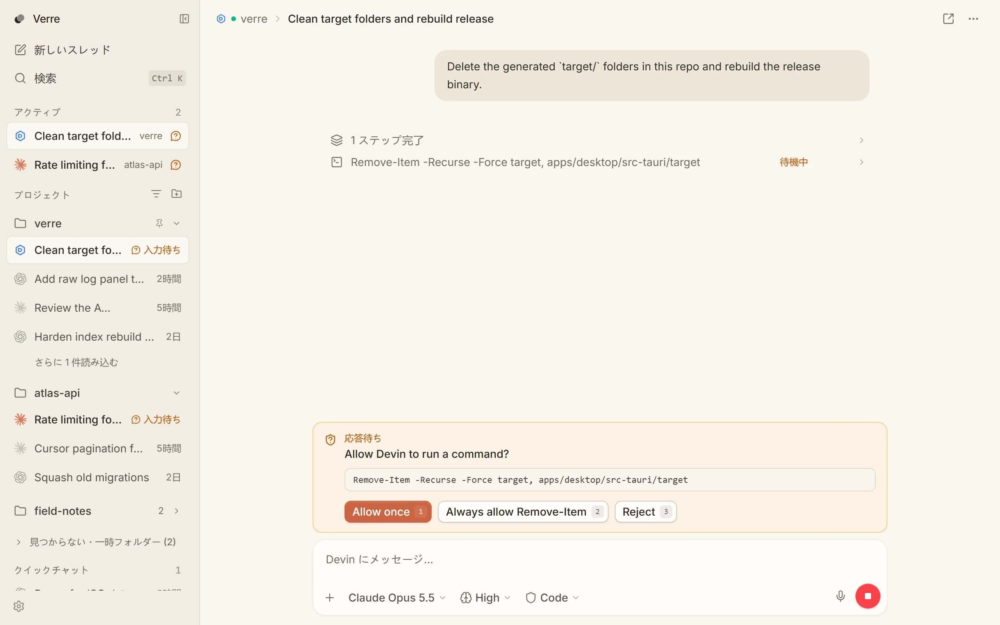
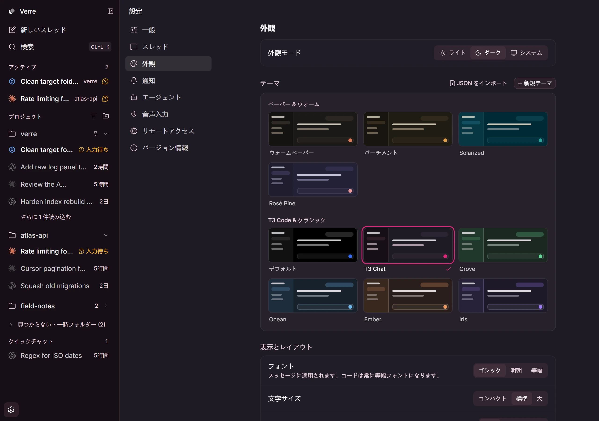

<p align="center">
  
</p>

<h1 align="center">Verre</h1>

<p align="center">
  手元のマシンに導入済みのコーディングエージェントを、ひとつの軽快なウィンドウで。
</p>

<p align="center">
  <a href="https://github.com/EveningStudy/verre/releases"><strong>ダウンロード</strong></a> ·
  <a href="../remote.md">リモートアクセス</a> ·
  <a href="../ARCHITECTURE.md">アーキテクチャ</a> ·
  <a href="../../CONTRIBUTING.md">コントリビュート</a>
</p>

<p align="center">
  <a href="../../README.md">English</a> ·
  <a href="README.zh-CN.md">简体中文</a> ·
  <a href="README.zh-Hant.md">繁體中文</a> ·
  <strong>日本語</strong> ·
  <a href="README.ko.md">한국어</a> ·
  <a href="README.es.md">Español</a> ·
  <a href="README.de.md">Deutsch</a> ·
  <a href="README.fr.md">Français</a>
</p>

<p align="center">
  
</p>

**Verre**（フランス語で「ガラス」、発音は vair）は、**21 の組み込みコーディングエージェント**（**Claude Code**、**Codex**、**Cursor**、**Antigravity**、**Gemini CLI**、**DeepSeek Harness**、**Grok**、**GitHub Copilot**、**OpenCode**、**Cline**、**CodeBuddy / WorkBuddy**、**Kiro**、**Devin** など）とあらゆる [Agent Client Protocol](https://agentclientprotocol.com)（ACP）ツールに対応した軽量ネイティブ UI です。[T3 Code](https://github.com/pingdotgg/t3code) をベースに設計されています。

## なぜ「ガラス（Verre）」なのか

- **ガラスのように透過。** 入力したテキストを公式バイナリへそのまま届けます。システムプロンプトやラッパー、余計な MCP サーバーは一切注入せず、`CLAUDE.md`・`config.toml`・hooks・skills・独自ゲートウェイやレート制限も端末どおりに動き、生ログパネルで全フレームを確認できます。
- **軽量ネイティブ構成。** 単一 Rust コア（約 14 MB）と OS 標準 WebView（待機時約 40 MB、Electron / Node 不使用）で動作し、読み取り専用 Git 差分、10 種のテーマ、オフライン音声入力、8 言語 UI を備えています。
- **痕跡ゼロ・後腐れなし。** Verre が書くのは `~/.verre`（`VERRE_HOME` で変更可）だけ。他ツールの履歴 DB は読み取り専用で開き、プロジェクトを汚さず、終了時は子プロセスツリーもすべて停止します。アンインストールはアプリと `~/.verre` を消すだけです。
- **ツール横断の単一サイドバー。** Verre や各社公式アプリ・CLI のローカル履歴をまとめて表示し、英語・CJK の全文検索や、Claude Code が起動した `codex exec` のような子セッションへのジャンプも行えます。
- **プライベートなリモート操作。** Tailscale Serve や自前の HTTPS リバースプロキシ経由でスマートフォンやブラウザーをペアリング可能（`127.0.0.1` のみ待機）。移動中でも承認や割り込み送信ができます。

| 生プロトコルログと起動コマンド | 承認カードとウォームペーパーテーマ |
|---|---|
|  |  |
| **リンクされた子セッション** | **組み込み・カスタムテーマ** |
|  |  |

<p align="center">
  
</p>

## 対応エージェント

Verre は各エージェントの公式プロトコルを既存の設定・認証のまま直接起動します：

| エージェント | プロトコル | 維持されるローカル設定 |
|---|---|---|
| **Claude Code** | `claude -p`（双方向 `stream-json`） | `CLAUDE.md`、hooks、skills、プラグイン、MCP、サインイン |
| **Codex** | `codex app-server` | `~/.codex/config.toml`、ChatGPT / API ログイン、独自プロバイダー、MCP |
| **19 の組み込み ACP エージェント**<br>Cursor、Antigravity、Gemini CLI、GitHub Copilot、DeepSeek Harness、Grok、OpenCode、Cline、CodeBuddy / WorkBuddy、Qwen Code、Kimi Code、Kiro、Devin、Goose、Factory Droid、Amp、Auggie、Mistral Vibe、Kilo | 公式 ACP（`acp` / `--acp` / `--profile acp`） | 各エージェントのネイティブツール・設定・認証 |
| **カスタム ACP** | 任意の stdio ACP コマンド | **設定 → エージェント**から追加 |

## インストール

[Releases](https://github.com/EveningStudy/verre/releases) からインストーラーまたはヘッドレス版 `verre` CLI をダウンロードしてください：

- **Windows:** NSIS インストーラー（`*-setup.exe`）および単体 `verre` CLI。
- **macOS:** Apple Silicon / Intel 向け `.dmg`・`.app` および `verre` CLI。
- **Linux:** `.deb`・`.AppImage`（x86_64）および `verre` CLI。

バイナリにはアプリ内アップデーター用の署名のみが付与されており、商用の OS コード署名証明書はまだ組み込まれていません：

- **Windows SmartScreen:** **詳細情報** → **実行** を選択してください。
- **macOS Gatekeeper:** 未確認の開発元と表示される場合は `xattr -cr /Applications/Verre.app` を実行してください。

### ヘッドレスモード

ウィンドウを開かず同じコアを起動し、ブラウザーから利用します：

```sh
verre serve --open
```

主なサブコマンド：`verre agents`、`verre threads`、`verre show <thread-id>`、`verre probe`。利用前に少なくとも 1 つの対応エージェントをインストールしてサインインしておいてください。

## ソースからのビルド

安定版 Rust（[rust-toolchain.toml](../../rust-toolchain.toml)）、Node.js 24、pnpm 10 が必要です（Linux の依存パッケージは [docs/desktop.md](../desktop.md) を参照）。

```sh
# 1. Web UI をビルド（コンパイル時に Rust コアへ埋め込まれます）
pnpm --dir apps/web install --frozen-lockfile
pnpm --dir apps/web build

# 2. デスクトップ版をビルド（ヘッドレス版のみの場合は下段を実行）
cd apps/desktop
pnpm dlx @tauri-apps/cli build

# ヘッドレス CLI のみ
cargo build --release -p verre-cli --features claude,codex,acp,antigravity-store
./target/release/verre serve --open
```

PR 前のチェックコマンド：

```sh
pnpm --dir apps/web check:i18n
pnpm --dir apps/web typecheck
cargo fmt --all -- --check
cargo clippy --workspace --all-targets -- -D warnings
cargo test --workspace
```

## ドキュメント

- [リモートアクセス](../remote.md) — Tailscale Serve、HTTPS リバースプロキシ、ペアリング権限制御
- [アーキテクチャ](../ARCHITECTURE.md) — コア構造、ストレージ設計、テスト構成（英語）
- [WebSocket / RPC API](../API.md) — UI 通信仕様（英語）
- [デスクトップシェル](../desktop.md) — Tauri 2 ビルドとプラットフォーム別パッケージ（英語）
- [セキュリティポリシー](../../SECURITY.md) — データ境界、マスキング規則、脆弱性報告（英語）
- [Antigravity ノート](../agents/antigravity.md) & [受け入れテスト項目](../ACCEPTANCE.md)（英語）

## 謝辞

- [T3 Code](https://github.com/pingdotgg/t3code) — UI/UX の基準であり、MIT ライセンスで移植したプレゼンテーションコンポーネントは [THIRD_PARTY_NOTICES.md](../../apps/web/THIRD_PARTY_NOTICES.md) に記載しています。
- [Agent Client Protocol](https://agentclientprotocol.com) — エージェント間を共通プロトコルで接続する仕組みを提供しています。

## ライセンス

[MIT](../../LICENSE)
