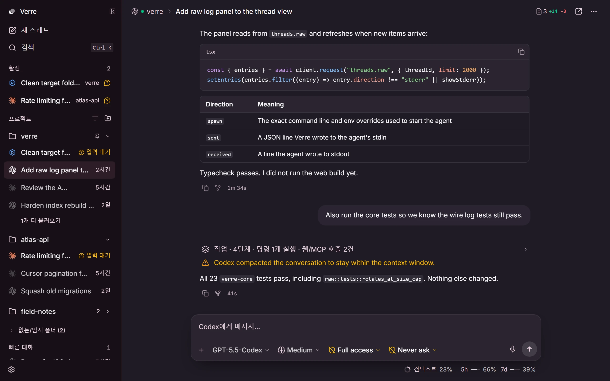
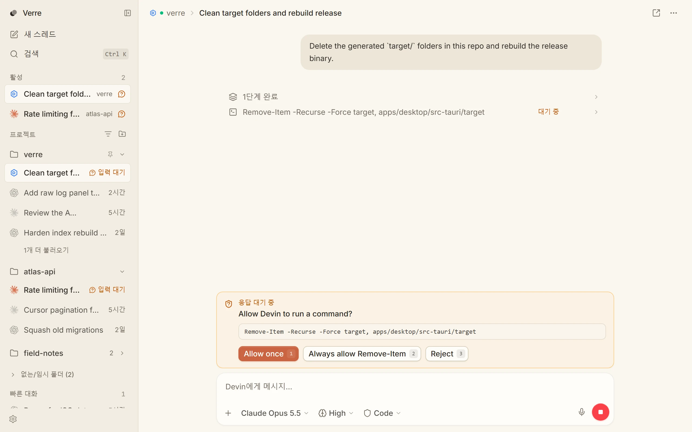
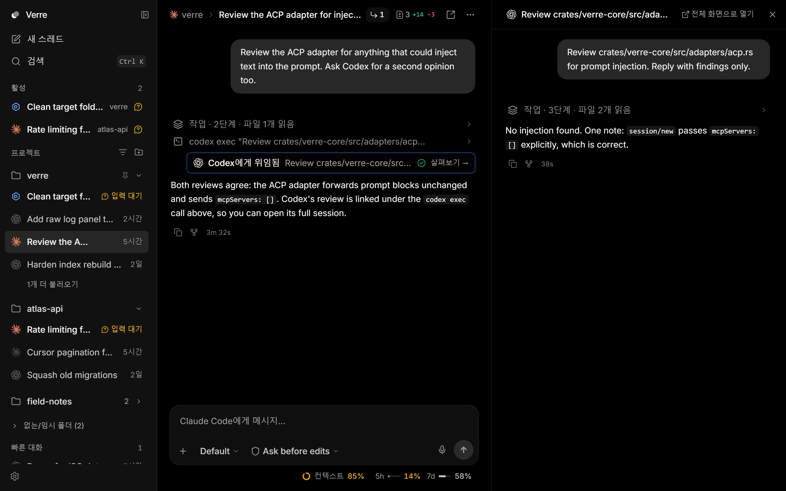
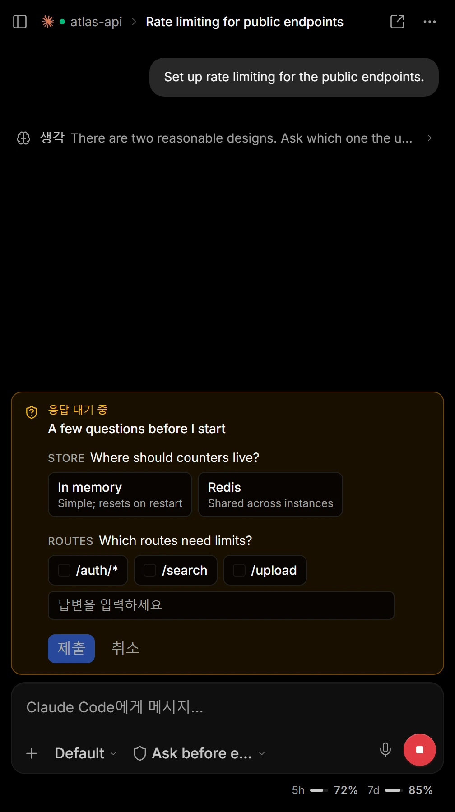

<p align="center">
  
</p>

<h1 align="center">Verre</h1>

<p align="center">
  내 컴퓨터에 이미 설치된 코딩 에이전트를 하나의 가볍고 깔끔한 창에서.
</p>

<p align="center">
  <a href="https://github.com/EveningStudy/verre/releases"><strong>다운로드</strong></a> ·
  <a href="../remote.md">원격 액세스</a> ·
  <a href="../ARCHITECTURE.md">아키텍처</a> ·
  <a href="../../CONTRIBUTING.md">기여하기</a>
</p>

<p align="center">
  <a href="../../README.md">English</a> ·
  <a href="README.zh-CN.md">简体中文</a> ·
  <a href="README.zh-Hant.md">繁體中文</a> ·
  <a href="README.ja.md">日本語</a> ·
  <strong>한국어</strong> ·
  <a href="README.es.md">Español</a> ·
  <a href="README.de.md">Deutsch</a> ·
  <a href="README.fr.md">Français</a>
</p>

<p align="center">
  
</p>

Verre(프랑스어로 ‘유리’, 발음 vair)는 로컬 CLI 코딩 에이전트를 위한 가벼운 네이티브 프런트엔드입니다. **Claude Code**, **Codex**, **Antigravity**, **Devin**, **Kiro**, **DeepSeek Harness**, **CodeBuddy / WorkBuddy**와 모든 [Agent Client Protocol](https://agentclientprotocol.com)(ACP) 도구를 기존 설정과 로그인 상태 그대로 실행하고, [T3 Code](https://github.com/pingdotgg/t3code)를 바탕으로 만든 통합 UI로 보여 줍니다.

## 주요 특징

- **에이전트를 건드리지 않습니다.** 입력한 텍스트를 한 글자도 바꾸지 않고 그대로 전달합니다. 시스템 프롬프트나 래퍼 지시문, 추가 도구나 MCP를 주입하지 않으므로 `CLAUDE.md`, `config.toml`, hooks, skills, 사용자 지정 게이트웨이와 구독 요금제가 터미널과 똑같이 동작합니다.
- **21개 기본 내장 에이전트 + 사용자 지정 ACP.** Claude Code와 Codex 네이티브 어댑터, 19개 ACP 프리셋을 기본 제공하며 설정에서 원하는 stdio ACP 명령도 직접 등록할 수 있습니다.
- **통합 사이드바와 에이전트 간 연결.** Verre뿐 아니라 각 벤더 데스크톱 앱과 CLI의 로컬 기록을 한곳에서 탐색하고 지원 시 이어서 대화할 수 있습니다. 한 에이전트가 다른 에이전트(예: Claude Code가 `codex exec`)를 호출하면 하위 세션이 해당 도구 호출 바로 아래에 연결됩니다.
- **전체 검색, 읽기 전용 Diff, 원본 로그.** 영어와 한중일 텍스트 전체 검색, 읽기 전용 Git 변경 내역·Worktree 확인은 물론, 모든 스레드에서 실제 실행 명령과 JSON 프레임을 보여 주는 원본 로그 패널을 열 수 있습니다.
- **비공개 원격 액세스.** Tailscale Serve나 직접 구성한 HTTPS 리버스 프록시(`127.0.0.1`만 수신)를 통해 스마트폰이나 다른 브라우저를 페어링하고, 이동 중에도 승인 요청에 답하거나 실행 중인 턴에 개입할 수 있습니다.
- **가벼운 네이티브 구조.** 단일 Rust 프로세스(데스크톱 바이너리 약 14 MB)와 OS 기본 WebView(WebView2 / WKWebView / WebKitGTK)만 사용합니다. Electron이나 Node 런타임 없이 유휴 메모리 약 40 MB로 동작하며, 선택적 오프라인 음성 입력, 테마 편집기, 8개 언어 UI를 제공합니다.

| 원본 통신 로그 및 실행 명령 | 승인 카드 및 웜 페이퍼 테마 |
|---|---|
|  |  |
| **연결된 하위 세션** | **모바일 원격 화면** |
|  | <p align="center"></p> |

## 지원 에이전트

Verre는 각 공급업체의 공식 클라이언트 인터페이스에 직접 연결되며, 화면의 모델·추론 강도·권한 모드·사용량 한도는 에이전트가 보고한 값 그대로 표시합니다.

| 에이전트 | 프로토콜 | 유지되는 로컬 설정 |
|---|---|---|
| Claude Code | `claude -p` (양방향 `stream-json`) | `CLAUDE.md`, hooks, skills, 플러그인, MCP, 로그인 상태 |
| Codex | `codex app-server` | `~/.codex/config.toml`, ChatGPT / API 로그인, 사용자 지정 공급자, MCP |
| Antigravity | `agy acp` | 공식 도구·설정·Google 로그인([참고](../agents/antigravity.md)) |
| Devin | `devin acp` | 기본 도구·설정·브라우저 인증 |
| Kiro | `kiro-cli acp` | 기본 CLI 도구·설정·인증 |

**추가 내장 ACP 프리셋(16종):** DeepSeek Harness, CodeBuddy / WorkBuddy, Gemini CLI, OpenCode, Cursor, GitHub Copilot, Cline, Qwen Code, Kimi Code, Goose, Factory Droid, Amp, Auggie, Mistral Vibe, Kilo, Grok. **설정 → 에이전트**에서 사용자 지정 stdio ACP 명령도 추가할 수 있습니다.

> Claude Code, Codex, Antigravity, Devin, Kiro는 실제 설치된 바이너리로 직접 검증했습니다. 나머지 16개 프리셋은 각 도구의 공개 ACP 플래그(`--acp` / `acp` / `--profile acp`)를 기준으로 연결했으므로, 버전 변경에 따른 경로·플래그 차이가 있으면 이슈를 남겨 주세요.

## 설치

[Releases](https://github.com/EveningStudy/verre/releases)에서 데스크톱 설치 파일이나 헤드리스 `verre` CLI를 받을 수 있습니다:

- **Windows:** NSIS 설치 프로그램(`*-setup.exe`) 및 포터블 `verre` CLI.
- **macOS:** Apple Silicon·Intel용 `.dmg` / `.app` 및 `verre` CLI.
- **Linux:** `.deb` 및 `.AppImage`(x86_64)와 `verre` CLI.

앱 내 자동 업데이트 서명은 적용되어 있으나, 상용 OS 코드 서명 인증서는 아직 적용되지 않았습니다:

- **Windows SmartScreen:** **추가 정보** → **실행**을 클릭하세요.
- **macOS Gatekeeper:** 확인되지 않은 개발자 경고가 뜨면 터미널에서 `xattr -cr /Applications/Verre.app`을 실행하세요.

### 헤드리스 서버

데스크톱 창 없이 동일한 코어를 실행하고 브라우저에서 UI를 엽니다:

```sh
verre serve --open
```

주요 CLI 명령: `verre agents`(감지된 바이너리 및 버전), `verre threads`(로컬 인덱스 검색), `verre show <thread-id>`, `verre probe`.

실행 전 컴퓨터에 지원하는 에이전트 중 하나 이상이 설치되고 로그인되어 있어야 합니다.

## 왜 이름이 ‘유리(Verre)’인가요?

- **제로 인젝션.** 사용자가 입력한 내용을 변형 없이 그대로 전달합니다. 시스템 프롬프트·스킬·도구·모델 설정은 에이전트 본연의 값과 사용자가 직접 바꾼 제어 항목만 반영합니다.
- **제로 풋프린트.** Verre는 오직 `~/.verre`(`VERRE_HOME`으로 변경 가능)에만 기록합니다. 다른 에이전트 폴더와 SQLite 저장소는 읽기 전용으로만 열며, 작업 폴더에 숨김 설정을 남기지 않습니다. 앱과 `~/.verre`만 지우면 완전히 제거됩니다.
- **고아 프로세스 없음.** Verre가 종료되면 관리하던 모든 자식 프로세스 트리가 함께 종료됩니다(Windows Job Object / Unix 프로세스 그룹 감시). 백그라운드 작업이 실행 중일 때는 세션을 해제하거나 종료하기 전에 먼저 경고합니다.
- **간결한 범위.** 대화, 권한 승인, 기록 탐색, 읽기 전용 Git diff, 오프라인 음성 입력, 비공개 원격 연결에만 집중하며 내장 IDE나 터미널, 워크플로 오케스트레이터로 비대화하지 않습니다.

## 소스에서 빌드

안정 버전 Rust([rust-toolchain.toml](../../rust-toolchain.toml)), Node.js 24, pnpm 10이 필요합니다(Linux 시스템 패키지는 [docs/desktop.md](../desktop.md) 참고).

```sh
# 1. 웹 UI 빌드 (컴파일 시 Rust 코어에 내장됨)
pnpm --dir apps/web install --frozen-lockfile
pnpm --dir apps/web build

# 2. 데스크톱 설치 패키지 빌드 (헤드리스 CLI만 빌드할 경우 아래 명령 사용)
cd apps/desktop
pnpm dlx @tauri-apps/cli build

# 헤드리스 CLI 전용 빌드
cargo build --release -p verre-cli --features claude,codex,acp,antigravity-store
./target/release/verre serve --open
```

PR 전 검증 명령:

```sh
pnpm --dir apps/web check:i18n
pnpm --dir apps/web typecheck
cargo fmt --all -- --check
cargo clippy --workspace --all-targets -- -D warnings
cargo test --workspace
```

## 문서

- [원격 액세스](../remote.md) — Tailscale Serve, 사용자 지정 HTTPS 리버스 프록시, 기기 페어링 경계
- [아키텍처](../ARCHITECTURE.md) — 코어 구조, 저장소 구성, 클린니스 검증 테스트(영문)
- [WebSocket / RPC API](../API.md) — UI 유선 계약(영문)
- [데스크톱 셸](../desktop.md) — Tauri 2 빌드, 플랫폼별 패키징, 아이콘(영문)
- [보안 정책](../../SECURITY.md) — 데이터 경계, 마스킹 규칙, 취약점 제보(영문)
- [Antigravity 참고](../agents/antigravity.md) 및 [인수 체크리스트](../ACCEPTANCE.md)(영문)

## 감사의 말

- [T3 Code](https://github.com/pingdotgg/t3code) — UI/UX 기준 모델이며 MIT 라이선스로 이식한 프레젠테이션 컴포넌트 목록은 [THIRD_PARTY_NOTICES.md](../../apps/web/THIRD_PARTY_NOTICES.md)에 있습니다.
- [Agent Client Protocol](https://agentclientprotocol.com) — 하나의 클라이언트가 여러 코딩 에이전트와 통신하는 표준 프로토콜을 제공합니다.

## 라이선스

[MIT](../../LICENSE)
