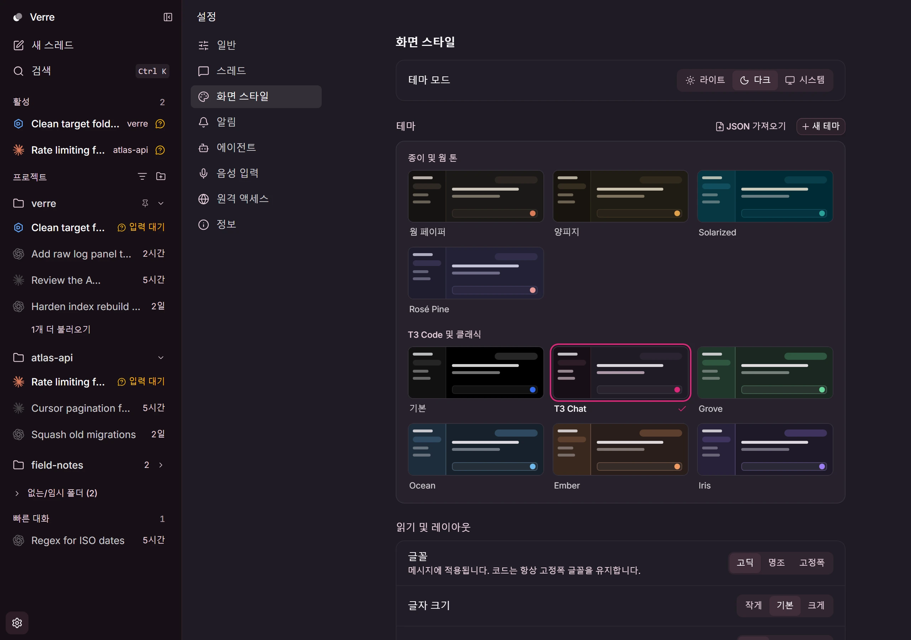
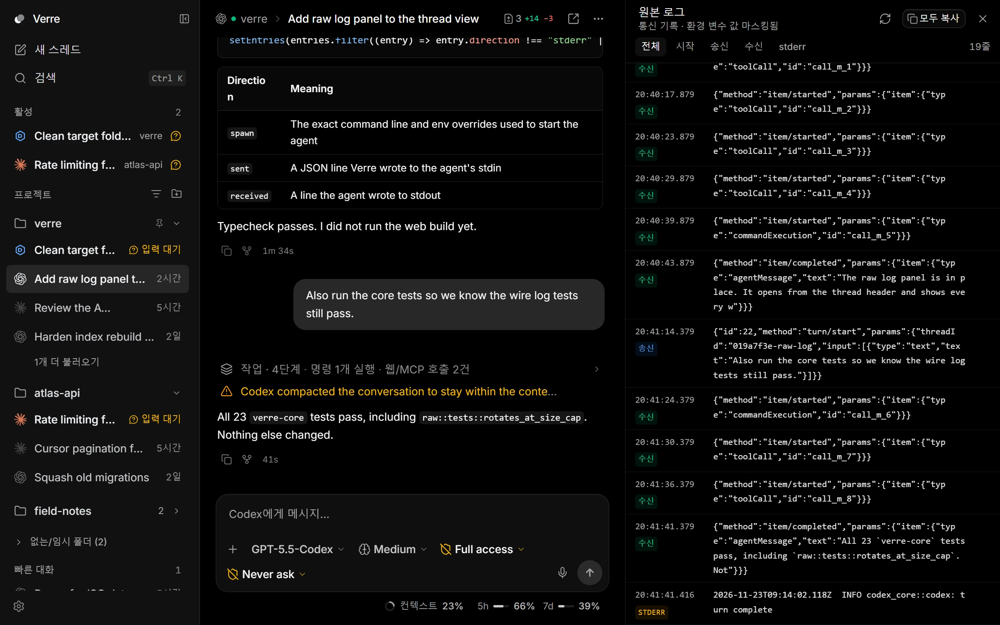

<p align="center">
  
</p>

<h1 align="center">Verre</h1>

<p align="center">
  내 컴퓨터에 이미 설치된 코딩 에이전트를 하나의 가볍고 깔끔한 창에서.
</p>

<p align="center">
  <a href="https://github.com/EveningStudy/verre/releases"><strong>다운로드</strong></a> ·
  <a href="../remote.md">원격 액세스</a> ·
  <a href="../ARCHITECTURE.md">아키텍처</a> ·
  <a href="../../CONTRIBUTING.md">기여하기</a>
</p>

<p align="center">
  <a href="../../README.md">English</a> ·
  <a href="README.zh-CN.md">简体中文</a> ·
  <a href="README.zh-Hant.md">繁體中文</a> ·
  <a href="README.ja.md">日本語</a> ·
  <strong>한국어</strong> ·
  <a href="README.es.md">Español</a> ·
  <a href="README.de.md">Deutsch</a> ·
  <a href="README.fr.md">Français</a>
</p>

<p align="center">
  
</p>

**Verre**(프랑스어로 ‘유리’, 발음 vair)는 **Claude Code**, **Codex**, **Cursor**, **Antigravity**, **Gemini CLI**, **DeepSeek Harness**, **Grok**, **GitHub Copilot**, **OpenCode**, **Cline**, **CodeBuddy / WorkBuddy**, **Kiro**, **Devin** 등 **21개 기본 내장 코딩 에이전트**와 모든 [Agent Client Protocol](https://agentclientprotocol.com)(ACP) 도구를 위한 가벼운 네이티브 UI입니다. 인터페이스는 [T3 Code](https://github.com/pingdotgg/t3code)를 참고했습니다.

## 왜 이름이 ‘유리(Verre)’인가요?

- **유리처럼 투명한 전달.** 입력한 프롬프트가 공식 에이전트 바이너리에 그대로 전달됩니다. 시스템 프롬프트나 래퍼, 추가 MCP 서버를 주입하지 않으므로 `CLAUDE.md`, `config.toml`, hooks, skills, 사용자 지정 게이트웨이와 사용량 한도가 터미널과 똑같이 동작하며 원본 로그 패널에서 모든 프레임을 직접 확인할 수 있습니다.
- **가벼운 네이티브 스택.** 단일 Rust 코어(약 14 MB)와 OS 기본 WebView(유휴 RAM 약 40 MB, Electron/Node 없음) 위에 읽기 전용 Git diff, 10가지 기본/사용자 지정 테마, 선택적 오프라인 음성 입력, 8개 언어 UI를 담았습니다.
- **흔적 없이, 깔끔한 종료.** Verre는 오직 `~/.verre`(`VERRE_HOME`으로 변경 가능)에만 기록하고 다른 도구의 저장소는 읽기 전용으로만 엽니다. 작업 폴더를 건드리지 않으며 종료 시 자식 프로세스 트리까지 모두 정리합니다. 앱과 `~/.verre`만 삭제하면 완전히 제거됩니다.
- **도구를 아우르는 하나의 사이드바.** Verre, 공식 데스크톱 앱, CLI의 로컬 기록을 한곳에서 탐색하고 영어·한중일 전체 검색과 에이전트 간 하위 세션(예: Claude Code가 실행한 `codex exec`) 이동을 지원합니다.
- **비공개 원격 액세스.** Tailscale Serve 또는 직접 구성한 HTTPS 리버스 프록시(`127.0.0.1`만 수신)로 스마트폰이나 브라우저를 페어링해 이동 중에도 승인 요청을 처리하고 실행 중인 턴에 개입할 수 있습니다.

## 스크린샷

**10가지 기본 및 사용자 지정 테마**



<details>
<summary>더 많은 스크린샷 보기 — 원본 로그, 권한 승인, 연결된 하위 세션, 모바일</summary>

#### 원본 통신 로그 및 실행 명령



#### 승인 카드 및 웜 페이퍼 테마


#### 연결된 하위 세션


#### 모바일 원격 승인

<p align="center">
  
</p>

</details>

## 지원 에이전트

Verre는 각 에이전트의 공식 CLI 인터페이스를 기존 설정과 로그인 상태 그대로 직접 실행합니다:

| 에이전트 | 프로토콜 | 유지되는 로컬 설정 |
|---|---|---|
| **Claude Code** | `claude -p` (양방향 `stream-json`) | `CLAUDE.md`, hooks, skills, 플러그인, MCP, 로그인 상태 |
| **Codex** | `codex app-server` | `~/.codex/config.toml`, ChatGPT / API 로그인, 사용자 지정 공급자, MCP |
| **19개 기본 내장 ACP 에이전트**<br>Cursor, Antigravity, Gemini CLI, GitHub Copilot, DeepSeek Harness, Grok, OpenCode, Cline, CodeBuddy / WorkBuddy, Qwen Code, Kimi Code, Kiro, Devin, Goose, Factory Droid, Amp, Auggie, Mistral Vibe, Kilo | 공식 ACP (`acp` / `--acp` / `--profile acp`) | 각 에이전트 고유의 도구·설정·인증 |
| **사용자 지정 ACP** | 모든 stdio ACP 명령 | **설정 → 에이전트**에서 추가 |

## 설치

[Releases](https://github.com/EveningStudy/verre/releases)에서 데스크톱 설치 파일이나 헤드리스 `verre` CLI를 받을 수 있습니다:

- **Windows:** NSIS 설치 프로그램(`*-setup.exe`) 및 포터블 `verre` CLI.
- **macOS:** Apple Silicon·Intel용 `.dmg` / `.app` 및 `verre` CLI.
- **Linux:** `.deb` 및 `.AppImage`(x86_64)와 `verre` CLI.

앱 내 자동 업데이트 서명은 적용되어 있으나, 상용 OS 코드 서명 인증서는 아직 적용되지 않았습니다:

- **Windows SmartScreen:** **추가 정보** → **실행**을 클릭하세요.
- **macOS Gatekeeper:** 확인되지 않은 개발자로 차단되면 `xattr -cr /Applications/Verre.app`을 실행하세요.

### 헤드리스 서버

데스크톱 창 없이 동일한 코어를 실행하고 브라우저에서 UI를 엽니다:

```sh
verre serve --open
```

주요 명령: `verre agents`, `verre threads`, `verre show <thread-id>`, `verre probe`. 실행 전 컴퓨터에 지원하는 에이전트가 하나 이상 설치되고 로그인되어 있어야 합니다.

## 소스에서 빌드

안정 버전 Rust([rust-toolchain.toml](../../rust-toolchain.toml)), Node.js 24, pnpm 10이 필요합니다(Linux 시스템 패키지는 [docs/desktop.md](../desktop.md) 참고).

```sh
# 1. 웹 UI 빌드 (컴파일 시 Rust 코어에 내장됨)
pnpm --dir apps/web install --frozen-lockfile
pnpm --dir apps/web build

# 2. 데스크톱 설치 패키지 빌드 (헤드리스 CLI만 빌드할 경우 아래 명령 사용)
cd apps/desktop
pnpm dlx @tauri-apps/cli build

# 헤드리스 CLI 전용 빌드
cargo build --release -p verre-cli --features claude,codex,acp,antigravity-store
./target/release/verre serve --open
```

PR 전 검증 명령:

```sh
pnpm --dir apps/web check:i18n
pnpm --dir apps/web typecheck
cargo fmt --all -- --check
cargo clippy --workspace --all-targets -- -D warnings
cargo test --workspace
```

## 문서

- [원격 액세스](../remote.md) — Tailscale Serve, 사용자 지정 HTTPS 리버스 프록시, 기기 페어링 경계
- [아키텍처](../ARCHITECTURE.md) — 코어 구조, 저장소 구성, 클린니스 검증 테스트(영문)
- [WebSocket / RPC API](../API.md) — UI 유선 계약(영문)
- [데스크톱 셸](../desktop.md) — Tauri 2 빌드, 플랫폼별 패키징, 아이콘(영문)
- [보안 정책](../../SECURITY.md) — 데이터 경계, 마스킹 규칙, 취약점 제보(영문)
- [Antigravity 참고](../agents/antigravity.md) 및 [인수 체크리스트](../ACCEPTANCE.md)(영문)

## 감사의 말

- [T3 Code](https://github.com/pingdotgg/t3code) — UI/UX 기준 모델이며 MIT 라이선스로 이식한 프레젠테이션 컴포넌트 목록은 [THIRD_PARTY_NOTICES.md](../../apps/web/THIRD_PARTY_NOTICES.md)에 있습니다.
- [Agent Client Protocol](https://agentclientprotocol.com) — 하나의 클라이언트가 여러 코딩 에이전트와 통신하는 표준 프로토콜을 제공합니다.

## 라이선스

[MIT](../../LICENSE)
