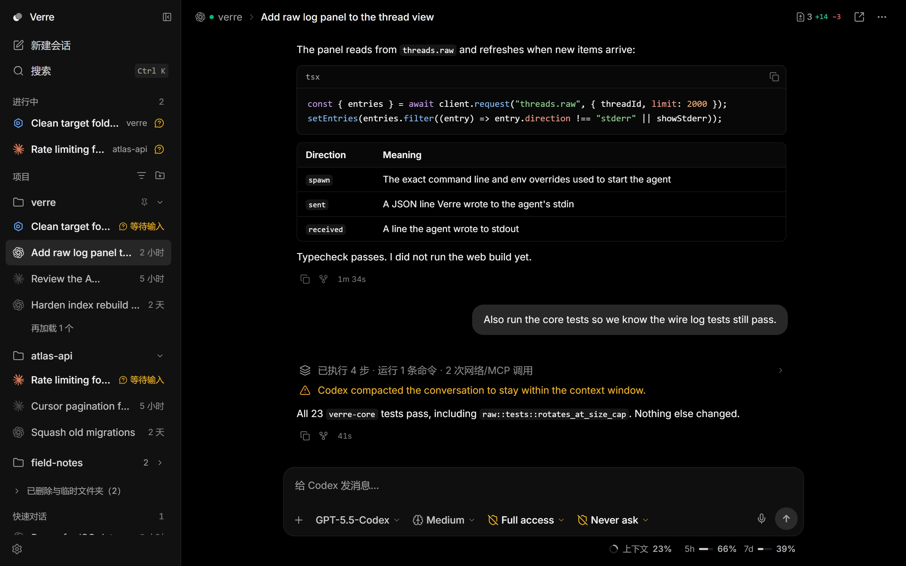
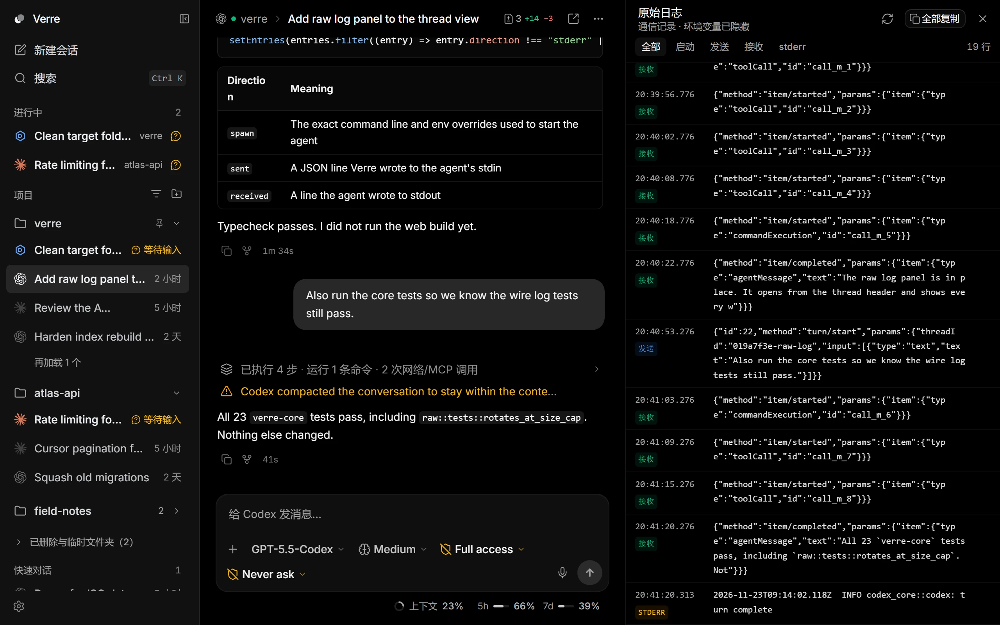
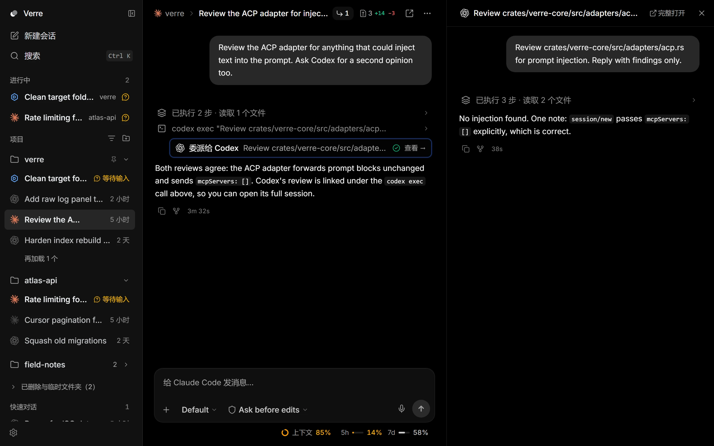
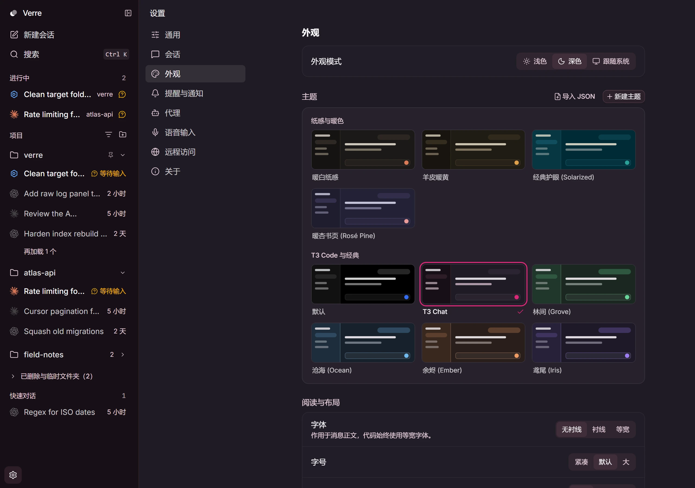

<p align="center">
  
</p>

<h1 align="center">Verre</h1>

<p align="center">
  用一个轻量、干净的窗口，驱动你电脑上已经装好的编程代理。
</p>

<p align="center">
  <a href="https://github.com/EveningStudy/verre/releases"><strong>下载安装</strong></a> ·
  <a href="../remote.md">远程访问</a> ·
  <a href="../ARCHITECTURE.md">架构说明</a> ·
  <a href="../../CONTRIBUTING.md">参与贡献</a>
</p>

<p align="center">
  <a href="../../README.md">English</a> ·
  <strong>简体中文</strong> ·
  <a href="README.zh-Hant.md">繁體中文</a> ·
  <a href="README.ja.md">日本語</a> ·
  <a href="README.ko.md">한국어</a> ·
  <a href="README.es.md">Español</a> ·
  <a href="README.de.md">Deutsch</a> ·
  <a href="README.fr.md">Français</a>
</p>

<p align="center">
  
</p>

**Verre**（法语“玻璃”，读作 vair）是一个轻量原生界面，默认支持 **21 个内置编程代理**——覆盖 **Claude Code**、**Codex**、**Cursor**、**Antigravity**、**Gemini CLI**、**DeepSeek Harness**、**Grok**、**GitHub Copilot**、**OpenCode**、**Cline**、**CodeBuddy / WorkBuddy**、**Kiro**、**Devin** 等主流工具，以及任意 [Agent Client Protocol](https://agentclientprotocol.com)（ACP）代理，界面参照 [T3 Code](https://github.com/pingdotgg/t3code) 打造。

## 为什么叫「玻璃」

- **像玻璃一样透明直达。** 你的输入原样传给官方原生程序——不注入系统提示词、不包一层工具，也不改动配置。`CLAUDE.md`、`config.toml`、hooks、skills、自定义网关和订阅额度全部照常工作，原始日志面板可随时核对每一帧收发。
- **原生轻量体验。** 单 Rust 核心（约 14 MB）搭配系统 WebView（空闲内存约 40 MB，无 Electron 与 Node），内置只读 Git Diff、10 套可定制主题、可选离线语音输入和 8 种界面语言。
- **零侵入，退出即净。** 所有自身数据只写在 `~/.verre`（可用 `VERRE_HOME` 改目录），只读打开各家历史库，绝不往项目里塞隐藏配置，退出时清理整棵子进程树；删掉应用和 `~/.verre` 即彻底卸载。
- **跨代理同一侧边栏。** 统一浏览 Verre、官方桌面端和 CLI 的本地会话，支持中英文全文检索，并直接点开代理调用产生的关联子会话（例如 Claude Code 启动的 `codex exec`）。
- **手机与网页私密远控。** 通过 Tailscale Serve 或自备 HTTPS 反代配对手机或远程浏览器（仅监听 `127.0.0.1`），随时审批权限并中途插话。

| 原始通信日志与启动命令行 | 权限审批卡片与暖白纸感主题 |
|---|---|
|  |  |
| **Claude Code 发起的关联子会话** | **内置与自定义主题** |
|  |  |

<p align="center">
  
</p>

## 支持的代理

Verre 直接按各家官方协议拉起代理，并完整保留你本机的配置、登录态与可用功能：

| 代理 | 接入协议 | 完整保留的本机配置 |
|---|---|---|
| **Claude Code** | `claude -p`（双向 `stream-json`） | `CLAUDE.md`、hooks、skills、插件、MCP、登录态 |
| **Codex** | `codex app-server` | `~/.codex/config.toml`、ChatGPT / API 登录、自定义网关、MCP |
| **19 个内置 ACP 代理**<br>Cursor、Antigravity、Gemini CLI、GitHub Copilot、DeepSeek Harness、Grok、OpenCode、Cline、CodeBuddy / WorkBuddy、Qwen Code、Kimi Code、Kiro、Devin、Goose、Factory Droid、Amp、Auggie、Mistral Vibe、Kilo | 官方 ACP（`acp` / `--acp` / `--profile acp`） | 各代理自身的工具、设置与认证状态 |
| **自定义 ACP** | 任意 stdio ACP 命令 | 在**设置 → 代理**中自行添加 |

## 安装

前往 [Releases](https://github.com/EveningStudy/verre/releases) 下载对应平台的桌面安装包或无窗口版 `verre` CLI：

- **Windows：** NSIS 安装包（`*-setup.exe`）与独立 `verre` CLI。
- **macOS：** Apple Silicon 与 Intel 版本的 `.dmg` / `.app` 与 `verre` CLI。
- **Linux：** `.deb` 与 `.AppImage`（x86_64）及 `verre` CLI。

发布包已启用应用内自动更新签名，暂未购买商业 OS 代码签名证书：

- **Windows SmartScreen：** 点击**更多信息** → **仍要运行**。
- **macOS Gatekeeper：** 如提示未验证开发者，在终端运行 `xattr -cr /Applications/Verre.app`。

### 无窗口模式（Headless）

不启桌面窗口，直接在浏览器里使用同一个本地核心：

```sh
verre serve --open
```

常用命令：`verre agents`、`verre threads`、`verre show <thread-id>` 与 `verre probe`。开始前请确保本机已装好并登录至少一个受支持的代理。

## 从源码构建

需要稳定版 Rust（见 [rust-toolchain.toml](../../rust-toolchain.toml)）、Node.js 24 与 pnpm 10（Linux 系统依赖见 [docs/desktop.md](../desktop.md)）。

```sh
# 1. 构建 Web 界面（编译期自动内嵌进 Rust 核心）
pnpm --dir apps/web install --frozen-lockfile
pnpm --dir apps/web build

# 2. 打包桌面客户端（或仅编译下方的无窗口 CLI）
cd apps/desktop
pnpm dlx @tauri-apps/cli build

# 仅编译无窗口 CLI
cargo build --release -p verre-cli --features claude,codex,acp,antigravity-store
./target/release/verre serve --open
```

提交 PR 前请确认以下检查全部通过：

```sh
pnpm --dir apps/web check:i18n
pnpm --dir apps/web typecheck
cargo fmt --all -- --check
cargo clippy --workspace --all-targets -- -D warnings
cargo test --workspace
```

## 文档

- [远程访问指南](../remote.md) — Tailscale Serve、HTTPS 反向代理与配对权限边界
- [架构说明](../ARCHITECTURE.md) — 核心设计、目录结构与可验证测试（英文）
- [WebSocket / RPC 协议](../API.md) — 前后端通信接口契约（英文）
- [桌面端说明](../desktop.md) — Tauri 2 构建、多平台打包与图标生成（英文）
- [安全与数据边界](../../SECURITY.md) — 脱敏规则、存储清单与漏洞反馈（英文）
- [Antigravity 说明](../agents/antigravity.md) & [验收清单](../ACCEPTANCE.md)（英文）

## 致谢

- [T3 Code](https://github.com/pingdotgg/t3code) — 界面与交互设计基准；遵循 MIT 许可移植的展示层组件列于 [THIRD_PARTY_NOTICES.md](../../apps/web/THIRD_PARTY_NOTICES.md)。
- [Agent Client Protocol](https://agentclientprotocol.com) — 让单个客户端统一接入各类编程代理。

## 许可证

[MIT](../../LICENSE)
