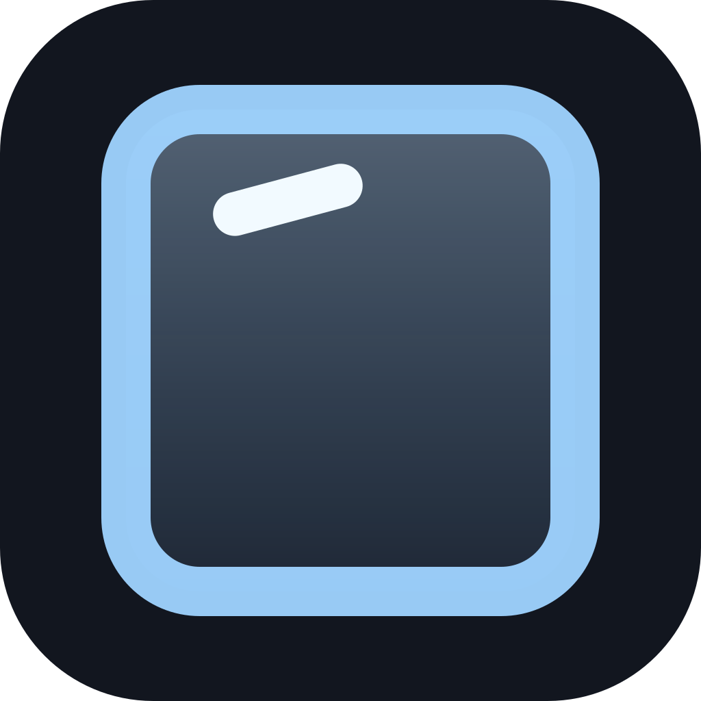
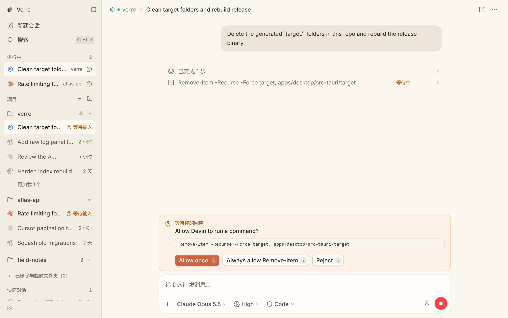
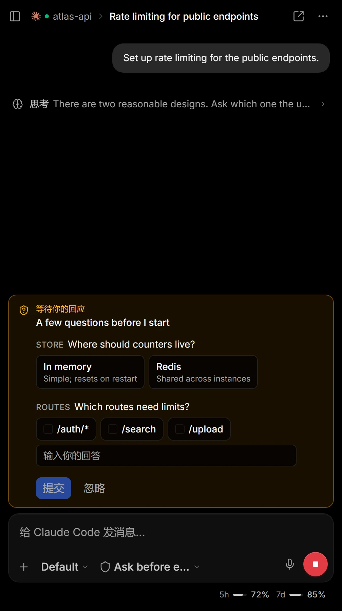

<p align="center">
  
</p>

<h1 align="center">Verre</h1>

<p align="center">
  用一个轻量、干净的窗口，驱动你电脑上已经装好的编程代理。
</p>

<p align="center">
  <a href="https://github.com/EveningStudy/verre/releases"><strong>下载安装</strong></a> ·
  <a href="../remote.md">远程访问</a> ·
  <a href="../ARCHITECTURE.md">架构说明</a> ·
  <a href="../../CONTRIBUTING.md">参与贡献</a>
</p>

<p align="center">
  <a href="../../README.md">English</a> ·
  <strong>简体中文</strong> ·
  <a href="README.zh-Hant.md">繁體中文</a> ·
  <a href="README.ja.md">日本語</a> ·
  <a href="README.ko.md">한국어</a> ·
  <a href="README.es.md">Español</a> ·
  <a href="README.de.md">Deutsch</a> ·
  <a href="README.fr.md">Français</a>
</p>

<p align="center">
  
</p>

Verre（读作 vair，法语意为“玻璃”）是面向本机命令行编程代理的原生桌面客户端，支持 **Claude Code**、**Codex**、**Antigravity**、**Devin**、**Kiro**、**DeepSeek Harness**、**CodeBuddy / WorkBuddy**，以及任意支持 [Agent Client Protocol](https://agentclientprotocol.com)（ACP）的程序。它直接启动电脑上现有的官方程序、沿用你自己的配置与登录状态，并以参照 [T3 Code](https://github.com/pingdotgg/t3code) 设计的界面统一呈现所有会话。

## 核心体验

- **原生代理，原汁原味。** 你的输入原样送达代理——不附加系统提示词、不塞包装指令，也不额外注册工具或 MCP。`CLAUDE.md`、`config.toml`、hooks、skills、自定义网关和订阅额度全部与终端一致。
- **内置 21 个代理 + 自定义 ACP。** 为 Claude Code 和 Codex 提供原生适配器，外加 19 个内置 ACP 预设；还可在设置里添加任意 stdio ACP 命令。
- **统一侧栏与跨代理关联。** 在同一侧栏浏览 Verre、各家官方桌面端与 CLI 的本地历史并按支持情况续聊；当一个代理调起另一个代理（例如 Claude Code 执行 `codex exec`）时，子会话会直接挂在对应工具调用下实时展开。
- **全文检索、只读 Diff 与原始日志。** 支持中英文对话全文搜索、Git 变更与工作树只读查看，并可在每个会话随手打开原始通信日志，核对实际启动命令与收发帧。
- **私密远程访问。** 通过 Tailscale Serve 或自备 HTTPS 反向代理配对手机或远程浏览器（核心仅监听 `127.0.0.1`），随时审批权限、接管或插话。
- **极致轻量。** 单 Rust 核心进程（约 14 MB 桌面端可执行文件）加系统自带 WebView（WebView2 / WKWebView / WebKitGTK），运行时无 Electron 和 Node，空闲内存约 40 MB；内置可选离线语音输入、多主题与 8 种界面语言。

| 原始通信日志与启动命令行 | 权限审批卡片与暖白纸感主题 |
|---|---|
|  |  |
| **Claude Code 发起的关联子会话** | **移动端远程交互** |
|  | <p align="center"></p> |

## 支持的代理

Verre 直接对接各家官方协议，界面中展示的模型、思考强度、权限模式与额度窗口均由代理自身上报。

| 代理 | 接入协议 | 完整保留的本机配置 |
|---|---|---|
| Claude Code | `claude -p`（双向 `stream-json`） | `CLAUDE.md`、hooks、skills、插件、MCP、登录态 |
| Codex | `codex app-server` | `~/.codex/config.toml`、ChatGPT / API 登录、自定义网关、MCP |
| Antigravity | `agy acp` | 原生工具、设置与 Google 登录（[说明](../agents/antigravity.md)） |
| Devin | `devin acp` | 原生工具、设置与浏览器登录 |
| Kiro | `kiro-cli acp` | 原生 CLI 工具、设置与认证状态 |

**其余 16 个内置 ACP 预设：** DeepSeek Harness、CodeBuddy / WorkBuddy、Gemini CLI、OpenCode、Cursor、GitHub Copilot、Cline、Qwen Code、Kimi Code、Goose、Factory Droid、Amp、Auggie、Mistral Vibe、Kilo、Grok。如需其他工具，可在**设置 → 代理**中自行添加 stdio ACP 命令。

> 上表 5 款代理均已通过真实二进制程序实机验证；其余 16 个 ACP 预设按各自官方公开参数（`--acp` / `acp` / `--profile acp`）集成，若版本升级导致参数或安装路径调整，欢迎提交 Issue 反馈。

## 安装

前往 [Releases](https://github.com/EveningStudy/verre/releases) 下载对应平台的桌面安装包或无窗口版 `verre` 命令行程序：

- **Windows：** NSIS 安装包（`*-setup.exe`）与独立 `verre` CLI。
- **macOS：** Apple Silicon 与 Intel 版本的 `.dmg` / `.app` 与 `verre` CLI。
- **Linux：** `.deb` 与 `.AppImage`（x86_64）及 `verre` CLI。

发布包已启用应用内自动更新签名，但暂未购置商业 OS 代码签名证书，首次运行可能遇到系统拦截：

- **Windows SmartScreen：** 点击**更多信息** → **仍要运行**。
- **macOS Gatekeeper：** 如提示未验证开发者或已损坏，在终端运行 `xattr -cr /Applications/Verre.app`。

### 无窗口模式（Headless）

不启动桌面窗口，直接在浏览器里使用同一个本地核心：

```sh
verre serve --open
```

常用调试命令：`verre agents`（查看探测到的代理与版本）、`verre threads`（检索本地索引）、`verre show <thread-id>` 与 `verre probe`。

开始前请确保本机至少已安装并登录一个受支持的代理。

## 为什么叫“玻璃”

- **零注入：** 你的提示词一字不改直达代理，不劫持系统提示词，不私自塞工具或覆盖配置。
- **零侵入：** 自身数据全部存放在 `~/.verre`（可用 `VERRE_HOME` 指定目录）；其他代理的配置和 SQLite 历史一律只读打开，仅在你主动操作时触碰工作区。删掉程序和 `~/.verre` 即可彻底卸载。
- **不留孤儿进程：** 主程序退出时通过 Windows Job Object / Unix 进程组看护清理整棵子进程树；若检测到后台任务仍在运行，释放或关闭前会先提示确认。
- **克制边界：** 专注对话、审批、历史、只读 Diff、离线语音与私密远控，不变成内置 IDE、终端或编排框架。

## 从源码构建

需要稳定版 Rust（见 [rust-toolchain.toml](../../rust-toolchain.toml)）、Node.js 24 与 pnpm 10（Linux 系统依赖见 [docs/desktop.md](../desktop.md)）。

```sh
# 1. 构建 Web 界面（编译期自动内嵌进 Rust 核心）
pnpm --dir apps/web install --frozen-lockfile
pnpm --dir apps/web build

# 2. 打包桌面客户端（或直接编译下方的无窗口 CLI）
cd apps/desktop
pnpm dlx @tauri-apps/cli build

# 仅编译无窗口 CLI
cargo build --release -p verre-cli --features claude,codex,acp,antigravity-store
./target/release/verre serve --open
```

提交 PR 前请确认以下检查全部通过：

```sh
pnpm --dir apps/web check:i18n
pnpm --dir apps/web typecheck
cargo fmt --all -- --check
cargo clippy --workspace --all-targets -- -D warnings
cargo test --workspace
```

## 文档

- [远程访问指南](../remote.md) — Tailscale Serve、HTTPS 反向代理与配对权限边界
- [架构说明](../ARCHITECTURE.md) — 核心设计、目录结构与零注入验证测试（英文）
- [WebSocket / RPC 协议](../API.md) — 前后端通信接口契约（英文）
- [桌面端说明](../desktop.md) — Tauri 2 构建、多平台打包与图标生成（英文）
- [安全与数据边界](../../SECURITY.md) — 脱敏规则、存储清单与漏洞反馈（英文）
- [Antigravity 说明](../agents/antigravity.md) & [验收清单](../ACCEPTANCE.md)（英文）

## 致谢

- [T3 Code](https://github.com/pingdotgg/t3code) — Verre 的界面与交互设计基准；部分遵循 MIT 许可移植的展示层组件列于 [THIRD_PARTY_NOTICES.md](../../apps/web/THIRD_PARTY_NOTICES.md)。
- [Agent Client Protocol](https://agentclientprotocol.com) — 让单个客户端能够统一接入多种编程代理。

## 许可证

[MIT](../../LICENSE)
