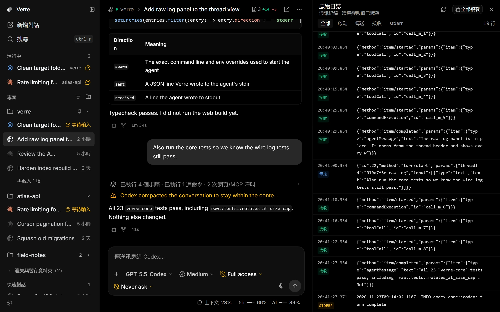

<p align="center">
  
</p>

<h1 align="center">Verre</h1>

<p align="center">
  用一個輕量、乾淨的視窗，操作你電腦上已經裝好的程式設計代理。
</p>

<p align="center">
  <a href="https://github.com/EveningStudy/verre/releases"><strong>下載安裝</strong></a> ·
  <a href="../remote.md">遠端存取</a> ·
  <a href="../ARCHITECTURE.md">架構說明</a> ·
  <a href="../../CONTRIBUTING.md">參與貢獻</a>
</p>

<p align="center">
  <a href="../../README.md">English</a> ·
  <a href="README.zh-CN.md">简体中文</a> ·
  <strong>繁體中文</strong> ·
  <a href="README.ja.md">日本語</a> ·
  <a href="README.ko.md">한국어</a> ·
  <a href="README.es.md">Español</a> ·
  <a href="README.de.md">Deutsch</a> ·
  <a href="README.fr.md">Français</a>
</p>

<p align="center">
  
</p>

Verre（讀作 vair，法文「玻璃」之意）是專為本機命令列程式設計代理打造的原生介面，支援 **Claude Code**、**Codex**、**Antigravity**、**Devin**、**Kiro**、**DeepSeek Harness**、**CodeBuddy / WorkBuddy**，以及任何支援 [Agent Client Protocol](https://agentclientprotocol.com)（ACP）的工具。它直接啟動你電腦上的官方執行檔、沿用既有設定與登入狀態，並以參照 [T3 Code](https://github.com/pingdotgg/t3code) 設計的介面統一呈現。

## 核心特色

- **原生代理，原貌呈現。** 你輸入的提示詞一字不改直接送達——不注入系統指令、不加包裝文字，也不額外安插工具或 MCP。`CLAUDE.md`、`config.toml`、hooks、skills、自訂閘道與訂閱額度皆與終端機一致。
- **內建 21 個代理 + 自訂 ACP。** 包含 Claude Code 與 Codex 原生配接器，以及 19 個內建 ACP 預設配置；亦可於設定中新增任意 stdio ACP 命令。
- **單一側邊欄與跨代理關聯。** 統一瀏覽 Verre、各家官方桌面版與 CLI 的本機歷史紀錄並在支援時接續對話；當代理調用另一個代理（例如 Claude Code 執行 `codex exec`）時，子工作階段會直接展開於對應工具呼叫下方。
- **全文檢索、唯讀 Diff 與原始日誌。** 支援中英文全文搜尋、Git 變更與工作樹唯讀檢視，也能在任何對話隨手開啟原始通訊日誌，核對實際啟動命令列與傳輸內容。
- **私密遠端存取。** 透過 Tailscale Serve 或自建 HTTPS 反向代理配對手機或瀏覽器（核心僅監聽 `127.0.0.1`），隨時處理權限核准或中途插話。
- **極致輕量。** 單一 Rust 核心處理程序（桌面端約 14 MB）搭配系統 WebView（WebView2 / WKWebView / WebKitGTK），執行期無 Electron 與 Node，待機記憶體約 40 MB；提供離線語音輸入、自訂主題與 8 種介面語言。

| 原始通訊日誌與啟動命令列 | 權限核准卡片與暖白紙感主題 |
|---|---|
|  |  |
| **Claude Code 發起的關聯子工作階段** | **行動裝置遠端檢視** |
|  | <p align="center"></p> |

## 支援的代理

Verre 直接透過各廠商的官方介面執行，畫面中的模型、思考強度、權限模式與配額資訊皆由代理自行回報。

| 代理 | 通訊協定 | 完整保留的本機設定 |
|---|---|---|
| Claude Code | `claude -p`（雙向 `stream-json`） | `CLAUDE.md`、hooks、skills、外掛、MCP、登入態 |
| Codex | `codex app-server` | `~/.codex/config.toml`、ChatGPT / API 登入、自訂供應商、MCP |
| Antigravity | `agy acp` | 原生工具、設定與 Google 登入（[說明](../agents/antigravity.md)） |
| Devin | `devin acp` | 原生工具、設定與瀏覽器驗證 |
| Kiro | `kiro-cli acp` | 原生 CLI 工具、設定與登入狀態 |

**其餘 16 個內建 ACP 預設：** DeepSeek Harness、CodeBuddy / WorkBuddy、Gemini CLI、OpenCode、Cursor、GitHub Copilot、Cline、Qwen Code、Kimi Code、Goose、Factory Droid、Amp、Auggie、Mistral Vibe、Kilo、Grok。於**設定 → 代理**中亦可加入任何 stdio ACP 命令。

> 上表 5 款代理皆已透過真實執行檔實機測試；其餘 16 個 ACP 預設依各家公開參數（`--acp` / `acp` / `--profile acp`）整合，若日後 CLI 旗標或安裝路徑變動，歡迎回報 Issue。

## 安裝

前往 [Releases](https://github.com/EveningStudy/verre/releases) 下載桌面安裝檔或無視窗版 `verre` CLI：

- **Windows：** NSIS 安裝檔（`*-setup.exe`）與可攜式 `verre` CLI。
- **macOS：** Apple Silicon 與 Intel 版 `.dmg` / `.app` 與 `verre` CLI。
- **Linux：** `.deb` 與 `.AppImage`（x86_64）及 `verre` CLI。

發行版已內建應用程式內自動更新簽章，但尚未購置商業作業系統程式碼簽章憑證：

- **Windows SmartScreen：** 點選**更多資訊** → **仍要執行**。
- **macOS Gatekeeper：** 若系統提示無法驗證開發者，請於終端機執行 `xattr -cr /Applications/Verre.app`。

### 無視窗模式（Headless）

不開啟桌面視窗，直接於瀏覽器使用同一個核心：

```sh
verre serve --open
```

實用 CLI 工具：`verre agents`（顯示偵測到的代理與版本）、`verre threads`（查詢本機索引）、`verre show <thread-id>` 與 `verre probe`。

開始前，請確認電腦上至少已安裝並登入一個受支援的代理。

## 為什麼叫「玻璃」

- **零注入：** 提示詞原文直達代理，不介入系統提示詞、不外加工具或覆寫設定。
- **零痕跡：** 本身資料僅寫入 `~/.verre`（可用 `VERRE_HOME` 變更位置）；其他代理的目錄與 SQLite 資料庫一律唯讀開啟，僅在明確觸發的工作區操作時寫入專案。移除程式與 `~/.verre` 即可完全清除。
- **不留孤兒程序：** Verre 結束時自動清理受託管的子程序樹（Windows Job Object / Unix 程序群組看門狗），若背景仍有工作進行，關閉或釋放前會先跳出確認。
- **精簡客戶端：** 專注對話、核准、歷史、唯讀 Diff、離線語音與私密遠控，不往裡塞進 IDE、終端機模擬器或工作流編排器。

## 從原始碼建置

需要穩定版 Rust（見 [rust-toolchain.toml](../../rust-toolchain.toml)）、Node.js 24 與 pnpm 10（Linux 系統套件需求見 [docs/desktop.md](../desktop.md)）。

```sh
# 1. 建置 Web 介面（編譯時會自動嵌入 Rust 核心）
pnpm --dir apps/web install --frozen-lockfile
pnpm --dir apps/web build

# 2. 打包桌面安裝程式（或僅建置下方的無視窗 CLI）
cd apps/desktop
pnpm dlx @tauri-apps/cli build

# 僅建置無視窗 CLI
cargo build --release -p verre-cli --features claude,codex,acp,antigravity-store
./target/release/verre serve --open
```

提交 PR 前請先確認下列檢查皆通過：

```sh
pnpm --dir apps/web check:i18n
pnpm --dir apps/web typecheck
cargo fmt --all -- --check
cargo clippy --workspace --all-targets -- -D warnings
cargo test --workspace
```

## 文件

- [遠端存取指南](../remote.md) — Tailscale Serve、HTTPS 反向代理與配對權限邊界
- [架構文件](../ARCHITECTURE.md) — 核心設計、資料儲存結構與可驗證測試（英文）
- [WebSocket / RPC 協定](../API.md) — 前後端通訊契約（英文）
- [桌面殼層文件](../desktop.md) — Tauri 2 建置、各平台打包與圖示產生（英文）
- [安全性政策](../../SECURITY.md) — 資料邊界、遮罩規則與漏洞回報（英文）
- [Antigravity 說明](../agents/antigravity.md) & [驗收清單](../ACCEPTANCE.md)（英文）

## 致謝

- [T3 Code](https://github.com/pingdotgg/t3code) — 介面與互動設計基準；依其 MIT 授權移植之展示層元件清單列於 [THIRD_PARTY_NOTICES.md](../../apps/web/THIRD_PARTY_NOTICES.md)。
- [Agent Client Protocol](https://agentclientprotocol.com) — 讓單一客戶端能以一致方式連接各種程式設計代理。

## 授權條款

[MIT](../../LICENSE)
