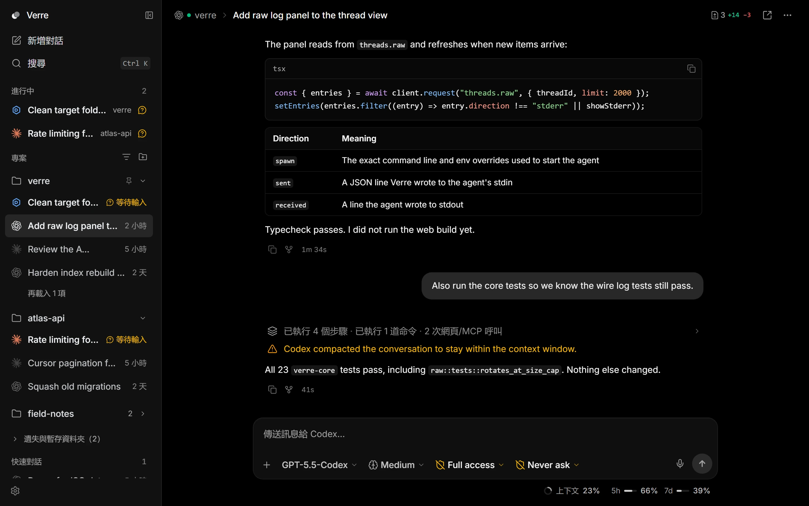
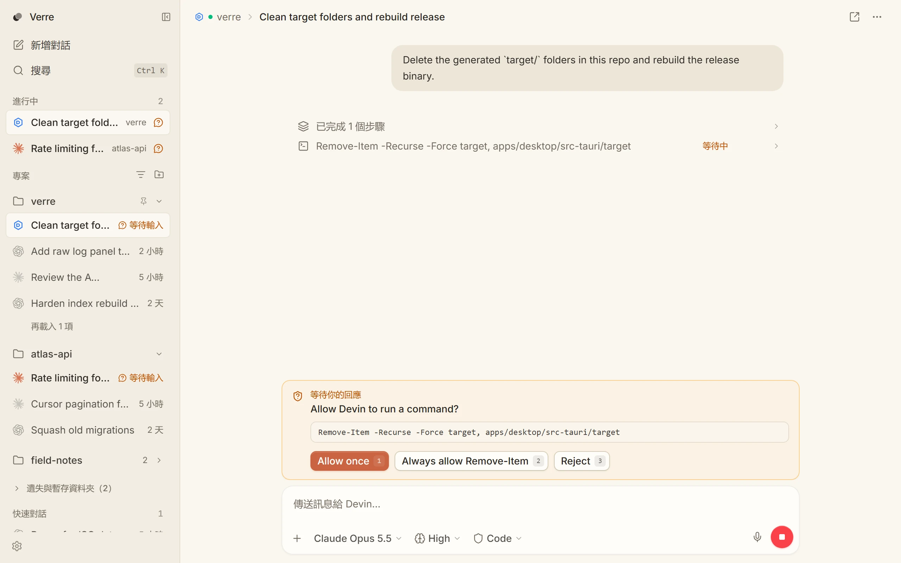
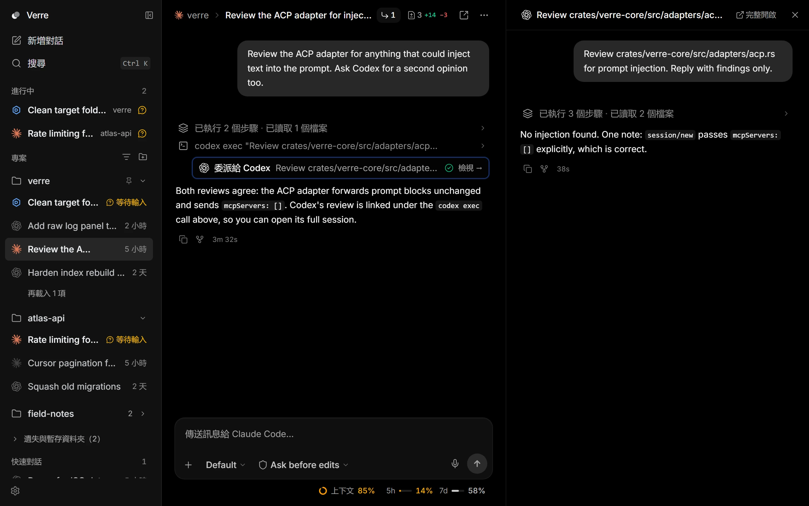
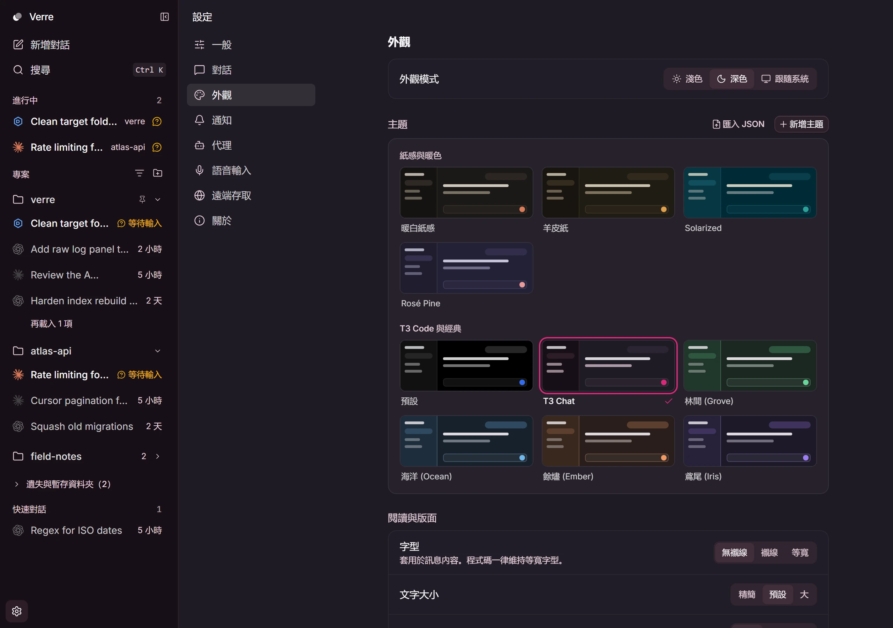
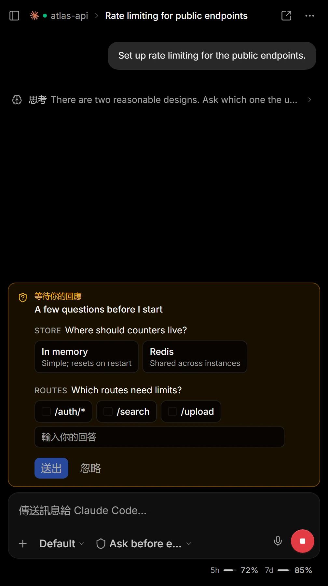

<p align="center">
  
</p>

<h1 align="center">Verre</h1>

<p align="center">
  用一個輕量、乾淨的視窗，操作你電腦上已經裝好的程式設計代理。
</p>

<p align="center">
  <a href="https://github.com/EveningStudy/verre/releases"><strong>下載安裝</strong></a> ·
  <a href="../remote.md">遠端存取</a> ·
  <a href="../ARCHITECTURE.md">架構說明</a> ·
  <a href="../../CONTRIBUTING.md">參與貢獻</a>
</p>

<p align="center">
  <a href="../../README.md">English</a> ·
  <a href="README.zh-CN.md">简体中文</a> ·
  <strong>繁體中文</strong> ·
  <a href="README.ja.md">日本語</a> ·
  <a href="README.ko.md">한국어</a> ·
  <a href="README.es.md">Español</a> ·
  <a href="README.de.md">Deutsch</a> ·
  <a href="README.fr.md">Français</a>
</p>

<p align="center">
  
</p>

**Verre**（法文「玻璃」，讀作 vair）是一款輕量原生介面，預設支援 **21 個內建程式設計代理**——涵蓋 **Claude Code**、**Codex**、**Cursor**、**Antigravity**、**Gemini CLI**、**DeepSeek Harness**、**Grok**、**GitHub Copilot**、**OpenCode**、**Cline**、**CodeBuddy / WorkBuddy**、**Kiro**、**Devin** 等工具，以及任何支援 [Agent Client Protocol](https://agentclientprotocol.com)（ACP）的代理，介面參照 [T3 Code](https://github.com/pingdotgg/t3code) 設計。

## 為什麼叫「玻璃」

- **像玻璃般透明直達。** 你的輸入一字不改送往官方原生程式——不注入系統提示詞、不加包裝，也不安插額外工具或 MCP。`CLAUDE.md`、`config.toml`、hooks、skills、自訂閘道與訂閱額度皆與終端機相同，且可隨時開啟原始日誌面板核對每一筆通訊。
- **零痕跡，退出即淨。** 自身資料只存放在 `~/.verre`（可用 `VERRE_HOME` 更改），其他工具的資料庫一律唯讀開啟，絕不往專案資料夾寫入隱藏設定；結束時自動清理所有子程序樹，刪除程式與 `~/.verre` 即完全移除。
- **跨代理共用單一側邊欄。** 統一瀏覽 Verre、各家桌面版與 CLI 的本機紀錄，支援中英文全文檢索，並能直接展開由代理啟動的關聯子工作階段（如 Claude Code 執行的 `codex exec`）。
- **手機與瀏覽器私密遠控。** 透過 Tailscale Serve 或自建 HTTPS 反向代理配對裝置（僅監聽 `127.0.0.1`），外出也能即時核准權限或中途插話。
- **原生輕量架構。** 單一 Rust 核心（約 14 MB）搭配系統 WebView（待機約 40 MB 記憶體，無 Electron 與 Node），內建唯讀 Git Diff、10 款可自訂主題、選用離線語音輸入與 8 種介面語言。

| 原始通訊日誌與啟動命令列 | 權限核准卡片與暖白紙感主題 |
|---|---|
|  |  |
| **Claude Code 發起的關聯子工作階段** | **內建與自訂主題** |
|  |  |

<p align="center">
  
</p>

## 支援的代理

Verre 直接透過各家官方協定啟動代理，完整保留你既有的設定、登入狀態與工具能力：

| 代理 | 協定 | 完整保留的本機設定 |
|---|---|---|
| **Claude Code** | `claude -p`（雙向 `stream-json`） | `CLAUDE.md`、hooks、skills、外掛、MCP、登入態 |
| **Codex** | `codex app-server` | `~/.codex/config.toml`、ChatGPT / API 登入、自訂供應商、MCP |
| **19 個內建 ACP 代理**<br>Cursor、Antigravity、Gemini CLI、GitHub Copilot、DeepSeek Harness、Grok、OpenCode、Cline、CodeBuddy / WorkBuddy、Qwen Code、Kimi Code、Kiro、Devin、Goose、Factory Droid、Amp、Auggie、Mistral Vibe、Kilo | 官方 ACP（`acp` / `--acp` / `--profile acp`） | 各代理自身的工具、設定與驗證狀態 |
| **自訂 ACP** | 任意 stdio ACP 命令 | 可於**設定 → 代理**新增 |

## 安裝

前往 [Releases](https://github.com/EveningStudy/verre/releases) 下載桌面安裝檔或無視窗版 `verre` CLI：

- **Windows：** NSIS 安裝檔（`*-setup.exe`）與可攜式 `verre` CLI。
- **macOS：** Apple Silicon 與 Intel 版 `.dmg` / `.app` 及 `verre` CLI。
- **Linux：** `.deb` 與 `.AppImage`（x86_64）及 `verre` CLI。

發行版已內建自動更新簽章，尚未購置商業作業系統程式碼簽章憑證：

- **Windows SmartScreen：** 點選**更多資訊** → **仍要執行**。
- **macOS Gatekeeper：** 若系統提示無法驗證開發者，請在終端機執行 `xattr -cr /Applications/Verre.app`。

### 無視窗模式（Headless）

不開啟桌面視窗，直接透過瀏覽器使用同一個核心：

```sh
verre serve --open
```

常用工具：`verre agents`、`verre threads`、`verre show <thread-id>` 與 `verre probe`。開始前請確保本機已安裝並登入至少一個受支援的代理。

## 從原始碼建置

需要穩定版 Rust（見 [rust-toolchain.toml](../../rust-toolchain.toml)）、Node.js 24 與 pnpm 10（Linux 系統套件需求見 [docs/desktop.md](../desktop.md)）。

```sh
# 1. 建置 Web 介面（編譯時會自動嵌入 Rust 核心）
pnpm --dir apps/web install --frozen-lockfile
pnpm --dir apps/web build

# 2. 打包桌面安裝程式（或僅建置下方的無視窗 CLI）
cd apps/desktop
pnpm dlx @tauri-apps/cli build

# 僅建置無視窗 CLI
cargo build --release -p verre-cli --features claude,codex,acp,antigravity-store
./target/release/verre serve --open
```

提交 PR 前請確認下列檢查全部通過：

```sh
pnpm --dir apps/web check:i18n
pnpm --dir apps/web typecheck
cargo fmt --all -- --check
cargo clippy --workspace --all-targets -- -D warnings
cargo test --workspace
```

## 文件

- [遠端存取指南](../remote.md) — Tailscale Serve、HTTPS 反向代理與配對權限邊界
- [架構文件](../ARCHITECTURE.md) — 核心設計、資料儲存結構與可驗證測試（英文）
- [WebSocket / RPC 協定](../API.md) — 前後端通訊契約（英文）
- [桌面殼層文件](../desktop.md) — Tauri 2 建置、各平台打包與圖示產生（英文）
- [安全性政策](../../SECURITY.md) — 資料邊界、遮罩規則與漏洞回報（英文）
- [Antigravity 說明](../agents/antigravity.md) & [驗收清單](../ACCEPTANCE.md)（英文）

## 致謝

- [T3 Code](https://github.com/pingdotgg/t3code) — 介面與互動設計基準；依其 MIT 授權移植之展示層元件清單列於 [THIRD_PARTY_NOTICES.md](../../apps/web/THIRD_PARTY_NOTICES.md)。
- [Agent Client Protocol](https://agentclientprotocol.com) — 讓單一客戶端能一致連接各類程式設計代理。

## 授權條款

[MIT](../../LICENSE)
